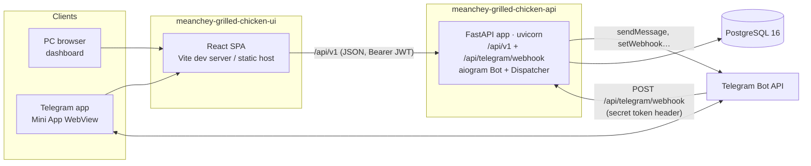
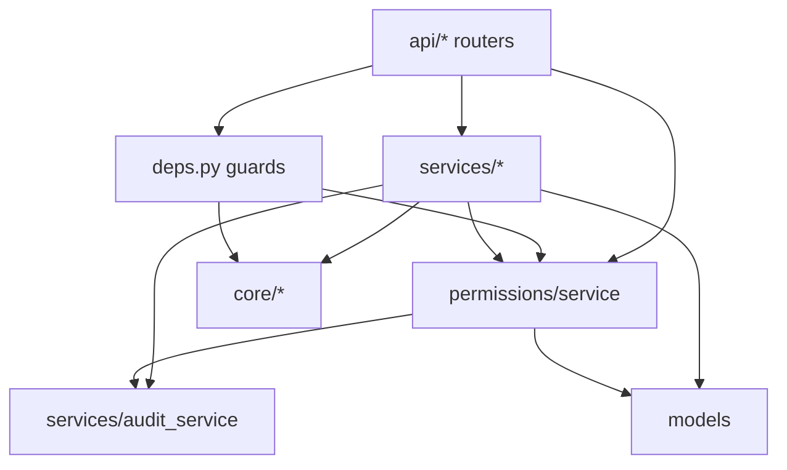
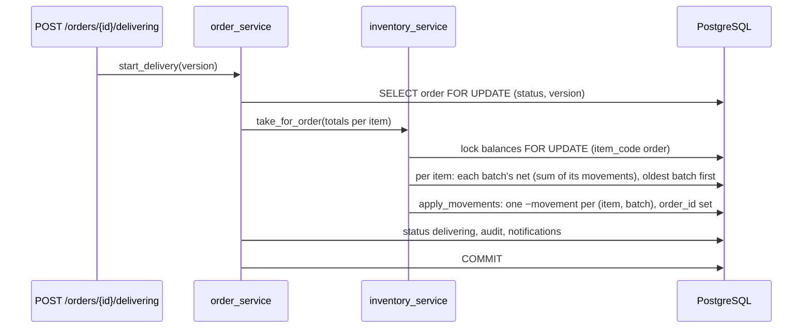
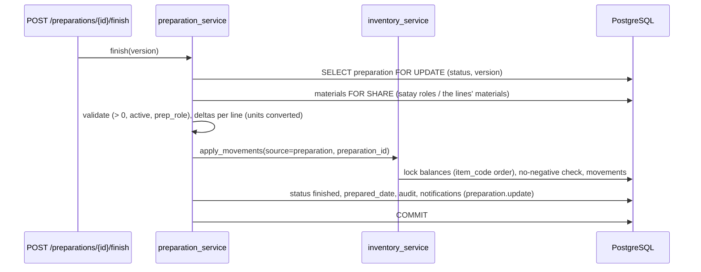
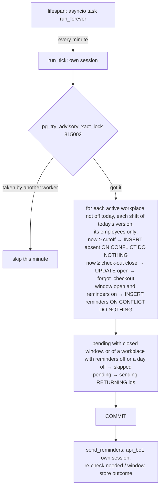
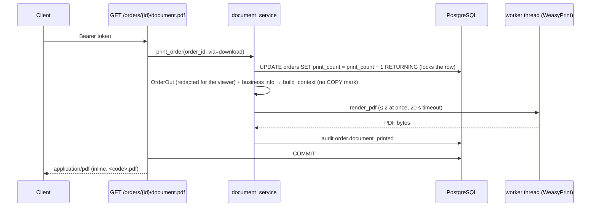
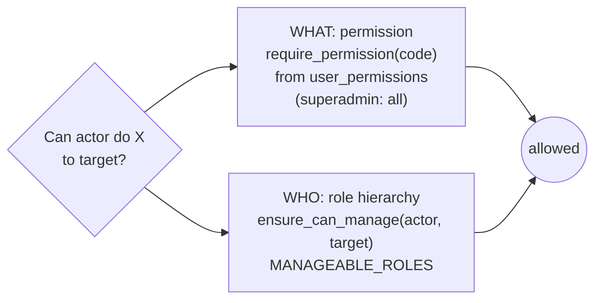
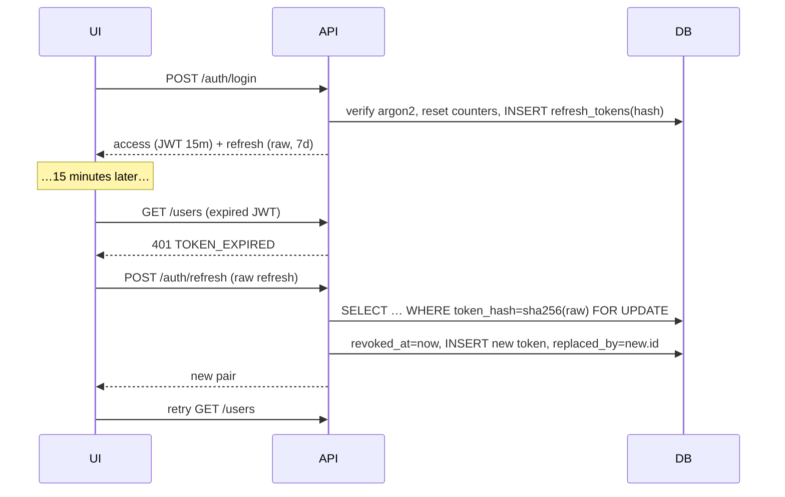
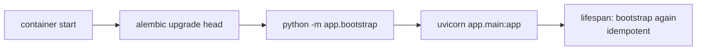
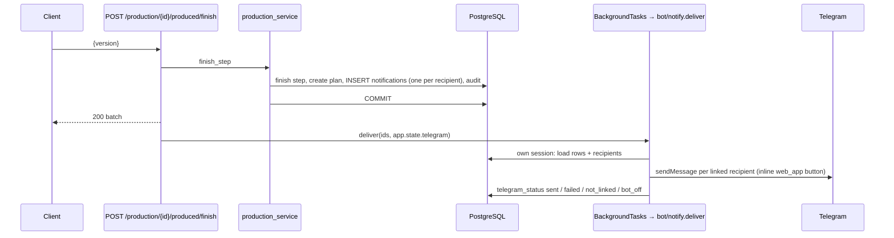

# API Architecture

How the Mean Chey Grilled Chicken API is put together, and why. For what it *does*, see [FEATURES.md](FEATURES.md).

- [1. System overview](#1-system-overview)
- [2. Tech stack](#2-tech-stack)
- [3. Code layout and layering](#3-code-layout-and-layering)
- [4. Request lifecycle](#4-request-lifecycle)
- [5. Data model](#5-data-model)
- [6. Authorization model](#6-authorization-model)
- [7. Authentication internals](#7-authentication-internals)
- [8. Startup and bootstrap](#8-startup-and-bootstrap)
- [9. Telegram bot](#9-telegram-bot)
- [10. Error handling](#10-error-handling)
- [11. Configuration](#11-configuration)
- [12. Testing strategy](#12-testing-strategy)
- [13. Deployment](#13-deployment)
- [14. Extending the system](#14-extending-the-system)
- [15. Design decisions](#15-design-decisions)

---

## 1. System overview



- In the default **webhook mode** there is **one process**: the FastAPI app serves the UI's JSON API and receives Telegram updates on `/api/telegram/webhook`. There is no separate bot process.
- The **UI** calls the API only through `/api/v1`. In development the Vite dev server proxies all of `/api` to the API, so one HTTPS tunnel (ngrok / cloudflared) serves the Mini App, `/api/v1` *and* the Telegram webhook.
- **Polling mode** (`BOT_MODE=polling`, local dev without a tunnel) adds back a separate `python -m app.bot` process from the same image. See §9.

## 2. Tech stack

| Concern | Choice |
|---|---|
| Language / runtime | Python 3.12 |
| Web framework | FastAPI, with Pydantic v2 schemas |
| Database | PostgreSQL 16 |
| ORM / driver | SQLAlchemy 2.x async + asyncpg |
| Migrations | Alembic (async `env.py`) |
| Password hashing | argon2-cffi (argon2id), with transparent rehash on login |
| Tokens | PyJWT (HS256) for access tokens; opaque random refresh tokens stored hashed |
| Bot | aiogram 3 |
| Documents (PDF) | Jinja2 templates → WeasyPrint (Pango / HarfBuzz) PDFs; Kantumruy Pro font bundled; Pillow (logo resize) |
| Config | pydantic-settings, reading `.env` |
| Tooling | uv (dependencies and lock), ruff (lint and format), pytest + pytest-asyncio + httpx, pypdf (reading PDFs in tests) |

## 3. Code layout and layering

```
app/
├── main.py              # create_app(): middleware, error handlers, routers, lifespan
├── config.py            # Settings (pydantic-settings), cached get_settings()
├── db.py                # async engine + SessionLocal + get_session dependency
├── bootstrap.py         # registry sync + superadmin seed (python -m app.bootstrap)
├── deps.py              # auth dependencies: CurrentUser, PendingUser, require_permission, require_role
├── core/
│   ├── errors.py        # ErrorCode enum, AppError, exception handlers
│   ├── security.py      # argon2, JWT encode/decode, refresh token generation, hash_token (SHA-256)
│   ├── telegram_auth.py # initData HMAC validation
│   ├── usernames.py     # Telegram username normalization/validation
│   └── phones.py        # phone normalization (storage) + formatting (phone_display)
├── models/              # SQLAlchemy ORM (User, Permission, UserPermission, RefreshToken, AuditLog, BotPref, AppSetting,
│                        #   Supplier + Customer via PartnerMixin, production batches + steps + plan,
│                        #   Notification, TelegramLinkToken, InventoryBalance, InventoryMovement,
│                        #   Order, OrderBox, OrderBoxItem, OrderReturnItem, OrderCounter, BusinessSettings,
│                        #   Preparation, PreparationLine, PreparationCounter, AttendanceWorkplace,
│                        #   AttendanceScheduleVersion, AttendanceHoliday, AttendanceHolidayWorkplace,
│                        #   AttendanceRecord, AttendanceReminder)
├── schemas/             # Pydantic request/response models; common.UserRef = the only user-reference shape
├── attendance/          # attendance rules and background work
│   ├── clock.py         # now(): the only clock for check-in / check-out and the scheduler (tests patch it)
│   ├── windows.py       # pure rules: ShiftDef / Rules → ShiftWindows, decide_check_in / _out,
│   │                    #   next_action, late / early / overtime minutes, haversine_m, validate
│   ├── summary.py       # pure: period (month / whole year, no future) and KPIs over records
│   │                    #   (present / absent / late / early / overtime, missing, extra, balance)
│   ├── workplaces.py    # TRACKED_ROLES, is_tracked, Schedule (a workplace + a schedule version → defs,
│   │                    #   rules, weekdays, windows), versions_of / version_on, default / copy_version,
│   │                    #   default / active workplace, assign_workplace (user_service), user_workplace,
│   │                    #   ensure_defaults (bootstrap)
│   ├── days.py          # Days: versions + holidays of some workplaces over a range → day_off (holiday /
│   │                    #   weekday), windows (none on a day off), next_tracked, off_pairs
│   ├── scheduler.py     # tick (advisory lock; per workplace: days off skipped, absent, forgot check-out,
│   │                    #   reminders), rerun (passed cutoffs of given workplace / date pairs),
│   │                    #   run_tick, run_forever
│   └── telegram.py      # confirmations and reminders: texts, check-screen button, send after commit
├── production/
│   └── catalog.py       # by-products and raw material kinds (code catalogs, no migration to extend)
├── inventory/
│   ├── catalog.py       # inventory items (stock / wasted), by-product items generated from production,
│   │                    #   ORDERABLE (packs + packed by-products), wasted_for(code), MATERIAL_PREFIX,
│   │                    #   satay sachets (Prepared), prepared twin codes (prepared_code, twin_base)
│   └── units.py         # count / kg / g / m2: precision, quantize, kg <-> g convert (the one quantity rule)
├── documents/           # delivery notes (later invoices): order → HTML → PDF
│   ├── delivery_note.py # build_context (what the note shows), labels km/en, DocumentKind + kind_for
│   │                    #   (delivery note now, invoice once orders have prices), sample_order
│   ├── render.py        # Jinja2 + WeasyPrint (lazy import), two-pass height, thread + timeout
│   ├── templates/       # delivery_note.html.j2, receipt.css (80 mm, black and white)
│   └── fonts/           # Kantumruy Pro Regular / Bold (static instances) + OFL.txt
├── permissions/
│   ├── registry.py      # PERMISSIONS, MODULES, FEATURES, DEFAULT_PERMISSIONS  ← feature authors edit this
│   ├── features.py      # feature access levels: current level, matrix, set_level (diff + feature.set audit)
│   ├── sync.py          # registry → DB sync + default backfill for new permissions
│   ├── hierarchy.py     # role scope: MANAGEABLE_ROLES, can_manage, ensure_can_manage
│   └── service.py       # effective permissions, grant/revoke rules, defaults, permission matrix
├── services/
│   ├── auth_service.py  # login (password/Telegram), tokens, change/reset password, /me
│   ├── user_service.py  # user CRUD, activation, resets, profile
│   ├── partner_service.py # generic supplier/customer CRUD, search, stats (PartnerKind)
│   ├── production_service.py # batches: drafts + versions, finish / reopen / cancel, codes, stats, plan gate
│   ├── plan_service.py  # packaging plans: list, detail, save, confirm (batch version, pieces rule)
│   ├── notification_service.py # alert recipients (per permission), rows in the action's transaction, the bell
│   ├── order_service.py # orders: boxes, status flow, returns, codes, list / stats / options, summary,
│   │                    #   customer (saved / direct) and its snapshot
│   ├── document_service.py # delivery notes: count (print_count) + render + audit, preview
│   ├── material_service.py # materials: defaults (incl. prep_role), create / edit / unit change (twin
│   │                       #   too) / archive, add / remove, icon (validate, square 256 px PNG)
│   ├── preparation_service.py # preparations: drafts + version, finish (movements per line) / reopen /
│   │                          #   cancel (reversals), codes, list / stats / options, alert
│   ├── attendance_service.py # me/today, check-in / check-out (ordered checks, refused attempts audited),
│   │                         #   day view (per workplace), corrections, workplaces (create / update /
│   │                         #   delete-or-archive / restore, default switch; schedule summary),
│   │                         #   summaries (mine / an employee's: KPIs and days; days off don't count)
│   ├── scheduling_service.py # versions (weekdays / shifts from a date, later versions follow, delete
│   │                         #   upcoming), holidays (CRUD, copy a year), calendar, retroactive effects
│   │                         #   (off-pair diff: remove records / rerun cutoffs), under the scheduler lock
│   ├── business_service.py # business info row (get-or-create), text fields, logo (validate, resize)
│   ├── telegram_link_service.py # superadmin one-time Telegram link (create, consume, unlink)
│   ├── role_limit_service.py # role limits: ensure_slot (row lock + count), settings, capacity
│   ├── inventory_service.py # ledger: apply_movements (locks, no-negative), production hooks, per-batch
│   │                        #   breakdown (item_detail), orders (take_for_order FIFO, return_from_order),
│   │                        #   production guard, adjustments (manual items only; none today)
│   ├── audit_service.py # record() + listing (viewer-aware filters)
│   └── redaction.py     # hides the superadmin from other viewers: viewer context, hides(), middleware
├── api/                 # thin routers: auth, me, users, permissions (superadmin), features, audit,
│                        #   partners (build_router(kind) → /suppliers, /customers), production,
│                        #   production_plans, notifications, settings (role limits, business info), inventory,
│                        #   orders (incl. document.pdf, document/send-telegram, delivery-note/supplier for the browser-built Excel: fonts Khmer OS Content / Trebuchet MS chosen per cell there, written values at size 11), preparations, attendance
└── bot/
    ├── setup.py         # create_bot(), create_dispatcher(): the one place handlers are registered
    ├── handlers.py      # /start (incl. /start link_<token>; Attendance button for tracked employees),
    │                    #   /lang (create_router()), menu_button, check_keyboard (the check screen's
    │                    #   web_app button)
    ├── notify.py        # send stored alerts after commit (deliver, resend_failed), bot username,
    │                    #   api_bot (which bot the API sends with), send_document (delivery notes)
    ├── i18n.py          # bot texts (km/en)
    ├── webhook.py       # POST /api/telegram/webhook (secret check → dp.feed_update)
    ├── runtime.py       # TelegramRuntime (Bot + Dispatcher on app.state), create_runtime()
    ├── registration.py  # ensure_webhook / set / delete / info, set_commands_and_menu, fingerprint in app_settings
    └── __main__.py      # CLI: polling mode, `webhook set|delete|info`, `notifications resend-failed`
```

**Layering rules**



- **Routers** are thin. They parse input with Pydantic, declare guards through dependencies, call one service function, and serialize the result.
- **Services** hold the business rules and own the transaction: they call `session.commit()`. Audit entries are added through `record()` inside the same transaction, so an action and its audit row commit or roll back together.
- **Guards** in `deps.py` and `permissions/hierarchy.py` are pure checks that raise `AppError`.
- **`core/`** has no dependency on models or services, apart from `errors`.
- **Redaction** sits at the serialization edge: `deps.get_current_user_allow_pending` records the viewer in a context variable (reset per request by `ViewerContextMiddleware`), and `UserRef`'s serializer hides the superadmin for any other viewer. Services never special-case it, except lookups (`get_user_or_404(..., viewer)`) and the audit filters.

## 4. Request lifecycle

```mermaid
sequenceDiagram
    participant C as Client
    participant F as FastAPI
    participant Dep as deps.py
    participant Svc as Service
    participant DB as PostgreSQL

    C->>F: PATCH /api/v1/users/{id} (Bearer JWT)
    F->>Dep: get_session() → AsyncSession (one per request)
    F->>Dep: get_current_user_allow_pending()
    Dep->>Dep: decode JWT (TOKEN_EXPIRED / INVALID_TOKEN)
    Dep->>DB: SELECT user by id
    Dep-->>F: 401 ACCOUNT_DISABLED if inactive
    F->>Dep: get_current_user()
    Dep-->>F: 403 PASSWORD_CHANGE_REQUIRED if pending
    F->>Dep: require_permission("users.update")
    Dep->>DB: effective permissions
    Dep-->>F: 403 MISSING_PERMISSION if missing
    F->>Svc: update_user(session, actor, target, body)
    Svc->>Svc: ensure_can_manage(actor, target) → FORBIDDEN_SCOPE
    Svc->>DB: UPDATE users …; INSERT audit_logs
    Svc->>DB: COMMIT
    F-->>C: 200 UserOut
```

- FastAPI caches a dependency per request, so the guard dependencies and the handler share the **same session**.
- Business-rule failures raise `AppError`, which becomes a JSON error (§10).

## 5. Data model

```mermaid
erDiagram
    users ||--o{ user_permissions : "holds"
    permissions ||--o{ user_permissions : "granted as"
    users ||--o{ user_permissions : "granted_by"
    users ||--o{ refresh_tokens : "has"
    users ||--o{ audit_logs : "actor"
    users ||--o{ audit_logs : "target"
    users ||--o{ users : "created_by"
    users ||--o{ suppliers : "created_by / updated_by"
    users ||--o{ customers : "created_by / updated_by"
    suppliers ||..o{ audit_logs : "entity (no FK)"
    customers ||..o{ audit_logs : "entity (no FK)"
    production_batches ||--|| production_raw_materials : "step 1"
    production_batches ||--o| production_outputs : "step 2"
    production_batches ||--o| production_packaging : "step 3"
    production_batches ||--o{ production_byproducts : "per catalog item"
    suppliers ||--o{ production_raw_materials : "supplier_id (RESTRICT)"
    users ||--o{ production_batches : "created_by / updated_by / cancelled_by"
    production_batches ||..o{ audit_logs : "entity (no FK)"
    production_batches ||--o| production_plans : "packaging plan"
    users ||--o{ production_plans : "confirmed_by / updated_by"
    users ||--o{ notifications : "recipient (CASCADE)"
    production_batches ||..o{ notifications : "entity (no FK)"
    users ||--o{ telegram_link_tokens : "one-time link"
    users ||--o{ role_limits : "updated_by"
    production_batches ||--o{ inventory_movements : "batch_id (SET NULL)"
    inventory_movements ||--o| inventory_movements : "reversal_of (unique)"
    users ||--o{ inventory_movements : "created_by"
    inventory_balances ||..o{ inventory_movements : "item_code (no FK)"
    inventory_materials ||..|| inventory_balances : "item_code (no FK)"
    users ||--o{ inventory_materials : "created_by / updated_by / archived_by"
    customers |o--o{ orders : "customer_id (RESTRICT; null for direct orders)"
    users ||--o{ orders : "driver_id / created_by / … (SET NULL)"
    orders ||--o{ order_boxes : "boxes (CASCADE)"
    order_boxes ||--o{ order_box_items : "lines (CASCADE)"
    orders ||--o{ order_return_items : "returns (CASCADE)"
    orders ||--o{ inventory_movements : "order_id (SET NULL)"
    orders ||..o{ audit_logs : "entity (no FK)"
    orders ||..o{ notifications : "entity (no FK)"
    users ||--o{ business_settings : "updated_by (one row)"
    preparations ||--o{ preparation_lines : "lines (CASCADE)"
    inventory_materials ||--o{ preparation_lines : "material_id (RESTRICT; packaging lines)"
    preparations ||--o{ inventory_movements : "preparation_id (SET NULL)"
    users ||--o{ preparations : "created_by / finished_by / … (SET NULL)"
    preparations ||..o{ audit_logs : "entity (no FK)"
    preparations ||..o{ notifications : "entity (no FK)"
    attendance_workplaces |o--o{ users : "workplace_id (SET NULL)"
    users ||--o{ attendance_untracked_periods : "user_id (CASCADE); set_by (SET NULL)"
    users ||--o{ attendance_requests : "user_id (CASCADE); reviewed_by (SET NULL)"
    users ||--o{ attendance_records : "user_id (CASCADE)"
    attendance_workplaces |o--o{ attendance_records : "workplace_id (SET NULL)"
    users ||--o{ attendance_records : "corrected_by (SET NULL)"
    users ||--o{ attendance_reminders : "user_id (CASCADE)"
    users ||--o{ attendance_workplaces : "created_by / updated_by"
    attendance_workplaces ||--|{ attendance_schedule_versions : "workplace_id (CASCADE; one per effective_from)"
    attendance_schedule_versions ||..o{ attendance_records : "shift code (no FK; times snapshotted)"
    attendance_holidays ||--o{ attendance_holiday_workplaces : "holiday_id (CASCADE; scope selected)"
    attendance_workplaces ||--o{ attendance_holiday_workplaces : "workplace_id (CASCADE)"

    users {
        uuid id PK
        user_role role "PG enum"
        varchar50 position "staff only, free-text label"
        varchar full_name
        varchar phone
        varchar telegram_username "normalized"
        bigint telegram_user_id "bound on first Mini App login"
        varchar password_hash "argon2id"
        bool must_change_password
        varchar language "km | en"
        bool is_active
        uuid created_by FK
        timestamptz created_at
        timestamptz updated_at
        timestamptz deleted_at
        int failed_login_count
        timestamptz locked_until
        date attendance_start_date "staff and supervisors; first tracked day, null for the others"
        bool attendance_tracked "staff always true; a supervisor can be switched off"
    }
    permissions {
        varchar code PK
        varchar module
        varchar name_en
        varchar name_km
        text description_en
        text description_km
        varchar_array assignable_to
        jsonb grantable_by "target role → grantor roles"
        bool is_active
    }
    user_permissions {
        uuid user_id PK,FK
        varchar permission_code PK,FK
        uuid granted_by FK
        timestamptz granted_at
    }
    refresh_tokens {
        uuid id PK
        uuid user_id FK
        varchar token_hash UK "sha256"
        timestamptz expires_at
        timestamptz revoked_at
        uuid replaced_by
    }
    audit_logs {
        bigint id PK
        uuid actor_id FK
        varchar action
        uuid target_user_id FK
        varchar entity_type "supplier | customer | production_batch"
        uuid entity_id "no FK"
        jsonb details
        timestamptz created_at
    }
    suppliers {
        uuid id PK
        varchar150 name
        varchar255 location
        varchar20 phone "normalized, unique among active"
        bool is_active
        timestamptz deleted_at
        uuid created_by FK
        uuid updated_by FK
        timestamptz created_at
        timestamptz updated_at
    }
    customers {
        uuid id PK
        varchar150 name
        varchar255 location
        varchar20 phone "normalized, unique among active"
        bool is_active
        timestamptz deleted_at
        uuid created_by FK
        uuid updated_by FK
        timestamptz created_at
        timestamptz updated_at
    }
    bot_prefs {
        bigint telegram_user_id PK
        varchar language
    }
    production_batches {
        uuid id PK
        varchar32 code UK "PR-YYYYMMDD-NNN (creation day)"
        varchar status "in_progress | completed | cancelled"
        smallint current_step "1-3"
        varchar500 cancel_reason
        int version "optimistic concurrency"
        bool inventory_tracked "false for batches before migration 0010"
        uuid created_by FK
        uuid updated_by FK
        uuid cancelled_by FK
        timestamptz created_at
        timestamptz updated_at
        timestamptz cancelled_at
        timestamptz completed_at
    }
    production_raw_materials {
        uuid batch_id PK,FK
        uuid supplier_id FK "null while draft"
        varchar material_kind "catalog code"
        numeric10_3 weight_kg
        int quantity
        date import_date "set at Finish, null while draft"
        varchar status "draft | finished"
        uuid finished_by FK
        timestamptz finished_at
        uuid updated_by FK
        timestamptz updated_at
    }
    production_outputs {
        uuid batch_id PK,FK
        numeric10_3 wings_kg
        numeric10_3 thighs_kg
        int wings_count "computed"
        int thighs_count "computed"
        numeric10_1 marinade_g
        date production_date "set at Finish"
        varchar status
    }
    production_packaging {
        uuid batch_id PK,FK
        int big_packages
        int small_packages
        int rejected_wings
        int rejected_thighs
        int sachets_4_used "one per 4-piece pack by default"
        int sachets_2_used "one per 2-piece pack by default"
        bool sachets_4_manual "false = follows the packs"
        bool sachets_2_manual
        text comment
        date packaging_date "set at Finish"
        varchar status
    }
    production_byproducts {
        uuid batch_id PK,FK
        varchar item_code PK "catalog code"
        numeric10_3 produced_kg
        numeric10_3 carry_kg
        numeric10_3 rejected_kg
    }
    production_batch_counters {
        date day PK
        int last_number
    }
    production_plans {
        uuid batch_id PK,FK
        int expected_big "4-piece packs"
        int expected_small "2-piece packs"
        varchar500 note
        varchar status "pending | confirmed"
        uuid confirmed_by FK
        timestamptz confirmed_at
        uuid updated_by FK
        timestamptz updated_at
    }
    notifications {
        uuid id PK
        uuid user_id FK
        varchar type "production.* | order.delivering | order.delivered | order.return_pending | order.returns_reviewed | preparation.finished"
        varchar entity_type
        uuid entity_id "no FK"
        jsonb payload
        timestamptz created_at
        timestamptz read_at
        varchar telegram_status "pending | sent | failed | not_linked | bot_off"
        text telegram_error
        timestamptz sent_at
    }
    inventory_balances {
        varchar64 item_code PK "inventory/catalog.py or a material"
        int count "null if not tracked, >= 0"
        numeric12_3 kg "null if not tracked, >= 0"
        numeric14_1 g "materials in grams, >= 0"
        numeric14_2 m2 "materials in square metres, >= 0"
        timestamptz updated_at
    }
    inventory_materials {
        uuid id PK
        varchar64 item_code UK "material_<8 hex>"
        varchar100 name_km "unique among active (lower)"
        varchar100 name_en "unique among active (lower)"
        varchar8 unit "kg | g | m2 | count"
        varchar32 system_code UK "marinade"
        varchar32 icon_key "bundled UI picture"
        bytea icon "uploaded, 256 px PNG"
        varchar16 icon_mime
        varchar16 prep_role "none | packaging | satay_sauce | zip_bag_2 | zip_bag_4"
        timestamptz archived_at
    }
    inventory_movements {
        bigint id PK
        varchar64 item_code
        int count_delta
        numeric12_3 kg_delta
        numeric14_1 g_delta
        numeric14_2 m2_delta
        bool kg_estimated
        varchar source "production | order | order_return | material_add | material_remove | material_unit_change | preparation (adjustment: old rows)"
        uuid batch_id FK "orders: the batch the quantity is attributed to"
        uuid order_id FK "order / order_return movements"
        uuid preparation_id FK "preparation movements"
        smallint step "1-3"
        bigint reversal_of FK "unique"
        text reason "reopen | cancel | a material removal's reason"
        int balance_count_after
        numeric12_3 balance_kg_after
        numeric14_1 balance_g_after
        numeric14_2 balance_m2_after
        uuid created_by FK
        timestamptz created_at
    }
    orders {
        uuid id PK
        varchar32 code UK "OR-YYYYMMDD-NNN"
        varchar16 customer_type "saved | direct"
        uuid customer_id FK "saved only"
        varchar150 customer_name "snapshot; null for direct"
        varchar20 customer_phone "snapshot, normalized; required for direct"
        varchar255 customer_location "snapshot"
        date delivery_date
        uuid driver_id FK "active staff / supervisor, null"
        text note "<= 1000"
        varchar status "created | delivering | return_pending | success | partly_returned | fully_returned | cancelled"
        varchar500 return_reason
        varchar500 cancel_reason
        int version
        uuid created_by FK
        timestamptz delivering_at "and _by; delivered_, returns_reviewed_, cancelled_ likewise"
    }
    order_boxes {
        uuid id PK
        uuid order_id FK
        varchar16 color "white | black | plastic_bag | delivery_bag"
        smallint position "unique per order"
    }
    order_box_items {
        uuid id PK
        uuid box_id FK
        varchar64 item_code "orderable; unique per box"
        int count "packs: > 0, xor kg"
        numeric12_3 kg "packed by-products: > 0"
        smallint position
    }
    order_return_items {
        uuid id PK
        uuid order_id FK
        varchar64 item_code "unique per order"
        int returned_count "xor returned_kg"
        numeric12_3 returned_kg
        int to_stock_count "null until reviewed"
        numeric12_3 to_stock_kg
        int to_wasted_count
        numeric12_3 to_wasted_kg
        uuid reviewed_by FK
        timestamptz reviewed_at
    }
    order_counters {
        date day PK
        int last_number
    }
    preparations {
        uuid id PK
        varchar32 code UK "PP-YYYYMMDD-NNN"
        varchar32 type "satay_sachet | packaging_material"
        varchar16 status "draft | finished | cancelled"
        date prepared_date "set at Finish"
        text note "<= 1000"
        varchar500 cancel_reason
        int version
        uuid created_by FK "and updated_by, finished_by, cancelled_by"
    }
    preparation_lines {
        uuid id PK
        uuid preparation_id FK
        smallint pack_size "2 | 4 (satay lines)"
        numeric14_1 satay_g "satay lines"
        int sachets "satay lines"
        uuid material_id FK "packaging lines"
        numeric14_3 quantity "zip bags / material, in unit"
        varchar8 unit "the material's when saved"
    }
    preparation_counters {
        date day PK
        int last_number
    }
    attendance_workplaces {
        uuid id PK
        varchar100 name
        varchar255 address
        numeric9_6 latitude "null until set"
        numeric9_6 longitude
        int radius_m "10-5000, default 100"
        bool is_default "exactly one active"
        bool is_active "false = archived"
        timestamptz archived_at
    }
    attendance_schedule_versions {
        uuid id PK
        uuid workplace_id FK "unique with effective_from"
        date effective_from
        smallint_array weekdays "ISO 1-7, at least one"
        jsonb shifts "morning + afternoon: code, names, HH:MM times, position"
        int open_before_min "30"
        int absent_after_min "45"
        int checkout_window_min "59"
        bool reminders_enabled
        bool count_early_checkin
        bool count_overtime
    }
    attendance_holidays {
        uuid id PK
        varchar100 name_km
        varchar100 name_en
        date start_date
        date end_date "start..start+30"
        varchar16 scope "all | selected"
        varchar500 note
    }
    attendance_holiday_workplaces {
        uuid holiday_id PK
        uuid workplace_id PK
    }
    attendance_records {
        uuid id PK
        uuid user_id FK
        date work_date "unique with user and shift"
        varchar16 shift_code
        uuid workplace_id FK
        timestamptz scheduled_start "snapshot"
        timestamptz scheduled_end "snapshot"
        varchar16 status "present | late | absent"
        int late_minutes
        int early_minutes "0 unless early_counts"
        int overtime_minutes "0 unless overtime_counts"
        bool early_counts "workplace flag snapshot"
        bool overtime_counts "workplace flag snapshot"
        timestamptz check_in_at "and lat, lng, accuracy_m, distance_m"
        varchar16 checkout_status "checked_out | forgot_checkout | null"
        timestamptz check_out_at "and lat, lng, accuracy_m, distance_m"
        varchar16 source "mini_app | auto | correction"
        bool corrected "and reason, corrected_by, corrected_at"
    }
    attendance_reminders {
        uuid id PK
        uuid user_id FK
        date work_date "unique with user, shift and kind"
        varchar16 shift_code
        varchar16 kind "check_in | check_out"
        timestamptz window_closes_at
        varchar16 telegram_status "pending | sending | sent | failed | not_linked | bot_off | skipped"
    }
    attendance_untracked_periods {
        uuid id PK
        uuid user_id FK
        date from_date
        date to_date "null = ongoing; at most one ongoing per user"
        uuid set_by FK
        timestamptz created_at
    }
    attendance_requests {
        uuid id PK
        uuid user_id FK
        smallint year
        smallint month "unique with user_id and year"
        varchar16 status "pending | approved | rejected"
        int missing_minutes "snapshot at submission"
        int extra_minutes
        int absent_minutes
        int late_minutes
        int balance_minutes
        int requested_salary_cut_minutes
        int requested_unpaid_work_minutes
        int approved_salary_cut_minutes "null until approved"
        int approved_unpaid_work_minutes
        varchar16 type "salary_cut | unpaid_work | both (of the requested split)"
        bool approved_with_changes
        varchar500 note
        varchar500 review_comment
        varchar500 reject_reason
        timestamptz submitted_at
        uuid reviewed_by FK
        timestamptz reviewed_at
    }
    role_limits {
        varchar32 role PK "general_manager | supervisor | staff"
        int max_active "null = unlimited (not for GM), 1-999"
        uuid updated_by FK
        timestamptz updated_at
    }
    telegram_link_tokens {
        uuid id PK
        uuid user_id FK
        varchar token_hash UK "sha256"
        timestamptz expires_at "10 minutes"
        timestamptz used_at
    }
```

**Notes**

- **`role`** is a native PostgreSQL enum: roles are structural and change rarely.
- **`language`** is a `VARCHAR` validated by a Python enum, so new values need no migration.
- **`position`** is a free-text `VARCHAR(50)` job title for staff (migration `0002` widened it from 32).
  - It is normalized by `schemas.user.normalize_position`: trimmed, whitespace collapsed, case and Khmer kept.
  - It is a **label only**. Nothing in `permissions/`, `deps.py` or the services branches on its value, so it has no effect on access.
  - Only its *presence* is tied to the role: required for staff, forbidden otherwise (`ck_users_position_staff_only`).
  - `GET /users/positions` returns the distinct values for suggestions (case-insensitive grouping, most used spelling).
- **Partial unique indexes** enforce the business invariants. See FEATURES §3.
- **Role limits** (`role_limits`, migration `0008`): one row per limited role, seeded 2 / 3 / 10 (bootstrap inserts any missing row, never overwrites). CHECKs keep `max_active` null or 1–999 and never null for the general manager. The migration dropped `uq_users_single_active_gm`; `services/role_limit_service.ensure_slot` locks the role's row (`FOR UPDATE`) and counts active users inside the create / reactivate / role-change transaction, so concurrent requests for the last slot are serialized.
- **Inventory** (migration `0010`): `inventory_balances` (one row per catalog item, created at startup and on demand; CHECK `count >= 0`, `kg >= 0`) and `inventory_movements` (append-only ledger; indexes on (`item_code`, `created_at`) and `batch_id`; unique partial index on `reversal_of`, so a movement is reversed at most once). `production_batches.inventory_tracked` was added as false for every existing batch, then defaults to true. Migration `0011` (data only) removed the adjustment movements and recomputed the balances and `balance_*_after` from production (production items are read-only). Item codes have no FK: the catalog lives in code (`app/inventory/catalog.py`), like permissions and by-products.
- **Business info and delivery notes** (migration `0013`): `business_settings`, one row (`ck_business_settings_single_row`: `id = 1`; `ck_business_settings_logo_mime`: logo and its MIME type both set or both null), seeded with the business name; the logo is `bytea`, loaded only when asked for (`deferred`). `orders.print_count` (default 0) counts generated delivery notes; it isn't part of the order's `version`.
- **Materials** (`inventory_materials`, migration `0014`): inventory items added by hand. CHECKs on `unit` and the name lengths; partial unique indexes `uq_inventory_materials_active_name_km` / `_en` on `lower(name)` where `archived_at IS NULL`; `system_code` unique. The migration also added `inventory_balances.g` (CHECK ≥ 0), `inventory_movements.g_delta` / `balance_g_after` (NUMERIC(14,1)), widened `source` to 24 characters with the three material sources and let `has_delta` accept a grams-only movement. Defaults are seeded by bootstrap, not the migration (`app_settings.inventory_materials_seeded`). Migration `0015` added `icon_key` (String(32)), `icon` (bytea) and `icon_mime` (String(16)) with `ck_inventory_materials_icon_mime`, and backfilled `icon_key` for the defaults. Migration `0023` added `inventory_balances.m2` (NUMERIC(14,2), CHECK ≥ 0), `inventory_movements.m2_delta` / `balance_m2_after`, widened `has_delta`, the `unit` CHECK and `preparation_lines.unit` with `m2`, renamed the two seeded kg stickers and created the two m² stickers with audit entries (`source: seed`), only when the defaults were already seeded; downgrade removes every m² material, its lines, movements and balances.
- **Order customers** (migration `0016`): `orders.customer_type` (`saved` \| `direct`, NOT NULL), `customer_id` nullable, and the snapshot `customer_name` (150) / `customer_phone` (20, normalized) / `customer_location` (255), the partners' column sizes. CHECKs `ck_orders_customer_type` and `ck_orders_customer` (`saved` ⇒ `customer_id` NOT NULL; `direct` ⇒ `customer_id` NULL and `customer_phone` NOT NULL). The migration backfilled existing orders as `saved` with their customer's **current** name, phone and location (the best available; earlier values weren't kept). Its downgrade refuses while direct orders exist (they have no customer to point back to, and stock movements reference them).
  - `order_service._resolve_customer` checks a choice and returns a `CustomerSnapshot` (saved: active customer, copied; direct: `core/phones.normalize_phone`, trimmed location); `_set_customer` writes it. Create and every edit while Created set it (an edit without customer fields re-copies the saved customer, `_refreshed`); `start_delivery` refreshes it once more after taking the stock; nothing writes it later, so it's frozen from Delivering on. Every reader (`_customer_brief` for the list and the order, alerts, the delivery note through `OrderOut`, audit details) uses the snapshot; the list no longer joins `customers` and loads them only for `is_active`.
  - Search: `q` matches `code`, `customer_name`, `customer_location` (ILIKE, escaped) and, when it has digits, `customer_phone` containing them (`012 345` → `012345`), like the partner lists.
- **Preparations** (`models/preparation.py`, migration `0017`): `preparations` (code unique, `ix_preparations_prepared_date`; CHECKs type, status, note length, and `ck_preparations_prepared_date_matches`: finished ⇔ date), `preparation_lines` (CHECK `kind`: a satay line has `pack_size` and no material, a packaging line `material_id` and no satay fields; values ≥ 0; unique (`preparation_id`, `pack_size`) and (`preparation_id`, `material_id`), so a draft save updates lines in place by that key and never collides), `preparation_counters` (codes per day, like production). Lines load with the preparation (`selectin`). The migration also added `inventory_materials.prep_role` (NOT NULL, default `packaging`, CHECK, partial unique index `uq_inventory_materials_prep_role` on the three satay roles) with its backfill, `inventory_movements.preparation_id` (FK SET NULL, indexed), and widened `ck_inventory_movements_source` (`preparation`) and `ck_notifications_type` (`preparation.finished`). The downgrade refuses while preparations exist (their movements explain balances).
- **Orders** (`models/order.py`, migration `0012`): `orders` (code unique; `ix_orders_status_delivery_date`, `customer_id`, `driver_id` indexed), `order_boxes` (unique `order_id, position`), `order_box_items` (unique `box_id, item_code`; CHECK `count` xor `kg`, > 0), `order_return_items` (unique `order_id, item_code`; CHECKs returned > 0, split ≥ 0, and once reviewed stock + wasted = returned), `order_counters` (codes per day, like production). Boxes, lines and returns load with the order (`selectin`). The migration also added `inventory_movements.order_id` (FK, SET NULL, indexed), widened `ck_inventory_movements_source` to `order` / `order_return` and `ck_notifications_type` to the four order alerts. Item codes are the inventory codes (no FK). The wasted pack items need no migration (balance rows on demand).
- **Attendance** (`models/attendance.py`, migration `0018`): `attendance_workplaces` (CHECKs on the latitude / longitude ranges, both-or-neither, the radius 10–5000 and every rule's range; `ck_attendance_workplaces_default_active`: the default isn't archived; partial unique indexes `uq_attendance_workplaces_default` on `is_default` where true (one default) and `uq_attendance_workplaces_name_active` on `lower(name)` where active), `attendance_shifts` (per workplace: unique `uq_attendance_shifts_workplace_code`, FK CASCADE, CHECK `start_time < end_time`), `attendance_records` (unique `uq_attendance_records_shift` = user, day, shift; `ix_attendance_records_work_date`; CHECKs: absent ⇔ no check-in, absent ⇒ no check-out, a check-out time only with `checked_out`, `late_minutes >= 0`), `attendance_reminders` (unique `uq_attendance_reminders_once`), and `users.workplace_id` (FK SET NULL; `User.workplace` loads with `selectin`, so `UserOut.workplace` needs no extra code). The migration seeds the default workplace "Mean Chey" without coordinates with the default rules and its two shifts (since `0020` a schedule version), and gives every staff member and supervisor the default workplace; bootstrap re-creates missing seeds (`workplaces.ensure_defaults`). Records keep `workplace_id` (SET NULL), so a workplace with history is archived rather than deleted. Its downgrade refuses while records exist. Records snapshot their shift's start / end as `timestamptz`, so changing the times never rewrites history; positions are `NUMERIC(9,6)`, accuracy and distance `NUMERIC(8,1)` / `NUMERIC(10,1)` metres (floats in the JSON).
- **Tracking** (migration `0021`, `models/attendance.py` + `models/user.py`): `users.attendance_start_date` (date, nullable: set for staff and supervisors, null for the others; backfilled with the date of `created_at` in `BUSINESS_TIMEZONE`) and `users.attendance_tracked` (bool, default true). `attendance_untracked_periods` (`from_date`, `to_date` null = ongoing; `ck_attendance_untracked_periods_range`: `to_date >= from_date`; partial unique `uq_attendance_untracked_periods_open` on `user_id` where `to_date IS NULL`, so one ongoing period per user; `ix_…_user` on `user_id, from_date`; `user_id` FK CASCADE, `set_by` FK SET NULL). `User.untracked_periods` loads with `selectin` (like `creator`), so `UserOut.attendance_untracked_since` and the tracking helper need no extra query; a User built in code must be given `untracked_periods=[]` (an unloaded collection can't lazy-load in async code). Downgrade drops the table and both columns.
- **Requests** (migration `0022`, `models/attendance.py`, `services/request_service.py`, pure rules in `attendance/requests.py`): `attendance_requests`, one row per (`user_id`, `year`, `month`) (`uq_attendance_requests_month`), `user_id` FK CASCADE, `reviewed_by` FK SET NULL. CHECKs: `status`, `type`, `month` 1–12, `requested_split` (both ≥ 0 and their sum = `missing_minutes`) and `approved_split` (both null or both ≥ 0 summing to `missing_minutes`). Indexes on (`status`, `submitted_at`) and (`year`, `month`). The migration also widens the `notifications.type` CHECK with the four `attendance.request_*` types; downgrade deletes those notifications and drops the table. The deadline (`attendance.request_deadline_day`, default 7 when absent) and the last month reminded (`attendance.request_reminder_month`) live in `app_settings` (`attendance/request_settings.py`).
- **Order bags** (migration `0026`): `ck_order_boxes_color` (named `ck_order_boxes_ck_order_boxes_color` by the naming convention, like the other CHECKs from `0012`) accepts `plastic_bag` and `delivery_bag` besides `white` / `black`. The column keeps the name `color` (the container of the box). `BOX_COLORS` (`models/order.py`) is the one list: summary order, list counts (`<color>_boxes`, one subquery each), audit counts, alert payload and the delivery note's sections follow it. Downgrade restores the old CHECK and fails while any order has a bag.
- **No GPS accuracy rule** (migration `0027`): `attendance_schedule_versions.max_accuracy_m` and its CHECK are dropped; only the distance to the workplace refuses a check. The downgrade adds the column back with 100 m in every version.
- **Satay sachets used** (migration `0025`): `production_packaging.sachets_4_used` / `sachets_2_used` (int, null in drafts, CHECK `ck_production_packaging_sachets_nonnegative`) and `sachets_4_manual` / `sachets_2_manual` (bool NOT NULL, default false). Backfill: every existing step 3 row got its pack counts (`big_packages` → 4-piece, `small_packages` → 2-piece), manual false; **no movement for the past**. Downgrade drops the columns (sachet movements already written stay in the ledger). `production_service._sync_sachets` keeps an auto count equal to its pack count on every save and at Finish; `sachet_differences` feeds the shared comment rule (`_check_comment`: plan error first, `details.reasons` when both apply).
- **Workplace Record level** (migration `0024`): inserts `attendance.workplace_update` and grants it to every holder of `attendance.workplace_manage` (same `granted_by`; `permission.grant` audit, no actor, `source: default_change`) so Full stays Full; downgrade removes the grants and the row. Guards: GET any workplace permission, PATCH `workplace_update` (+ `workplace_manage` for `is_default`, checked in the route before the service), POST / DELETE / restore `workplace_manage`.
- **Month lock** (`attendance/month_lock.py`): `ensure_unlocked(user, day)` is called by `correct` and `create_record` (`409 ATTENDANCE_MONTH_LOCKED`); `locked_pairs` filters the records `scheduling_service._apply_effects` would remove, and the scheduler's `_mark_absent` leaves locked employee-months out (`month_locked_sql`, an EXISTS), counting them in `skipped_locked` (`Effects`, `TickResult`). `pending` and `approved` lock; a rejection doesn't.
- **Request notifications:** `notification_service.notify_users` writes one row for each given user (the reviewers in scope: `recipients(…)` filtered by `can_manage`; or the employee) in the action's transaction and queues them for Telegram, like `notify`; `bot/notify.py` builds the texts (`_request_message`). The 1st-of-month reminder is `request_service.queue_reminders`, called by `scheduler.run_tick` after the tick in the same transaction, then delivered after the commit.
- **Scheduling** (migration `0020`): `attendance_schedule_versions` (unique `uq_attendance_schedule_versions_date` = workplace + `effective_from`, FK CASCADE; CHECKs: `weekdays` a non-empty subset of 1–7 (`cardinality`, `<@`), every rule's range, moved from the workplaces), `attendance_holidays` (CHECKs: `scope`, `end_date >= start_date` and at most 31 days; `ix_attendance_holidays_dates`) and `attendance_holiday_workplaces` (PK holiday + workplace, both FK CASCADE). The migration built one version per workplace from its `attendance_shifts` and rule columns (`effective_from` = creation date in `BUSINESS_TIMEZONE`, all seven weekdays) and dropped the table and columns; it moved `attendance.shifts_manage` grants to `attendance.scheduling` (inserting that permission row first) with a `feature.set` `default_change` audit entry each. Downgrade restores each workplace's latest version into the old shape (holidays and older versions are lost). Bootstrap gives any workplace without a version the default one (`ensure_defaults`).
- **Early check-in and overtime** (migration `0019`): `attendance_workplaces.count_early_checkin` / `count_overtime` (default true) and `attendance_records.early_minutes` / `overtime_minutes` (CHECK `>= 0`) with the flags' snapshot `early_counts` / `overtime_counts`. The migration backfilled existing records in SQL from their snapshot times (the check-in truncated to the minute, capped by their workplace's `open_before_min` / `checkout_window_min`, 30 / 59 without one; absent and forgot check-out → 0; flags true). Late, early and overtime minutes are stored per record, so a summary is a sum over records.
- **Uniqueness only counts active users,** so a deactivated user's username can be reused.
- **`permissions` rows are never deleted.** Removing a permission from the registry flips `is_active`.
- **`suppliers` / `customers`** share their columns and indexes through `PartnerMixin` (`models/partner.py`), migration `0004`:
  - `ix_<table>_name_lower` on `lower(name)` for case-insensitive sorting and search;
  - `uq_<table>_active_phone`, a partial unique index on `phone` `WHERE is_active AND phone IS NOT NULL`: one active record per normalized number, per table;
  - `phone` stores the normalized form (digits, optional leading `+`); `phone_display` is computed on output.
- **Production** (`models/production.py`, migrations `0005`, `0006` and `0007`):
  - one `production_batches` row per batch, and **one row per step** (`production_raw_materials`, `production_outputs`, `production_packaging`, PK = `batch_id`, `ON DELETE CASCADE`). A step's row is created when it becomes available (step 1 with the batch, step 2 when step 1 is first finished, step 3 when step 2 is), so "not started" is simply a missing row. All three step tables share `status` / `finished_by` / `finished_at` / `updated_by` / `updated_at` through `StepMixin`;
  - `production_byproducts`: one row per batch and catalog `item_code` (created on demand, so a new catalog entry needs no migration);
  - **step dates** (migration `0006`): `production_raw_materials.import_date`, `production_outputs.production_date` and `production_packaging.packaging_date` (`DATE`, indexed), written by the service at Finish (today in `BUSINESS_TIMEZONE`) and cleared on reopen. A CHECK per table (`ck_<table>_<column>_matches_status`: `(status = 'finished') = (<date> IS NOT NULL)`) is the safety net. The migration filled them for finished steps from `finished_at` converted to `BUSINESS_TIMEZONE` (drafts stay null) and dropped `production_batches.production_date`; batch codes were not touched;
  - `production_batch_counters`: the last number used per creation day, incremented with `INSERT … ON CONFLICT (day) DO UPDATE … RETURNING`. The row stays locked until the transaction ends, so concurrent creations on one day get distinct numbers; `uq_production_batches_code` is the safety net;
  - CHECK constraints keep statuses, `current_step` (1–3) and all quantities ≥ 0 valid even outside the API;
  - the relationships load with `selectin`, so a batch arrives with all its steps (no lazy loads under asyncio).
- **Packaging plan** (`production_plans`, migration `0007`): one row per batch, created by `production_service` when step 2 is finished and reset to `pending` on step 2 re-finish / step 1–2 reopen. CHECKs: `status` in (`pending`, `confirmed`), values ≥ 0, and `ck_production_plans_confirmed_complete` (a confirmed plan has both values). Loaded with the batch (`selectin`). The migration created a `pending` plan for each in-progress batch whose step 2 was finished; completed and cancelled batches have none (`plan_legacy`).
- **Notifications** (`notifications`, migration `0007`): one row per recipient, indexed on (`user_id`, `read_at`, `created_at`) for the bell. `entity_type` / `entity_id` like `audit_logs` (no FK). `payload` keeps `actor_id`, turned into a `UserRef` when read. CHECKs on `type` and `telegram_status`.
- **Telegram link tokens** (`telegram_link_tokens`, migration `0007`): SHA-256 of the raw token (unique), 10-minute `expires_at`, `used_at` once consumed.
- **Weights are `Decimal` end to end:** `NUMERIC(10,3)` for kg, `NUMERIC(10,1)` for grams and `NUMERIC(14,2)` for square metres in the database, `Decimal` in Python (never `float`), accepted by Pydantic from JSON numbers or strings with `max_digits` / `decimal_places`, and serialized as fixed-precision strings (`"12.500"`, `"350.0"`) through a `PlainSerializer`. The UI parses them into scaled integers for exact sums.
- **`audit_logs.entity_type` / `entity_id`** (indexed together as `ix_audit_logs_entity`) reference non-user records. There is no foreign key because one column pair points into several tables; the audit listing resolves current names with one query per entity type (`ENTITY_LABELS`: `suppliers.name`, `customers.name`, `production_batches.code`, `orders.code`).
- **Constraint naming.** All constraints follow a naming convention (`ix_`, `uq_`, `ck_`, `fk_`, `pk_`), which keeps Alembic autogenerate deterministic.
- **Timestamps** are `timestamptz`. The app sets them in Python (UTC) and also has server defaults. Setting them in Python avoids lazy loads after `commit` under asyncio (`expire_on_commit=False`).

### Orders and inventory (FIFO by batch)



- **Attribution:** every movement of a production item carries a `batch_id`; a batch's contribution to an item is the **sum of its movements, any source**. Delivering spends the oldest batches' contributions first; the review gives back to the batches the order took from, newest first (stock first, then wasted into the wasted item of the same batch). So `item_detail`'s per-batch sources always add up to the balance.
- **Guard in `reverse`:** before writing a production reversal, the batch's own contribution per item must cover the net it removes; otherwise `PRODUCTION_STOCK_ALREADY_USED` with the order codes (from the order movements with that `batch_id`).
- **Locking:** both paths lock the affected balance rows **before** reading contributions. Any change to an item's movements takes that lock, so the read is consistent until commit. Lock order is unchanged: the batch / order row first, then balances in `item_code` order (an order and a batch are never locked together).
- **Warnings vs. errors:** create and edit only compute `stock_warnings` (not locked); the hard check is at Delivering (`INVENTORY_INSUFFICIENT`, nothing written).
- **Units:** inside the services a quantity is one `Decimal` in the item's unit (count or kg); `_qty_delta` turns it into a count or kg movement. Packs stay whole numbers.

### Materials and units

- **One quantity rule** (`app/inventory/units.py`, mirrored by the UI's `lib/quantity.ts`): count whole, kg 3 decimals, g 1 decimal, m² 2 decimals (`m2`). `quantize`, `has_precision` and `convert` (kg <-> g, half-up to the target precision; m² and count convert to nothing) are the only places that know it; the material service validates quantities with them and the marinade hook converts with them.
- **Grams have their own columns** instead of a generic quantity: production items keep their typed `count` / `kg` columns and CHECKs untouched, and grams need 0.1 g, which the 3-decimal kg column can't hold. A balance row holds exactly one non-null unit for a material.
- **Materials are resolved, not cataloged:** `inventory_service.resolve(codes)` returns `ItemDef`s for catalog codes and for `material_*` codes (from the table, `material_def`: group raw, origin manual, `tracks_g`). `apply_movements`, `ensure_balances`, the overview, item detail, the history and a batch's stock changes all go through it, so a material is an ordinary ledger item (locks, no-negative rule, `balance_*_after`).
- **Unit change** (`material_service._change_unit`) locks the material row and its balance, converts the balance and writes one `material_unit_change` movement with the old unit's negative delta and the new unit's positive one (`balance_*_after` in the new unit). Old movements are never rewritten.
- **Marinade hook** (`inventory_service.finish_step`, step 2): reads Marinade sauce by `system_code` with `FOR SHARE` (a unit change waits), appends `−marinade_g` in the material's unit to the step's deltas, and `apply_movements` refuses the whole Finish if it isn't there. `reverse` converts a material's reversal to its current unit (`_in_current_unit`) and leaves materials out of `_guard_reversal`.
- **Icons** (migration `0015`): `icon_key` names a picture the UI bundles (the defaults' keys are in `DEFAULTS`; the migration backfilled them); an upload lives in the row (`icon` bytea, **deferred** so lists never load it, `icon_mime`; CHECK both-or-neither, like the business logo). `prepare_icon` decodes with Pillow (PNG / JPEG / WebP only, ≤ 1 MB in, ≤ 25 MP), applies the EXIF rotation, `ImageOps.fit`s it to 256 × 256 (center crop) and saves an optimized RGBA PNG (a few kB), so serving needs no work and every client gets one size. `inventory_service.material_icon_url` builds `icon_url` with `?v=` = a short SHA-1 of `updated_at` (an upload or removal touches it), which makes the URL a cache key: the route answers `Cache-Control: private, max-age=31536000, immutable`, and the UI caches the blob by URL.
- **Prepared twins** (`inventory_service.prepared_def`): a packaging material's twin is the item `<item_code>_prepared`, resolved from the material like materials are (`resolve` → `twin_materials`): section and group `prepared`, origin `preparation`, the material's names and unit. No table: the twin's balance row is created by `ensure_balances` (at startup for every packaging material, with the material in `_add`, and on demand by `lock_balances`). `is_material` excludes twin codes (they share the prefix); the history's `section` filter splits them (`material_%` without / with `%_prepared`). `material_service._change_unit` locks and converts the twin's balance too (kg ↔ g, its own movement when it has stock) and checks both codes for movements before a count switch. The overview lists twins after the satay sachets (archived materials' only while in stock); `item_detail` answers `preparation_sources` (sum of movements per `preparation_id`) for origin `preparation`.
- **Seeding** (`material_service.ensure_defaults`, in bootstrap under the advisory lock): the eleven defaults once (flag row in `app_settings`; the four stickers: two kg, two m²), with their `icon_key` and `prep_role` (a satay role already taken falls back to `packaging`), skipping a name already in use; Marinade sauce on every start if missing (an active material with that English name becomes the system one).

### Preparations



- **Deltas:** satay line → `−satay_g` on the `satay_sauce` material (grams, `units.convert` to kg when needed), `−quantity` on `zip_bag_<size>`, `+sachets` on `satay_sachet_<size>`; packaging line → `−quantity` on the material and `+quantity` on its twin. A line saved in another weight unit than the material's current one is converted; a count ↔ weight mismatch is a `VALIDATION_ERROR`.
- **Sachets used by production** (`inventory_service.finish_step`, step 3): after `step_deltas`, every balance of the Finish (step items + the two sachet items) is locked in `item_code` order, then `preparation_contributions` (per sachet item, each preparation's net count over all its movements, oldest first like the breakdown) and `_take_by_preparation` split each count oldest first: one `−count` movement per (item, preparation) with `batch_id`, `step = 3` and `preparation_id`; a shortfall is left unattributed so `apply_movements` refuses it with `INVENTORY_INSUFFICIENT`. Production `reverse` copies `preparation_id` onto the reversal, so `_preparation_sources` still adds up to the balance. `stock_changes` sums one row per (step, item).
- **Guard on preparation reversal** (`_guard_outputs`): before reversing, every balance involved is locked, then each counted output's **own** contribution (`preparation_contributions(preparation_id=...)`) must cover what is taken back; otherwise `INVENTORY_INSUFFICIENT` with that remainder as `available_count`. Without it a reopened preparation could take sachets another preparation still holds and leave its own breakdown negative.
- **Reversals** (`_reverse`): the preparation's open movements (no `reversal_of`, not reversed yet), each negated in its item's **current** unit (`_in_current_unit` with the material, or the twin's material), through `apply_movements`, so a reopen or cancel whose outputs are gone is refused like any shortage. Production's "stock already used in orders" guard doesn't apply: prepared items aren't attributed to batches or orders.
- **Draft saves** replace the lines but keep rows matched by `pack_size` / `material_id` (update in place, delete the others, insert new keys), so the unique constraints never see a transient duplicate.
- **Lock order:** the preparation row, then the materials (share), then the balances; a material unit change takes the material row first, then its balances, so the two never wait on each other in opposite orders.

### Attendance

```mermaid
sequenceDiagram
    participant P as Phone (Mini App)
    participant R as POST /attendance/check-in
    participant S as attendance_service.check
    participant W as attendance/windows
    participant DB as PostgreSQL
    participant B as BackgroundTasks → attendance/telegram

    P->>R: {latitude, longitude, accuracy_m} (GPS, never a time)
    R->>S: check(user, action)
    S->>S: tracked? workplace set? (refusal: audit + commit, then the error)
    S->>W: clock.now() → the employee's workplace Schedule → day_windows → decide_check_in / _out
    S->>DB: SELECT record FOR UPDATE (duplicates / order)
    S->>W: haversine_m ≤ the workplace's radius (the accuracy is only stored)
    S->>DB: INSERT record (snapshot start / end, late minutes) or set check-out; COMMIT
    R-->>P: {action, record, today}
    R->>B: send_confirmation(record_id) after the response
```

- **One clock, pure rules, a schedule per workplace and date.** `attendance/clock.now()` is the only time source (the server's, never the phone's); `days.load_days` loads the versions of some workplaces and the holidays over a date range once, and `Days` answers per (workplace, date): `schedule` (the version in effect, as a `workplaces.Schedule`), `day_off` (holiday wins over weekday), `windows` (none on a day off) and `next_tracked` (the next tracked day's windows, for `next_action` and `ATTENDANCE_DAY_OFF`). `windows.py` turns shifts + rules + a date into `ShiftWindows` (instants in `BUSINESS_TIMEZONE`, closing times exclusive) and decides with plain functions (`decide_check_in`, `decide_check_out`, `next_action`, `late_minutes`), which the API, `me/today` and the scheduler share and the tests cover minute by minute.
- **The server decides the action.** `next_action` puts a pending check-out before a check-in (the 12:30–12:59 overlap), and `check()` picks the shift from the time, so an old link or a stale screen can't record the wrong shift.
- **Haversine** (`windows.haversine_m`, mean Earth radius 6 371 008.8 m) gives the distance to the workplace; the UI uses the same formula only for its live status line.
- **Refused attempts** are audited in their own commit before the `AppError` is raised (like the lockout), so the error rolls nothing back; a double tap racing on the unique constraint becomes `ATTENDANCE_ALREADY_CHECKED_IN`.
- **Corrections** reuse the record's snapshot for late minutes (and its flags for early / overtime minutes, capped by the windows of the record's workplace's version on its date) and write `attendance.correct` with before / after in the same transaction; scope is `ensure_can_manage` (the role hierarchy), the superadmin's id is `USER_NOT_FOUND` for others.

- **Summaries** (`/attendance/me/summary`, `/attendance/users/{id}/summary`): one query for the period's records of one employee; `summary.kpis` sums them (scheduled minutes from the snapshot times, stored late / early / overtime minutes), and the service lists one day per date from the period start (or the account's creation) to today, newest first, with each shift's record or `none`. The manager route reuses the corrections' target check (`_target`: hidden → 404, scope, tracked roles).

**Scheduling** (`services/scheduling_service.py`):

- **Writes** (`set_weekdays`, `set_shifts`, holidays create / update / delete / copy) take `pg_advisory_xact_lock` on the scheduler's key (blocking), so no tick runs between a change and its retroactive effects; one transaction across every target workplace.
- **Versions:** `_write_version` writes the changed fields into the version on `effective_from` (replaced, or a `copy_version` of the one in effect then) and into the workplace's later versions; unchanged workplaces are skipped.
- **Retroactive effects by diff:** each write computes the (workplace, date ≤ today) pairs that are days off before and after it (`Days.off_pairs`, after a flush) and applies the difference: newly off → `DELETE` the records of those workplaces and dates except corrected ones, with one `attendance.records_removed_by_day_off` entry holding their snapshots; back on → `scheduler.rerun`. Holiday writes cover the union of the old and new dates and workplaces (`all` = every active workplace); weekday writes only today, and only when effective today.

**Scheduler** (`attendance/scheduler.py`):



- **One worker per tick:** `pg_try_advisory_xact_lock` inside the tick's transaction; other workers or replicas skip that minute instead of waiting.
- **Who is tracked (`attendance/tracking.py`):** one rule, asked everywhere: staff or supervisor, active, date ≥ `attendance_start_date` (null = since forever), date not inside an untracked period. `status_on(user, day, periods)` (Python: check-in / check-out, `me/today`, the bot's `/start`, the day view, the summaries) and `tracked_on_sql(day, …)` (SQL on `User`; `day` may be a column, e.g. a reminder's `work_date`) are the same rule written twice. The scheduler's absent, forgot check-out and reminder queries all go through `tracked_on_sql`, so an employee who is not yet started or switched off gets nothing; waiting reminders of someone no longer tracked on their date are `skipped`. Workplace days off stay in `Days` (§ above).
- **Per workplace and date:** each active workplace is evaluated with its version for the date (`Days`), skipping days off, for the employees assigned to it (`users.workplace_id`); the default workplace also takes employees without an active one (missing or archived). Absent records get that workplace's id; forgot check-out updates the records made at it.
- **Idempotent, with catch-up:** every step is keyed on "now ≥ the cutoff" for **today** and protected by unique constraints, so a tick after downtime fills in today's absences and forgotten check-outs, and re-running a tick changes nothing. Absent records only for employees who existed before the cutoff (`created_at`).
- **Reminder de-duplication:** a reminder row is unique per user / day / shift / kind and created only while its window is open; rows are **claimed** (`pending → sending`) in the locked transaction and sent after the commit, so two workers never send the same one; a row whose window closed before it was sent (crash, downtime), or whose workplace turned reminders off, becomes `skipped`. The send re-checks that it's still needed (no record yet / still open).
- **Replay for given dates:** `rerun(session, pairs, now)` runs the same absent / forgot steps for (workplace, date) pairs, inside the caller's transaction (which holds the lock), without reminders: Scheduling calls it for days that became tracked again (a holiday removed or shortened, today's weekday tracked again).
- **Which bot:** `notify.api_bot` like the alerts (the runtime's in webhook mode, a short-lived one in polling mode, none otherwise → `bot_off`). Off with `ATTENDANCE_SCHEDULER_ENABLED=false` (tests call `run_tick(now, runtime)` with a fixed clock).

### Documents (delivery notes)



- **Template:** `documents/templates/delivery_note.html.j2` + `receipt.css`, Jinja2 with autoescape. `build_context` (pure Python, no WeasyPrint) turns the order **as serialized for the requester** into the template's context, so user names are already redacted. Labels are Khmer with English under them (`LABELS`); items use short names ("Liver", not "Liver (packed)").
- **Fonts:** Kantumruy Pro (SIL OFL) as two static instances (Regular 400, Bold 700) cut from the Google Fonts variable font with fontTools, loaded by `@font-face` from `documents/fonts/`. Nothing is fetched at runtime; Pango + HarfBuzz shape the Khmer. DejaVu Sans (image package) is the fallback for any glyph the font lacks.
- **Height fits the content (two passes):** pass 1 renders on an 80 × 3000 mm page and reads the bottom of the empty `#end` element from WeasyPrint's layout boxes; pass 2 renders at that height + the bottom margin (at least 60 mm). A note longer than the probe page keeps the probe's pages.
- **Off the event loop:** `anyio.to_thread.run_sync` with a `CapacityLimiter(2)` and `fail_after(20)` (`abandon_on_cancel`: the request returns 503 while the thread finishes). WeasyPrint is imported lazily (`render.unavailable_reason()`), so the API starts and everything else works where its system libraries are missing (plain Windows); documents then answer `503 DOCUMENT_UNAVAILABLE`.
- **Counting:** the atomic `UPDATE … RETURNING` both numbers the note and locks the order row until commit, so concurrent prints get distinct numbers (the note itself isn't marked). The order's `version` is untouched. A failed render or Telegram send rolls back: nothing counted, nothing audited.
- **Telegram:** `notify.api_bot(runtime)` is the one place deciding which bot the API sends with (shared with `deliver`); `send_document` posts a `BufferedInputFile` to the requester's `telegram_user_id` with a 30 s request timeout.
- **Black and white:** the stylesheet uses only `#000` / `#fff` (a test checks it); each container is a marker plus its name: filled square (black box), outlined (white box), dashed outline (plastic bag), half filled with a diagonal `linear-gradient` of `#000` / `#fff` (delivery bag).
- **Prices later:** `DocumentKind` (`DELIVERY_NOTE`, `INVOICE`) holds the title and `show_prices`; `kind_for(order)` is the single switch. The template's price columns and the invoice's one Total amount line already exist behind `kind.show_prices` (the delivery note itself has no subtotals or grand total).
- **Docker:** the image installs `libpango-1.0-0`, `libpangoft2-1.0-0`, `libharfbuzz-subset0`, `libfontconfig1` and `fonts-dejavu-core`.
- **Business info** (`services/business_service.py`): `get_row` recreates the single row with the default names if it's missing; the logo is decoded with Pillow (PNG / JPEG only, ≤ 500 kB, ≤ 25 megapixels before decoding) and stored resized to ≤ 400 px wide.

## 6. Authorization model

Authorization combines **two independent axes**, plus a **feature layer** on top of permissions for general managers (and, for staff, supervisors with Staff access):

**The superadmin can do everything the general manager can.** It holds every permission implicitly, manages every other role, and every `require_role(...)` that lists `general_manager` also lists `superadmin`. The audit log is behind `audit.view` (a GM only when the superadmin allows it). Role checks on `general_manager` in services are business rules (one active GM), never access checks. `tests/test_superadmin_superset.py` enforces this for every route, including future ones (§12).



| Layer | Where | Answers |
|---|---|---|
| `require_permission(*codes)` | `deps.py` | Does the actor hold the feature permission? |
| `require_any_permission(*codes)` | `deps.py` | At least one of them (the Access endpoints: `permissions.grant` or `users.manage_access`) |
| `require_role(*roles)` | `deps.py` | Coarse role gate, e.g. detailed permissions and role limits (superadmin) |
| `ensure_can_manage(actor, target)` | `permissions/hierarchy.py` | Is the target strictly below the actor? |
| `ensure_can_manage_role(actor, role)` | `permissions/hierarchy.py` | Can the actor create or filter this role? |
| Detailed grant rules | `permissions/service.py` | Superadmin only (`require_role`). Held-by-grantor, `grantable_by`, target active, `assignable_to` |
| Feature levels | `permissions/features.py` | GM and superadmin: set Off / View only / [Record /] Full access; supervisor with Staff access: staff only, capped by its own access; diff within the feature's codes |
| Redaction | `services/redaction.py`, `schemas/common.py` | Hides the superadmin from every other viewer |

### How effective permissions are computed

```sql
SELECT up.permission_code
FROM user_permissions up JOIN permissions p ON p.code = up.permission_code
WHERE up.user_id = :uid
  AND p.is_active
  AND :role = ANY(p.assignable_to)
```

The superadmin short-circuits to "all active permissions".

### Grant rule order

Detailed permissions are the superadmin's tool: the four endpoints are guarded by `require_role(superadmin)`. Behind that guard, `block_reason(actor, actor_perms, target, perm)` returns the first failing rule, and both the grant/revoke endpoints and the permission matrix (`can_edit` + `reason`) use it:

| # | Rule | Error |
|---|---|---|
| 1 | Actor holds `permissions.grant` (route guard) | `MISSING_PERMISSION` |
| 2 | Target is in the actor's scope | `FORBIDDEN_SCOPE` |
| 3 | Permission exists and is active (endpoints only) | `PERMISSION_NOT_FOUND` |
| 4 | Actor holds the permission (grant and revoke) | `PERMISSION_NOT_HELD` |
| 5 | `grantable_by[target.role]`, if present, lists the actor's role (grant and revoke; superadmin exempt) | `PERMISSION_GRANT_RESTRICTED` |
| 6 | Grant only: target is active | `USER_INACTIVE` |
| 7 | Grant only: target's role is in `assignable_to` | `PERMISSION_NOT_ASSIGNABLE` |

`grantable_by` refines *who may hand out* a permission for particular target roles, without touching the role hierarchy. No permission uses it now (it used to keep partner permissions away from staff unless the superadmin granted them); the mechanism stays. Features can't contain such permissions (startup validation), because a level change doesn't apply per-permission grant rules.

### Feature layer

```mermaid
flowchart LR
    GM[General manager<br/>Access tab] -->|PUT /users/{id}/features/{f}| F[features.set_level]
    SUP[Supervisor with Staff access<br/>Access tab of staff] -->|same, capped| F
    SA[Superadmin<br/>Permissions (advanced)] -->|PUT/DELETE /users/{id}/permissions/{code}| G[service.grant / revoke]
    F -->|diff: insert / delete<br/>only the feature's codes| UP[(user_permissions)]
    G --> UP
    UP -->|effective permissions| ME[/auth/me → menus, guards/]
```

- A feature (`registry.FEATURES`) maps each level to an exact set of codes. Levels come from `LEVELS = (off, view, record, full)` in that order; a feature starts with `off` and may omit any of the others (`production` and `staff_management` have `record` = view + create; `staff_access` is only `off` / `full`). `current_level` = the level whose set equals the user's effective codes within the feature, else `custom`; this works unchanged for any number of levels.
- `set_level` checks, in order: scope (`FORBIDDEN_SCOPE`; the hidden account is already `USER_NOT_FOUND`), `FEATURE_NOT_FOUND`, `FEATURE_NOT_APPLICABLE`, unknown level (`VALIDATION_ERROR`), the supervisor cap (`PERMISSION_NOT_HELD`), target active (`USER_INACTIVE`). The level is a plain string in the body so this order holds.
- **Two kinds of grantor.** Whoever holds `permissions.grant` (general managers, the superadmin) sets any level of any applicable feature: no held-by-grantor rule. Whoever holds `users.manage_access` but not `permissions.grant` (a supervisor with Staff access) is **capped**: `allowed_levels(feature, actor_perms)` keeps only the levels whose codes are all in the actor's effective permissions, and `set_level` refuses the rest. The same function fills `allowed` on every level in `GET /users/{id}/features`, so the UI and the endpoint can't disagree. Scope limits supervisors to staff. There is no cascade: lowering a supervisor leaves the staff levels it set.
- **Features a grantor must hold** (`FeatureDef.grantor_must_hold`, e.g. `inventory_history`): `visible_to(feature, actor_perms)` is true only when the actor holds every code of the feature (the superadmin always does). `feature_matrix` skips invisible features, `set_level` answers `FEATURE_NOT_FOUND` for them at the "feature exists" step (before scope-independent checks such as the target role, so nothing leaks), and `audit_service.list_audit_logs` hides their `feature.set` entries (`details->>'feature'`) from viewers for whom `hidden_features(perms)` lists them. Unlike the supervisor cap this applies to general managers too; there is no cascade.
- `users.manage_access` is supervisor-only (`assignable_to`), so `grant_defaults` treats a creator holding `permissions.grant` as holding it; otherwise a GM-created supervisor would miss its default Staff access.
- **Role changes** (`user_service.change_role`) call `service.reset_to_role_defaults`: all grants are replaced by `DEFAULT_PERMISSIONS[new role]` (not limited to what the actor holds), in the same transaction as the role update and the `user.role_change` audit entry.
- The diff touches only the feature's codes, in one transaction, with one `feature.set` audit entry and no `permission.*` entries. Re-setting the current level writes nothing.
- `DEFAULT_PERMISSIONS` for supervisors and staff is computed from feature levels (supervisor: workstation Full except the production plan, Staff management View only, Staff access Full; staff: all Off).
- **Changing a default for existing users** is a data migration, not a startup step: `0009_supervisor_staff_defaults` moved supervisors at exactly Full staff management to View only, with a `feature.set` entry (`source = "default_change"`, no actor) per user. Alembic records that it ran, so it's idempotent without a flag, and it runs before the registry sync and backfill.

The query filters on `is_active` and `assignable_to` **at read time**, not only when a grant is made. So if a registry change deactivates a permission or narrows its `assignable_to`, existing grants stop working immediately, with no data migration. That's how supervisors lost `permissions.grant` and `users.delete`: the rows remain, the effect is gone.

## 7. Authentication internals

### 7.1 Token design



- **Stateless access tokens:** no database hit to validate the signature. The user row is still loaded on each request to check `is_active` and `must_change_password`.
- **Refresh tokens:**
  - **Hashing.** They are hashed with SHA-256 rather than argon2: they are high-entropy random values, so a fast hash is enough, and it lets them be looked up by an indexed equality match.
  - **Row lock.** `SELECT … FOR UPDATE` prevents double-spending one token under concurrent refreshes.
  - **Mass revocation** is a single `UPDATE … WHERE user_id = … AND revoked_at IS NULL`. It runs on deactivation, password reset and "log out everywhere".

### 7.2 Lockout

- **Race handling.** The login flow selects the user `FOR UPDATE`, so concurrent attempts are serialized per account.
- **Commit before rejecting.** The failure count and lock are committed *before* the error is raised, so a rejected login still persists its side effects.

### 7.3 Telegram initData

`core/telegram_auth.validate_init_data` is a pure function, unit-tested with generated payloads:

1. Parse the query string strictly.
2. Pop `hash`.
3. Build `data_check_string` from the sorted `key=value` pairs, joined by `\n`.
4. `secret = HMAC_SHA256(key="WebAppData", msg=bot_token)`.
5. Compare `HMAC_SHA256(secret, data_check_string)` against `hash` in constant time.
6. Check that `auth_date` is fresh, then parse `user`.

## 8. Startup and bootstrap



`bootstrap()` does five things:

1. `SELECT pg_advisory_xact_lock(815001)`: serializes concurrent starts, for example several workers or replicas, or the api and a migration job.
2. `validate_features()` (also at import) and `sync_registry()`: checks FEATURES against PERMISSIONS, then upserts the registry (including `grantable_by`) and deactivates entries that were removed. It returns the codes it **inserted**.
3. `backfill_defaults(new_codes)`: grants each newly inserted permission to every active user whose role has it in `DEFAULT_PERMISSIONS` (`granted_by = NULL`, `INSERT … ON CONFLICT DO NOTHING`), with a `permission.grant` audit entry per grant (`details.source = "default_backfill"`). Because it only sees codes inserted by this run, it grants nothing on later starts, and a manual revoke stays revoked.
4. `seed_superadmin()`: creates the superadmin if none exists, with `must_change_password = false`. Then role limits, materials and balances, and the **attendance defaults** (`attendance.workplaces.ensure_defaults`: the default workplace and its two shifts when missing; the default workplace for staff and supervisors without one).
5. **Webhook registration**, only when `BOT_MODE=webhook`, a token is set and `TELEGRAM_WEBHOOK_AUTO_SET=true`. `ensure_webhook()`:
   1. calls `getWebhookInfo`;
   2. calls `setWebhook(url, secret_token, allowed_updates=dp.resolve_used_update_types(), drop_pending_updates)`, `setMyCommands` and `setChatMenuButton` (the default menu button: `web_app` → `MINI_APP_URL`) only if **any** of these differ:
      - the URL;
      - the allowed updates;
      - the fingerprint stored in `app_settings`, a SHA-256 of URL, secret, allowed updates, drop-pending and `MINI_APP_URL`. Telegram never returns the secret, so this is the only way to detect a rotated secret.
   - Every Telegram call has a 10 s timeout. **Any failure is logged and swallowed**, so the API still comes up.
   - Because this runs under the advisory lock, several workers starting together register once. The rest see the matching fingerprint and skip.

It then commits. The whole thing is idempotent.

- It also runs inside the FastAPI lifespan, so a plain `uvicorn` run in development gets the same guarantees. The lifespan then starts the attendance scheduler task (unless `ATTENDANCE_SCHEDULER_ENABLED=false`) and cancels it on shutdown.
- The lifespan creates the `TelegramRuntime` first (webhook mode only) and passes it in, so registration and request handling use the same `Bot` and `Dispatcher`.
- When run as `python -m app.bootstrap`, a short-lived `Bot` is created for registration and then closed.

## 9. Telegram bot

### 9.1 Webhook mode (default)

```mermaid
sequenceDiagram
    participant T as Telegram
    participant W as POST /api/telegram/webhook
    participant D as Dispatcher (app.state.telegram)
    participant H as handlers
    participant DB as PostgreSQL

    T->>W: Update JSON + X-Telegram-Bot-Api-Secret-Token
    alt no runtime (polling / off / no token)
        W-->>T: 404
    else secret mismatch or missing
        W-->>T: 401 (warning logged, body not read)
    else
        W->>D: Update.model_validate → feed_update(bot, update)
        D->>H: /start or /lang
        H->>DB: short-lived session (/start: bind by username; language, bot_prefs)
        H->>T: sendMessage (via the same Bot)
        W-->>T: 200 (also when a handler raised: logged, not retried)
    end
```

- **Lifecycle.** The FastAPI lifespan builds one `TelegramRuntime` per process: a `Bot` and a `Dispatcher` from `bot/setup.py`. It is stored on `app.state.telegram`, and the bot's HTTP session is closed on shutdown.
- **The endpoint** lives outside `/api/v1`: it isn't part of the versioned public API. It is still under `/api`, so the Vite dev proxy and a same-origin production setup both reach it through one HTTPS domain.
  - It is hidden from OpenAPI and uses no auth dependencies. It is authenticated only by the secret token, compared with `hmac.compare_digest`.
- **Inline processing.** Updates are handled inline in the request, with no background queue. Handlers are short (one database session each), well within Telegram's timeout.
- **Handlers** (`bot/handlers.py`) are stateless and are registered only in `create_dispatcher()`. `create_router()` returns a fresh router each time, because an aiogram router can only have one parent.
- **Shared data.** The bot reuses `app.db.SessionLocal` and the models: there is one source of truth for users and their language.
- **Bot texts** live in `bot/i18n.py`, separately from the UI translations.
- **Binding on `/start`** (`telegram_link_service.bind_on_start`): the same rule as Mini App sign-in (`auth_service.login_with_telegram`): no active user bound to the sender's id → lock the active, unbound, non-superadmin user with the sender's normalized username (`SELECT … FOR UPDATE`), set `telegram_user_id`, audit `auth.telegram_bound` (`via: "bot_start"`) and commit. A concurrent bind of the same id hits the partial unique index `uq_users_active_telegram_user_id` and is rolled back (nothing bound). Alerts (`bot/notify.py`), attendance reminders and confirmations (`attendance/telegram.py`) all read `telegram_user_id`, so the next one is sent.

### 9.2 Polling mode (fallback for local development)

- `BOT_MODE=polling` + `python -m app.bot` (compose: `docker compose --profile polling up`).
  - It deletes any registered webhook, clears the stored fingerprint, sets the commands and the menu button, then long-polls with the **same** `create_dispatcher()`.
  - In this mode the API creates no runtime, so the webhook endpoint returns 404 and nothing is registered at startup.
- The whole stack must use `BOT_MODE=polling`. If the API still runs in webhook mode, it re-registers the webhook on its next restart, and Telegram then rejects `getUpdates`. The poller logs a warning when it finds a webhook registered.
- **Only one polling instance** per bot token may run: Telegram rejects concurrent `getUpdates` calls.

### 9.3 Sending from the API (production and order alerts)



- **Same path for orders and preparations:** Delivering, Delivered and the return review call `notify(..., permission="orders.review_returns")` in their transaction, a preparation's Finish `notify(..., permission="preparation.update")` (type `preparation.finished`, button `/workstation/preparations/<id>`, summary text built by `notify.preparation_summary`); the orders router hands the queued ids to the same `deliver` task. `notify` takes the recipients' permission (`production_plan.view` by default), so a new alert family needs no new plumbing; `message_for` picks the text and the button (`/workstation/orders/<id>`) by type.
- **Stored first, sent after commit.** `notification_service.notify()` adds the rows in the Finish transaction and queues their ids on the session (`session.info`); the router takes them (`take_queued`) and hands them to a FastAPI background task, which runs after the response with its own session. A rolled-back Finish sends nothing (`discard_queued`).
- **Which bot:** webhook mode uses the runtime's `Bot` (`app.state.telegram`); polling mode creates a short-lived `Bot` (`notify.bot_factory`) because the poller is another process; no token / `BOT_MODE=off` / no runtime → `bot_off`.
- **Attendance messages** (`attendance/telegram.py`) use the same `api_bot`: the check-in / check-out confirmation is a background task after the response (`send_confirmation`), the reminders are sent by the scheduler after its commit (`send_reminders`); both carry the check screen's `web_app` button (`handlers.check_keyboard`) and never raise.
- **Never fails the action:** every exception is caught, logged and recorded as `failed` (with the error). There is no retry loop; `python -m app.bot notifications resend-failed` retries the failed rows once with a short-lived bot.
- **Texts** live in `bot/i18n.py` (km/en, HTML; the code and comment are escaped). The bot username for the superadmin's link comes from `getMe`, cached per process (`notify.bot_username`).

### 9.4 Scaling

In webhook mode the API can run **multiple uvicorn workers or replicas**.

- Each worker has its own `Bot` and `Dispatcher`, and Telegram delivers each update to whichever worker the load balancer picks.
- Handlers keep no in-process state, so no coordination is needed.
- Startup registration is serialized by the bootstrap advisory lock (§8).

## 10. Error handling

- Domain errors are raised as `AppError(status, ErrorCode, message, details)`.
- Handlers in `core/errors.py` map these to JSON:

  | Raised | Response |
  |---|---|
  | `AppError` | `{"error": {"code", "message", "details?"}}` |
  | `RequestValidationError` | `422 VALIDATION_ERROR`, with `details.fields[] = {loc, type, msg}` |
  | Starlette `HTTPException` | `NOT_FOUND`, `METHOD_NOT_ALLOWED` or `HTTP_ERROR` |

- **Database constraint violations become API errors.** `_flush_or_conflict` in `user_service` catches `IntegrityError` and maps the name of the violated partial unique index to a domain code (`DUPLICATE_TELEGRAM_USERNAME`). The old single-GM mapping (`GM_ALREADY_EXISTS`) is gone with its index; role limits are checked under a row lock instead (§5).
  - The code also checks these conditions up front, for friendly errors.
  - The database index is the real guarantee under concurrency.

## 11. Configuration

- **Source:** all settings live in `app/config.py` (`Settings`).
- **Where values come from:** environment variables first, then `.env`.
- **Access:** through the cached `get_settings()`.
- **Required:** `JWT_SECRET`. In webhook mode with a bot token, also `TELEGRAM_WEBHOOK_URL` and `TELEGRAM_WEBHOOK_SECRET`.
- **Full list:** in the README.

**API docs**

| Setting | Default | Notes |
|---|---|---|
| `ENVIRONMENT` | `development` | Set `production` in production. |
| `API_DOCS_ENABLED` | unset | `true` / `false` forces `/docs`, `/redoc`, `/openapi.json` on or off. Unset: on only when `ENVIRONMENT=development`. The schema lists every role, so it stays off in production. |

**Business settings**

| Setting | Default | Notes |
|---|---|---|
| `BUSINESS_TIMEZONE` | `Asia/Phnom_Penh` | IANA zone for business calendars, e.g. the "new this month" figure on suppliers and customers. Validated at startup. Zone data comes from the `tzdata` package, so it works on Windows and slim images too. |

**Attendance**

| Setting | Default | Notes |
|---|---|---|
| `ATTENDANCE_SCHEDULER_ENABLED` | `true` | Run the attendance scheduler (absent, forgot check-out, reminders) in the API process. With several workers it runs in each; the advisory lock lets one work per minute. Tests set `false`. |

**Telegram bot settings**

| Setting | Default | Notes |
|---|---|---|
| `BOT_MODE` | `webhook` | `webhook` \| `polling` \| `off` |
| `TELEGRAM_WEBHOOK_URL` | empty | Full public URL, e.g. `https://example.com/api/telegram/webhook`. Must be `https` on port 443, 80, 88 or 8443. |
| `TELEGRAM_WEBHOOK_SECRET` | empty | 1–256 chars `[A-Za-z0-9_-]`. Generate with `python -c "import secrets; print(secrets.token_urlsafe(32))"`. |
| `TELEGRAM_WEBHOOK_AUTO_SET` | `true` | Register or refresh the webhook during bootstrap. |
| `TELEGRAM_DROP_PENDING_UPDATES` | `false` | Passed to `setWebhook`. |

**Startup validation.** A `model_validator` on `Settings` checks the URL and secret whenever `webhook_enabled` is true (webhook mode and a token is set).

- A misconfigured deployment fails at startup with a clear message, rather than silently never receiving updates.
- Every entry point that loads settings fails this way, including Alembic and the CLI.
- With `polling` / `off`, or with no token, the webhook values are not checked.

Settings are read at import time by `app.db` to build the engine. Tests therefore set environment variables at the top of `tests/conftest.py`, *before* importing `app`.

## 12. Testing strategy

| Aspect | Approach |
|---|---|
| Database | A real PostgreSQL (`TEST_DATABASE_URL`). The partial indexes, `ANY(array)` and `FOR UPDATE` are Postgres-specific. |
| Schema | A session fixture drops the `public` schema, then runs **Alembic `upgrade head`**. This tests the migration too. |
| Isolation | Before each test: `TRUNCATE … RESTART IDENTITY CASCADE`, then `bootstrap()`. |
| Engine | `DB_NULL_POOL=true` avoids connection reuse across pytest-asyncio event loops. |
| HTTP | `httpx.AsyncClient` over `ASGITransport(app)`: in-process, no server. |
| Auth in tests | `auth(user)` mints an access token directly. Login flows have their own tests. |
| Coverage focus | Scope matrix for every role pair; grant rules; defaults; DB invariants; forced password change; lockout; Telegram valid / tampered / expired / binding; normalization; deactivation; resets; audit access (`test_audit.py`: superadmin always, GM refused until the superadmin sets Audit log to View only, refused again when switched off, still filtered; only the superadmin sets it; supervisors and staff refused); webhook secret / dispatch / errors / modes; webhook registration; bot settings validation; default backfill, `grantable_by` and `reason`; suppliers/customers CRUD, validation, phone rules, duplicates, search/sort/paging, stats month boundary, audit entities (parametrized over both lists); feature levels (mapping, diffs, check order, defaults, startup validation); detailed permissions superadmin-only; **superadmin invisibility sweep** over every GET route from the OpenAPI schema plus key mutations, as GM / supervisor / staff; **superadmin ⊇ GM sweep** (`test_superadmin_superset.py`): every route and method in the schema is called as the GM and, wherever the GM isn't refused with 403, as the superadmin, which must not get 403 either (placeholders filled with targets both manage; empty bodies unless a valid one is needed to reach a service-level check; both accounts reset between calls); production steps, drafts, versions, reopen (cascading), cancel (GM only), codes under concurrency, stats; GM feature levels set by the superadmin; packaging plan (feature and backfill, lifecycle through reopen sequences, pieces rule, confirm, lock, versions, cancelled, legacy batches, audit, list and detail) and the step 3 gate and comment rule; notifications (recipients by permission, rows only with a successful Finish, Telegram per language with the web_app button, `not_linked` / `bot_off` / `failed`, polling-mode bot, repeat after reopen, resend, own-only bell, "System" actor); superadmin Telegram link (hashed single-use token, expiry, id taken, unlink, role guard); binding on `/start` (`test_telegram_start_bind.py`: by normalized username with the audit entry and the reply in the user's language, nothing when the id is already bound / the username's account is bound elsewhere / superadmin / deactivated / unknown / no username, the next production alert `sent` after Start, `telegram_linked` in the users list and detail without the id, `telegram_alerts` for tracked employees and alert-permission holders, `GET /me/telegram-bot` for every role and 503 without a token; `conftest` pins the bot username so no test calls `getMe`); role limits (defaults, create / reactivate / role change at the limit per role and actor, freed slots, unlimited, range, lowering below the count, superadmin-only settings and hidden audit, capacity per viewer, two GMs out of each other's scope and both alerted) including **concurrent creates for the last slot** (several requests at once, each with its own session: exactly one succeeds; the test fails without the row lock); supervisors setting staff access (scope, cap, `allowed`, no cascade, Staff access Off) and View / Record / Full staff management; migrations `0006`, `0007`, `0008`, `0009` (idempotent), `0010` and `0011` (reset, idempotent); inventory (movements per Finish incl. estimated waste kg and the by-product split, two batches, reopen cascades latest first, re-finish, cancel, no double reversal, negative guard on Finish / reopen / cancel with nothing changed, untracked batches, production items refused for everyone, per-batch breakdown through step 3 / reopen / cancel adding up to the balance, access and backfill, history filters, concurrent Finishes on the same items); inventory history (Off by default, movements and batch stock changes gated, grantor-must-hold: superadmin on GMs and supervisors, a GM only while holding it, hidden in GET / 404 on PUT / hidden audit entries, no cascade); orders (`test_orders.py`: registry levels and defaults, backfill, staff Off / View only, supervisor cap for staff Orders, staff Record without edit / review; create with boxes and the per-colour summary, every validation location, colours and extra fields, plastic / delivery bags (summary order, list and audit counts, a box changed to a bag on edit), customer / driver rules, edit with box replacement and audit diff, conflicts, edit / cancel only Created and only with their permission; Delivering FIFO across two batches with the per-batch breakdown and order movements, `INVENTORY_INSUFFICIENT` keeping it Created, version conflict; Delivered accepted / returned validation; review split, stock / wasted movements attributed newest first, partly vs fully returned, wasted by-products; the **production guard** on reopen of step 3 and of step 2 (cascade), allowed for an untouched batch and after a return to stock, still blocked after a return to wasted; codes under concurrency; stats and list filters; available stock; audit entity names); order alerts (`test_order_notifications.py`: recipients = holders of `orders.review_returns`, one row per status change, payloads, none on a failed Delivering, the bell, Khmer Telegram texts with the **Open order** button, English texts escaped, containers without boxes left out of the Out for delivery text); migration `0012` round trip; migration `0026` round trip (`test_migration_order_bags.py`: the CHECK without the bags after downgrade, with them again after upgrade). Migration 0027 (`test_migration_attendance_no_accuracy.py`: the column gone at head, back at 100 m with its CHECK after downgrade). Order customers (`test_order_customers.py`: saved snapshot, direct orders with phone required and normalized and location optional, fields that don't match the type, inactive customers (refused, kept on their own order), switching saved ⇄ direct while Created with the audit diff, snapshot refreshed by edits and by Delivering and frozen after it, `customer_type` filter and search by phone digits / location / name, customer options with location, alerts and the delivery note for a direct order; migration `0016`: backfill, CHECKs, downgrade refused with direct orders). The redaction and superset sweeps fill `{order_id}`; delivery notes (`test_documents.py`: content per status (Created, Delivering, Return pending, reviewed, Success, Cancelled banner), print counting with no COPY mark and the `order.document_printed` audit, the simpler layout (no subtotals / grand total, no driver, Prepared by name only, Received by with the delivery date, no QR), the shorter sample note, version untouched, access, "System" for the superadmin, renderer unavailable → 503 with nothing counted, Telegram send to the linked chat (`SendDocument`, escaped caption, QR) / not linked / bot off / Telegram failing with nothing counted, invoice switch and black-and-white stylesheet; with WeasyPrint: real PDFs 80 mm wide, Khmer and English text extracted with pypdf, a longer order gives a taller page, the preview PDF); material icons (`test_material_icons.py`: the defaults' `icon_key`, upload resized to a 256 px square PNG from JPEG and WebP, `icon_url` in the list and the overview and changing with each upload, serve and delete, wrong type / fake / empty / over 1 MB refused, guards, audit; migration `0015` round trip with the backfill; the redaction and superset sweeps include the icon routes); m² (`test_material_m2.py`: 2-decimal precision, add / remove, never negative with `available_m2`, history rows, unit switches to / from m² only without movements while kg <-> g still converts, Marinade never m², the four sticker defaults with distinct icons and zero twins, a preparation line moving m² 1:1 with reopen and insufficient stock, migration `0023` round trip: renames only seeded names, creates the two materials once with balances and `seed` audit entries); materials (`test_materials.py`: defaults seeded once and Marinade sauce re-created, Raw order, precision per unit, add / remove with reason and the no-negative rule, history and audit, `set` refused, kg <-> g conversion with history in the original unit, count locked after movements, duplicate names, archive / restore, system locks, step 2 marinade in g and kg with reopen / cancel restoring it, insufficient marinade blocking Finish, `marinade_g = 0` and untracked batches moving nothing, registry, access, supervisor cap; migration `0014` round trip; every test starts with plenty of marinade set on the balance directly, `conftest.set_marinade_stock`, and of both satay sachet sizes, `conftest.set_sachet_stock`); production sachets (`test_production_sachets.py`: auto follows the packs (a client value ignored), manual kept until reset, a cleared count defaults at Finish; comment required when sachets are higher / lower, the plan error alone unchanged, both reasons with one comment; insufficient sachets refusing Finish with details; FIFO by preparation with the breakdown adding up, movements and merged stock changes, a used preparation refused on reopen, reopen of step 3 giving each preparation its sachets back; cancel after reopen; untracked batches; audit; plan detail needed vs stock / short and null cases; migration `0025` backfill without movements); business info (`test_business_info.py`: seeded row, superadmin edits, GM only with the feature, not applicable to supervisors, validation, phone normalization, logo resize / kept as uploaded / wrong type / empty / over 500 kB / remove, audit, preview data source). Preparations (`test_preparations.py`: prep_role seeds and the twins in the overview, a new material defaulting to packaging with a twin and in the options, non-preparable materials refused; satay drafts (partial, precision, line kind, version conflict with the current preparation), Finish validation, movements of both lines and the item breakdown per preparation, the sauce in kg; packaging 1:1 for kg, g and counted materials; insufficient stock refusing with nothing changed; archived material at Finish, archived twin kept while in stock; kg → g converting the twin and count locked; a kg line finished after a switch to g; reopen / cancel reversing (and re-finish), blocked when the outputs are gone; cancelled read-only; codes under concurrency; stats and list filters; audit; migration `0017` round trip with the backfill and the downgrade refused with preparations) and `test_preparation_access.py` (registry levels and defaults, backfill, GM levels, staff Off / View only / Record and management not applicable, supervisor Record then management, the supervisor cap; alerts to holders of `preparation.update` only, repeat after reopen, none on a refused Finish, the Khmer Telegram text and Open preparation button, English texts escaped); the redaction and superset sweeps fill `{preparation_id}`. Route tests use the `html_documents` fixture (the renderer returns the template's HTML), so counting, audit and **redaction** are checked as text and run anywhere; the redaction sweep reads the notes, and the superset sweep gives its GM Business info so the settings routes are compared. |
| Attendance | `test_attendance_windows.py` (pure rules: both shifts' windows, every check-in / check-out decision, `next_action` through the whole day incl. the 12:30–12:59 overlap, late minutes, haversine, changed times and rules, validation), `test_attendance_checkin.py` (fixed clock via the `clock` fixture, `workplace` fixture with coordinates: windows and error details, late minutes, location inside / outside (a rough accuracy is stored, never refused), workplace without coordinates, duplicates and order, refused attempts audited, snapshot kept after a time change, `me/today`, the overlap, the Telegram confirmation per language), `test_attendance_scheduler.py` (each workplace's own schedule incl. reminders off at one, archived workplace → default, absent at the cutoff and only for people who existed, forgot check-out, catch-up after downtime without late reminders, reminders to the right people once, skipped when disabled / not linked / no longer needed / window closed, failures recorded, the advisory lock, today only), `test_attendance_corrections.py` (reason required, late recalculated, absent clearing, add a missing record, scope, audit, the day view's KPIs and rows, per workplace and filtered), `test_attendance_access.py` (registry, defaults and the Access tab, workplace on create / edit / role change / reactivation / bootstrap, the users list filter, workplace guards and options), `test_workplace_access.py` (each level off / view / record / full against every workplace endpoint incl. `is_default` needing Full, level detection incl. `custom`, migration 0024 keeping Full at Full), `test_attendance_workplaces.py` (list with the schedule summary, windows and counts; create copying the default's current version from today; names unique; default switch; delete refused for the default or with employees, deleted without history, archived with it, restore; check-in and `me/today` with each employee's own schedule and radius, a rough reading inside it accepted), `test_attendance_scheduling.py` (version selection by date; weekdays from today / a future date, replaced on the same date, past refused; a change flowing into later versions; deleting upcoming only; shifts PUT validation, audit and snapshots kept; one / several / all workplaces, `differs`, archived targets; weekday and holiday days off: check-in refused with `ATTENDANCE_DAY_OFF`, `next_action`, no reminders / absents / forgot check-out, waiting reminders skipped; scope incl. an `all` holiday covering a workplace created later; calendar statuses; summaries and the day view skip days off but list kept corrected records; retroactive removal except corrected records with the audit snapshot, absents recreated on delete / shortening, weekday change today; copying holidays (Feb 29, duplicates); access: GM off by default, read-only with `attendance.view`, superadmin grants, GM grants to supervisors only while holding it), `test_migration_attendance_scheduling.py` (0020: versions from shifts and rules, the creation date, CHECKs, `shifts_manage` → `scheduling` with the audit entry, downgrade to the latest version), `test_attendance_day_rules.py` (a whole day: an absent shift needs no check-out and doesn't block the next one, a late shift still needs one, else late + forgot check-out; `next_action` and scheduler ticks), `test_attendance_extra_time.py` (early / overtime minutes, window limits, forgot check-out = 0, flags off and snapshotted, recomputed on corrections and added records), `test_attendance_summary.py` (KPI math incl. corrected records and a schedule change mid-month, balance sign, month / whole year / past month, the day list's bounds and creation date, invalid periods, self only for tracked employees, manager scope and 404 for hidden accounts), `test_attendance_bot.py` (the /start Attendance button for tracked employees only, no attendance commands, not configured, per-chat menu button, menu button at registration and the fingerprint) and `test_migration_attendance.py` (seeds, backfill, CHECKs, downgrade refused with records) and `test_migration_attendance_extra_time.py` (0019's flags and the early / overtime backfill, capped). `test_attendance_requests.py` (pure window / eligibility rules; the months list and the window (1st to the deadline day, current and future months refused, under an hour); one request per month, none after a rejection; the split rule and the derived type; the snapshot kept after a rejection unlocks the month; the month lock for corrections, added records and holidays (`skipped_locked`); approve, approve with changes (both splits stored, the sum rule), reject (reason), own request, scope and permission; the list order, filters and `no_request` rows; the deadline setting (superadmin only) and its audit; notifications to the reviewers in scope and to the employee, Telegram texts, the 1st-of-month reminder (once); summaries with `request` and `month_locked`; defaults and the feature), `test_attendance_tracking.py` (start date: default today / future, past refused with `ATTENDANCE_START_IN_PAST`, locked once it arrives, role change sets / keeps / clears it, 0021's backfill; nothing tracked before the start date in check-in, `me/today`, the scheduler, the bot and the day view, everything from it; tracking toggle: supervisors only and by GMs / the superadmin, staff forced on, off today keeps today's records and stops later windows and waiting reminders, on resumes from today, periods closed / removed, role changes close them, "Not tracked" summary days excluded from the KPIs).  The redaction and superset sweeps fill `{record_id}`, `{workplace_id}`, `{holiday_id}` and `{version_id}` (the superadmin created a holiday and versions, so `created_by` is checked). |
| PDFs | The `needs_weasyprint` tests are **skipped where WeasyPrint's system libraries are missing** (a plain Windows machine). Run the full suite in the API image to cover them: build the image, add the dev dependencies (`FROM <image>` + `RUN uv sync --frozen`), mount the repo and run `/app/.venv/bin/python -m pytest` with `TEST_DATABASE_URL` pointing at the test database. Put the test container and the test Postgres on **one Docker network** and use the container name as host: through `host.docker.internal` (Docker Desktop's port forwarding) a few of the thousands of new connections (`DB_NULL_POOL`) time out, which shows up as random `TimeoutError`s. |
| Telegram | Never contacted. Alert tests put a runtime with a `RecordingSession` bot on `app.state` (webhook mode) or replace `notify.bot_factory` (polling); background tasks finish before the in-process request returns, so assertions see the final `telegram_status`. `tests/telegram_fakes.RecordingSession` is an aiogram `BaseSession` that records Bot API calls (`SendMessage`, `SetWebhook`, …) and returns canned responses, or simulates an outage. `BOT_MODE=off` by default; webhook tests put their own `TelegramRuntime` on `app.state`. |

Run:

```bash
uv run pytest
```

Lint and format:

```bash
uv run ruff check . && uv run ruff format --check .
```

## 13. Deployment

- **Image:** one image (`Dockerfile`, `python:3.12-slim` + uv, frozen lockfile, no dev dependencies) serves both the `api` and the optional `bot-polling` service. It also installs WeasyPrint's system packages (Pango, HarfBuzz, fontconfig, DejaVu fonts) for delivery note PDFs.
- **Default stack** (`docker compose up`): `postgres` + `api`.
  1. `postgres` becomes healthy.
  2. `api` runs migrations and bootstrap (including webhook registration), then becomes healthy on `/health`.
- **Polling profile** (`docker compose --profile polling up`, with `BOT_MODE=polling` in `.env`): adds `bot-polling`, which starts after `api` is healthy.
- **Network:** the `api` container needs **outbound HTTPS to `api.telegram.org`** (for `setWebhook`, `sendMessage` and `sendDocument`), and **inbound HTTPS from Telegram** on the public URL.
- **Production stack** (`docker-compose.prod.yml` at the repo root, runbook in `deploy/DEPLOY.md`): `postgres` (not published) + `api` (not published) + `web` (nginx from the UI image, the only service on 80/443).
  - The `api` command is `alembic upgrade head && python -m app.bootstrap && uvicorn … --proxy-headers --forwarded-allow-ips='*'`, so every deploy migrates automatically; `web` starts only after `api` is healthy.
  - TLS: Cloudflare proxy in **Full (strict)** mode with a Cloudflare Origin Certificate mounted into `web`. `ENVIRONMENT=production` hides the API docs.
  - Config comes from `.env.prod` (template `.env.prod.example`); compose reads it with `--env-file .env.prod`. `deploy/deploy.sh` pulls, rebuilds and restarts; `deploy/backup.sh` dumps the database.
- **Production notes:**
  - Put the API behind a TLS-terminating reverse proxy that forwards `/api/*`, including `/api/telegram/webhook`.
  - Serve the UI on the same origin under `/`, and the API under `/api`. Otherwise configure `CORS_ORIGINS`.
  - Use a strong `JWT_SECRET`. Rotating it invalidates all access tokens; refresh tokens keep working.
  - Rotating `TELEGRAM_WEBHOOK_SECRET` needs no extra step: the next start detects the new fingerprint and re-registers.
  - Scaling: see §9.4. Webhook mode supports multiple workers or replicas; polling mode must stay single-instance.
  - `.env` is read only when a container is **created**. After changing it, use `docker compose up -d --force-recreate <service>`, not `restart`.

## 14. Extending the system

To add a business feature, for example `orders`:

1. **Registry:** add a `ModuleDef` and `PermissionDef`s (with `assignable_to`) to `permissions/registry.py`, **and a `FeatureDef`** in `FEATURES` (`menu`, `applies_to`, levels `off` / `view` / `full` → codes) so general managers can switch it on the Access tab. `menu` is `"workstation"` for day-to-day work (e.g. `FeatureDef(code="orders", menu="workstation", …)`) or `"settings"` for administration; a new menu goes into both `Menu` and `MENUS` (the display order). Startup validation checks the feature against the permissions. Update `DEFAULT_PERMISSIONS` (supervisor/staff defaults are built from feature levels). There is no migration for permissions.
2. **Models and migration:** add the feature's tables in `models/`, then:
   ```bash
   uv run alembic revision --autogenerate -m "orders"
   ```
3. **Service and router:** add the service in `services/` and the router in `api/`. Every user reference in a response must be a `schemas.common.UserRef`, and per-user lookups must pass the viewer (`get_user_or_404(session, id, actor)`), so the superadmin stays hidden (the redaction sweep test will catch misses). Guard the routes with `require_permission("orders.view")`. Call `ensure_can_manage` whenever acting on another user's data. Record audit entries for sensitive actions.
   - **New permissions reach existing users automatically** when you list them in `DEFAULT_PERMISSIONS`: the next start backfills them (§8).
   - To keep a permission away from some roles unless a specific role grants it, set `grantable_by`.
4. **Tests:** permission denied, scope, and the happy path.

**Pattern: several lists with the same shape.** Suppliers and customers are one implementation:

- `models/partner.py`: `PartnerMixin` declares the columns and per-table indexes; `Supplier` and `Customer` only set `__tablename__`.
- `services/partner_service.py`: every rule takes a `PartnerKind(model, entity, prefix, not_found)`.
- `api/partners.py`: `build_router(kind)` creates the seven routes, guarded by `<prefix>.view|create|update|delete`.
- `tests/test_partners.py` runs every test against both kinds.

A third list with the same fields needs a model class, a `PartnerKind`, a router mount, the registry entries, a migration and translations.
5. **UI:** route guard, menu entry, `<Can>`, translations. See the UI's ARCHITECTURE.md.

**Inventory items** follow the production catalog: a new by-product gets its processed / packed / wasted items in `app/inventory/catalog.py` automatically (balance rows are created at the next start or on demand). Another kind of stock item is an `ItemDef` there, plus movements in `inventory_service.step_deltas`.

**Adding a by-product or a raw material kind** (production): add a `ByproductDef` (code, names, unit, order) or a `MaterialKindDef` (code, names, wings / thighs per unit) to `app/production/catalog.py`. No migration: by-product rows are keyed by `item_code` and created on demand, and every batch response carries the catalog, so the UI shows the new row automatically (add a `production.materialKinds.<code>` label in the UI locales if you want a translated kind name). Existing finished batches simply have no row for the new item; the new item becomes required at the next Finish of step 2 / step 3.

**Adding a feature level:** levels are the fixed ordered list `LEVELS` in `registry.py`; a feature lists the ones it uses (e.g. production uses `record`). A new level name needs an entry in `LEVELS`, in the UI's `FeatureLevel` type and `access.levels.<name>` translations.

## 15. Design decisions

| Decision | Rationale |
|---|---|
| Permissions defined in code, mirrored to the database | Code review covers every permission change, deployment is reproducible, and the database still supports foreign keys and grant history. |
| Role hierarchy separate from permissions | Keeps "who" (organizational structure) and "what" (features) orthogonal, so each can change independently. |
| Invariants in database indexes, not only in code | Race-proof: two concurrent "create GM" requests cannot both succeed. |
| Uniqueness only among active users | Supports "deactivate and recreate" without renaming old records. |
| Role change resets access to the new role's defaults | A promoted or demoted user never keeps access meant for the old role (leftover rows would silently come back if the role changed again). A general manager fine-tunes afterwards with feature levels. |
| Reload the user on every request | Deactivation and forced password change take effect instantly. The cost is one primary-key lookup. |
| Opaque, hashed, rotating refresh tokens | A database leak doesn't expose usable tokens, and each token can be revoked individually. |
| No cascade on revoke | Predictable behavior. Follow-up is surfaced through the audit log instead of silently removing other people's access. |
| Superadmin is implicit-all | New features are immediately available to the superadmin without extra grants. |
| Audit log behind a permission | Who did what is sensitive, so it's the superadmin's to share: `audit.view` (GM only, feature **Audit log**, default Off) replaced the superadmin + GM role check. A GM given it still gets the filtered view (§13 in FEATURES); switching it off takes effect on the next request. |
| Bind Telegram on `/start` | Alerts were skipped as `not_linked` for users who never opened the Mini App. Pressing Start proves the same thing as Mini App sign-in (Telegram tells us the sender's id and username), so `/start` applies the same rule: bind by normalized username only when nothing is bound to that id and the account has no binding; never rebind, never the superadmin (its account has no username and links with a one-time token). `telegram_linked` and `me.telegram_alerts` let the app show who still has to press Start. |
| Stable error codes, English message | The UI owns translation, and API consumers get a machine-readable contract. |
| One image for api and bot | Shared models and config, with no version drift between the API and the optional polling process. |
| Webhook in FastAPI instead of a polling process | One process fewer to deploy and monitor. It scales with the API's workers and replicas, where polling allows only one instance. Updates arrive over the same HTTPS domain as the UI and API. Telegram pushes updates instead of the bot holding a long poll open. Polling stays available as a local-dev fallback, using the same dispatcher setup. |
| Webhook fingerprint stored in the database | `getWebhookInfo` can't reveal the secret. A SHA-256 fingerprint in `app_settings` detects secret changes without calling `setWebhook` on every start. |
| Feature levels also for the GM, set by the superadmin | The superadmin controls the GM with the same simple levels the GM uses for its team, instead of permission codes. The role scope (only the superadmin manages the GM) keeps the GM from changing its own access with no extra rule. GM-only powers stay detailed permissions, so a level change can't grant or remove them by accident. |
| Reopening a finished step reopens every later step | Later steps were computed from the earlier one (counts, balances). Reopening them together, with values kept, is one action for the user and guarantees they are checked again, instead of a chain of reopen clicks in reverse order. |
| Step dates recorded by the server at Finish | The dates mean "when this step really happened", so they come from the server clock (business time zone), never from a form: nobody can backdate one, and the order import ≤ production ≤ packing follows from the step order and reopen rules, with no extra validation. The batch code keeps the creation day and never changes. |
| Step 3 defaults prefilled by the app, not the API | The packs default to the confirmed plan and each by-product to carried forward whole, but the API stores only what a draft PATCH sends: the app prefills empty fields and autosaves them, so the server copy (which Finish validates) is always what the person saw, and a cleared field stays empty instead of being refilled behind their back. |
| Plan gate before step 3 | Packing follows a decision (how many 4-piece and 2-piece packs), so step 3 is locked until a planner confirms it, and the API enforces it (`PRODUCTION_PLAN_REQUIRED`), not just the UI. The plan lives in its own table with its own permissions, so who plans is independent of who records; it shares the batch `version`, so plan and step writes can't overwrite each other. Reopening step 1 or 2 resets it to pending (the counts may change); a mismatch between plan and actual needs a comment rather than being forbidden. |
| Notifications stored first, Telegram after commit | An alert must exist exactly when the step was finished, and Telegram must never slow down or break a Finish. Rows are written in the Finish transaction (the bell always works); sending happens afterwards in a background task that records its outcome per row, so failures are visible and can be resent. No queue or worker process is needed at this size. |
| Superadmin links Telegram with a one-time token | The superadmin has no Telegram username to be matched by, and must stay invisible. A short-lived, single-use, hashed deep-link token binds exactly the account that opens it, without the superadmin typing an id, and the bot's replies never mention a role. |
| Role limits in a table with a row lock instead of a unique index | A partial unique index can only express "at most one". Limits the superadmin can change need a number stored as data; locking that row while counting keeps the check race-safe (one request takes the last slot) without a table lock. Lowering a limit never deactivates anyone: it only blocks new users, which is safer than guessing whom to remove. |
| Cancelling batches is GM-only | Cancelling removes a batch from the figures: a management decision, like deactivating people. Outside the feature levels, so a supervisor at Full access can fix steps but not cancel. |
| Feature levels for managers, detailed permissions for the superadmin | Managers think in "who can use Suppliers, and how much", not in permission codes. Levels are exact code sets over the same `user_permissions` table, so nothing else changes and the superadmin can still fine-tune (shown as `custom`). |
| Superadmin redacted for all other viewers | The superadmin is an operator account, not part of the business. Hiding it at the serialization edge (one `UserRef` schema, one lookup helper, fail-closed) covers new endpoints by default, and a route-walking test guards against regressions. |
| Supervisors never deactivate users or hold `permissions.grant` | Keeps people decisions with general managers. Enforced by `assignable_to`, so older grants lose their effect without a data migration. |
| Supervisors manage staff access with their own permission, capped by what they were given | Supervisors know what their staff need, so by default they set staff levels, but never above their own: a GM or the superadmin stays the source of all access. A new permission (`users.manage_access`) instead of making `permissions.grant` assignable again: old supervisors still have stale `permissions.grant` rows that would silently become effective, and `permissions.grant` would also bring the GM's uncapped meaning. The cap is computed from the supervisor's effective permissions at request time, with no cascade, like revoking. |
| Viewing, adding and editing staff are separate levels | Seeing staff (to set their access) is everyday work; adding people and changing their details are decisions the GM makes per supervisor. Staff management gets a *Record* level (view + create) between View only and Full access (+ update), the same pattern as Production, so each step is one click on the Access tab instead of detailed permissions. |
| Backfill role defaults only for newly inserted permissions | New features reach existing managers on deploy with no manual grants, and it runs exactly once per permission, so a later deliberate revoke is never undone by a restart. |
| `grantable_by` on the permission, not a new role rule | Keeps the hierarchy (who manages whom) unchanged, and restricts only the permissions that need it, per target role. The superadmin is exempt, matching "implicit-all". Unused today; kept for later. |
| Separate `suppliers` and `customers` tables, one generic implementation | Each list gets its own ids, indexes and future columns, while the code and tests are written once. |
| Phones stored normalized, displayed formatted | Search and the uniqueness index work on one canonical form, whatever separators people type. |
| Production as a batch with one row per step | The three steps have different fields, owners and lifecycles (draft / finished, reopen). One table per step keeps each typed and constrained, a missing row means "not started", and a batch loads with all steps at once. |
| Server-side drafts with a batch `version` | Autosave needs the half-filled form on the server (the Mini App may be closed any time, work continues on another device). Optimistic versioning (`409 PRODUCTION_CONFLICT` with the current batch) is simpler than locking a batch to one user and still prevents silent overwrites; the row lock (`FOR UPDATE`) serializes concurrent writes. |
| Piece counts computed by the server | `wings_count` / `thighs_count` follow from the chicken count; accepting them from clients would let the balance check be bypassed. |
| Inventory as a ledger with balances | An append-only movement per change (with the balance after it) gives a full history and lets reopen / cancel undo exactly what a step did, as new reversing movements instead of edits. A balance row per item makes reads cheap and is the lock point: `apply_movements` locks the rows in `item_code` order (the batch row is always locked first), checks nothing goes below zero and writes in the caller's transaction, so a refused change rolls back the whole action. |
| Old batches not tracked | Batches finished before inventory existed never added stock, so reversing them on reopen or cancel would remove stock that isn't there (or go negative). `inventory_tracked = false` for them (migration) keeps inventory starting at zero and consistent. |
| Estimated waste kg | Rejected wings and thighs are counted, not weighed. Their kg is estimated as rejected count × the batch's average piece weight (step 2 kg ÷ count), marked `kg_estimated` so the UI shows "≈". |
| Production items are read-only in inventory | Every item today is made and used by production, and its per-batch breakdown and history only add up if production is the only thing that changes it. Hand-set values (opening stock, recounts) would mix in quantities that belong to no batch. So `set` refuses production items for everyone, the superadmin included (`INVENTORY_ITEM_PRODUCTION_ONLY`), migration `0011` removed the adjustments made before, and `inventory.adjust` is inactive until `manual` items exist (`ItemDef.origin`). |
| Features a grantor doesn't hold are invisible to them | Some access (inventory history) is the superadmin's to hand out, then passed on by those who have it. A general manager without it shouldn't learn it exists: a 403 or a disabled row would reveal it. So for them the feature is absent from the matrix, PUT answers `FEATURE_NOT_FOUND`, and its audit entries are hidden. The rule is a flag on the feature (`grantor_must_hold`), so the next such feature needs no new code. |
| Per-batch breakdown computed from the ledger | "Where did this stock come from" is the sum of each batch's movements for the item (every source), so it needs no extra table and always equals the balance, because every movement — including orders' — is attributed to a batch. |
| Stock leaves at Delivering | The packs are physically gone when the driver leaves, not when the order is typed in: orders are often entered ahead, edited or cancelled. Taking stock at Delivering keeps Created orders free to change (they only warn), makes Cancel a pure status change, and puts the one hard stock check (`INVENTORY_INSUFFICIENT`) where it matters. |
| FIFO by batch keeps the breakdown exact | Each order movement is split across batches, oldest first (one movement per item and batch), and returns go back to the batches they came from, newest first. The per-batch breakdown stays equal to the balance with no extra table, older packs go out first, and every pack can be traced to its batch and order. |
| Production reversal blocked once stock is used | Reopening or cancelling a batch takes back what it made; if its packs are already with a customer, undoing them would make the batch's contribution negative and the history false. So the reversal needs the batch's own remaining stock (`PRODUCTION_STOCK_ALREADY_USED`, naming the orders), checked after locking the balances so a concurrent Delivering can't slip in between. A return to stock frees the batch again. |
| Order lines as rows for future prices | Boxes and their lines are tables (`order_boxes`, `order_box_items`), not JSON, so the database checks them (units, one line per item per box) and prices can later be columns on the line (`unit_price`, `amount`) without restructuring. The box colour is a code for the same reason. |
| Archive instead of delete (materials) | A material has a ledger: deleting it would orphan its movements and make the history unreadable, and it may come back next season. Archiving hides it from Raw and the pickers, keeps its balance and history, blocks stock changes and can be undone; its name is free for a new material meanwhile. |
| Unit change only within the same measure | kg <-> g is the same quantity in another unit, so converting the balance (and recording it as a movement) keeps the ledger true. Count <-> weight and m² <-> anything have no conversion (an area isn't a weight or a count): switching after movements would make old rows and the balance meaningless, so it's allowed only before the first movement. |
| Satay sachets allocated to preparations oldest first | Sachets only come from preparations, and the item breakdown lists preparations. Taking them FIFO by preparation (like orders take packs by batch) keeps that breakdown equal to the balance and lets a reopen give each preparation back exactly what it lost. The cost is one movement per (item, preparation) and a guard on preparation reversal. |
| Sachet "auto" stored on the server | `sachets_*_manual` lives on the row, not in the browser, so a count left on auto keeps following the packs whoever edits next, on any device; a typed count is never overwritten by a pack change. |
| Marinade linked by system code | Production needs one specific material, but names are editable and translatable. A `system_code` (`marinade`) identifies it whatever it's called, locks what would break production (archive, switch to count) and lets bootstrap re-create it if it's ever missing. |
| Customer details snapshotted on the order | An order is a delivery record: the delivery note, alerts and history must show who it went to then, not whoever the customer is renamed to later. Copying name / phone / location on the order (refreshed while it's still Created and editable, frozen once delivery starts) gives that, and lets **direct orders** (a phone and an optional location, no saved customer) use exactly the same columns, display and search. `customer_id` stays for the Customers link and the per-customer filter. |
| Material icons stored in the row, normalized on upload | Icons are few and tiny once resized (256 px PNG, a few kB), so a deferred bytea column avoids file storage, backups and paths, like the business logo. Normalizing on upload (square crop, one size, one format) keeps cards uniform and serving trivial; a versioned `icon_url` makes them cacheable forever. Defaults use bundled pictures (`icon_key`) so nothing has to be uploaded on a fresh install. |
| Order alerts to whoever reviews returns | The people who must act on a return are the ones told about deliveries: one permission (`orders.review_returns`) decides both, like the plan feature for production alerts. `notify` takes the permission, so the mechanism is shared. |
| Server-side PDF instead of browser print (Telegram WebView) | The Mini App runs in Telegram's WebView, where `window.print()` and downloads are unreliable or missing, and phone browsers print web pages at A4 with their own headers. A PDF rendered by the API looks the same everywhere, can be sent to the person's Telegram chat (from where it prints or forwards), and gives one place to number originals and copies. WeasyPrint keeps the layout in HTML/CSS (the team's language) and shapes Khmer through HarfBuzz with a bundled font. |
| Receipt layout black-and-white | Thermal receipt printers print black dots only: colours vanish and greys dither into noise. Nothing carries meaning through colour (the container = a filled / outlined / dashed / half-filled square + its name), rules are solid black, the page is 80 mm wide and as tall as its content so no paper is wasted. |
| One template for delivery note and future invoice | The invoice is the delivery note plus prices. One template with price columns behind `show_prices`, and one switch (`kind_for`) for the title, means prices are a data change (line columns) plus flipping that switch, not a second document to keep in sync. |
| Print count outside the order version | Printing doesn't change the order; bumping `version` would make anyone editing it hit `ORDER_CONFLICT` because a driver printed. The count is incremented atomically on its own column, which also serializes concurrent prints so each gets its own number. The PDF carries no original / COPY mark: the count is shown in the app (and audited), not on the paper. |
| By-product kg balance enforced by the UI only (for now) | Weights are measured on a scale and may legitimately not add up exactly; the business may relax the rule. Keeping it out of the API means that change is UI-only; a test documents that the API accepts it. |
| Preparation separate from production packaging | Production step 3 turns a batch's pieces into packs and is tied to its plan, balance and FIFO attribution; preparing sachets or skewers is daily work on **materials**, independent of any batch. Its own table, permissions and alert keep step 3 unchanged and let staff prepare materials without Production access, while reusing the same ledger (`apply_movements`), draft + `version` pattern and autosave. |
| Prepared twins instead of a status on stock | "Ready to use" is a different stock to count and to take from, not a flag on the raw one. A twin item per packaging material (`<item_code>_prepared`, resolved from the material, no table) gets its own balance, history and no-negative rule for free, keeps the material's names, unit and icon automatically, and makes the 1:1 move two ordinary movements. New materials get a twin by default (`prep_role = packaging`). |
| Inputs entered by hand (no recipe yet) | How much satay sauce and how many bags a batch of sachets takes varies and isn't settled; typing what was actually used records the truth and still lets the ledger refuse a shortage. A recipe can later pre-fill the same fields without changing the data. `prep_role` likewise lives on the material but isn't editable in the UI until the business decides who may change it. |
| Location through the Mini App, not chat messages | A location shared in a Telegram chat can be a picked map point or forwarded; the Mini App reads the phone's GPS itself (Telegram's LocationManager, else the browser's geolocation) with its accuracy, shows it against the radius before sending, and needs no typing or map picking from the employee. |
| No GPS accuracy limit, only the radius | A limit (it was 50–100 m) blocked people standing inside the circle whenever the phone's first reading was rough (indoors, ±96 m), with no way out but waiting. Only the position inside the radius counts; the Mini App keeps listening for a better reading for a few seconds, so the dot moves toward the real spot. The accuracy is still stored with each record and in refused attempts' audit. |
| Server time only | The phone's clock can be changed; the server's (in `BUSINESS_TIMEZONE`) decides the shift, lateness and windows, so the body carries only the position. One `clock.now()` makes every rule testable minute by minute. |
| Shift times snapshotted on each record | Shift times and rules will change; a record keeps the start / end it was judged against (and the workplace it was made at), so history (and later corrections' late minutes) never moves with a schedule change, and changes apply from the next window. |
| Schedule belongs to the workplace | Branches open at different hours; the schedule hangs off the workplace instead of one global setting, so check-in, `me/today`, the day view and the scheduler all evaluate an employee with their own workplace's schedule. A new workplace copies the default's current version, and Scheduling writes one change to several or all workplaces when that's what the business wants. |
| Schedule versions by effective date | Changes are planned ("from 1 November, Sundays off"): a version per `effective_from` keeps today's rules intact until the date, lets past dates be evaluated with the schedule they had (re-runs, corrections' caps, the summary's day-off marks), and makes "upcoming" deletable. A change also flows into later upcoming versions, so it holds from its date on instead of being undone by an older plan. Records still snapshot their times, so nothing depends on keeping history exact. |
| All-workplace holidays include future workplaces | Public holidays apply to the business, not to a list: `scope = all` is evaluated at read time, so a workplace opened later is covered without editing every holiday; `selected` lists workplaces explicitly for local closures. |
| Records removed when a day becomes a day off (audited) | A holiday entered late (or today untracked) would otherwise leave absents and check-ins on a day nobody had to work. Removing them keeps KPIs honest; corrected records are a manager's deliberate decision and stay (shown, not counted). The audit entry holds every removed record's snapshot, so data can be recovered; removing the holiday again replays the passed cutoffs, so absences come back. |
| Archive workplaces with history | Records point at the workplace they were made at; deleting it would orphan that history. A workplace with records is archived (hidden, not assignable, its name free again, restorable); one without is deleted. Employees must be moved first, and the default can't go, so nobody is ever left without a workplace. |
| One action decided by the server | Employees shouldn't choose between check-in and check-out or between shifts; `next_action` (check-out before check-in in the overlap) drives the Home card, the check screen and the bot's button, and the endpoints pick the shift from the time, so a stale screen can't record the wrong one. |
| Hours from scheduled snapshot times | Present and absent hours come from each record's own `scheduled_start` / `scheduled_end`, never from today's schedule: a shift moved mid-month doesn't rewrite earlier days, and a correction changes only that record. An absent shift costs its scheduled minutes; a late one its late minutes. |
| Early and overtime rewarded, switchable per workplace | Coming early and staying late make up for lateness in the hours balance (extra − missing), within the windows that already exist (open-before, check-out window), so no new limit is needed. Some workplaces may not want that: two flags per workplace, snapshotted on each record so switching them never rewrites the past. |
| Minutes stored per record so summaries are sums | Late, early and overtime minutes are computed once (at check-in / check-out, again on a correction) and stored; a month or a year is then a plain sum over records, the same in SQL and in the UI's per-month totals, with no re-evaluation of old schedules or flags. |
| Reminders as the main entry point | Staff open the app when told: a reminder at the moment a window opens, with a button straight to the check screen (location already being read), is the shortest path. Each is sent once and never late (a closed window is skipped), so downtime never produces a burst of stale messages. The /start Attendance button, the menu button and the Home card are the other ways in. |
| Buttons instead of commands | `/checkin` and `/checkout` only replied with a button anyway, and a command list suggests chat-based check-in that can't carry a GPS reading. The check screen decides the action, so one **Attendance** button (in `/start`, reminders and confirmations) is enough, and only tracked employees see it. |
| Untracked periods kept as history | Switching a supervisor's attendance off is a stretch of dates, not a flag: the days inside it must still read "Not tracked" (and stay out of the KPIs) after tracking resumes, and records made before the switch-off must stay. Rewriting or deleting records would lose that; one periods table plus a start date answers "was this person tracked on this date?" for the scheduler, check-in and every report with the same helper (`attendance/tracking.py`), and a switch-off made and undone on the same day leaves no trace. |
| Requests only after month end | The missing time of a month is final only once the month is over (late arrivals, corrections, holidays can still change it), so the window opens on the 1st of the next month and closes on the deadline day (default 7, set by the superadmin). A request earlier would be a guess. |
| One request per month, no resubmission | A month has one agreed settlement. Letting an employee edit, withdraw or send again after a rejection would turn the review into negotiation by repetition; the reviewer can already approve a different split, so a rejection is final for the month. |
| Month locked while pending / approved | The request quotes the month's numbers (and keeps them as a snapshot); if records could change under a pending or approved request, the agreement would no longer match the month. Corrections, added records and holiday effects skip locked employee-months (reported as `skipped_locked`); a rejection unlocks the month. |
| Fulfilment outside the app for now | Payroll and the extra work are not modelled yet: the app records who agreed what (both the requested and the approved split are kept) and notifies everyone involved. Salary cut or unpaid work minutes can feed payroll later without changing the request. |
| Scheduler in the API process with an advisory lock | Absences, forgotten check-outs and reminders need a clock-driven job, but not a new service: a minute loop in the lifespan, guarded by `pg_try_advisory_xact_lock`, keyed on "now ≥ cutoff" and unique constraints, works with any number of workers and catches up after a restart. |
| Batch code from a per-day counter row | Readable, gap-free per day and race-safe (`ON CONFLICT … RETURNING`), without a sequence per day. |
| Always `200` once the secret is valid | Telegram retries non-2xx responses, so a failing handler would otherwise replay the same update in a loop. Failures are logged instead. |
