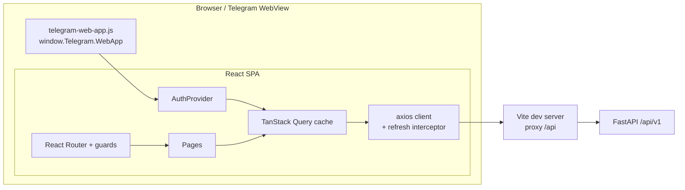
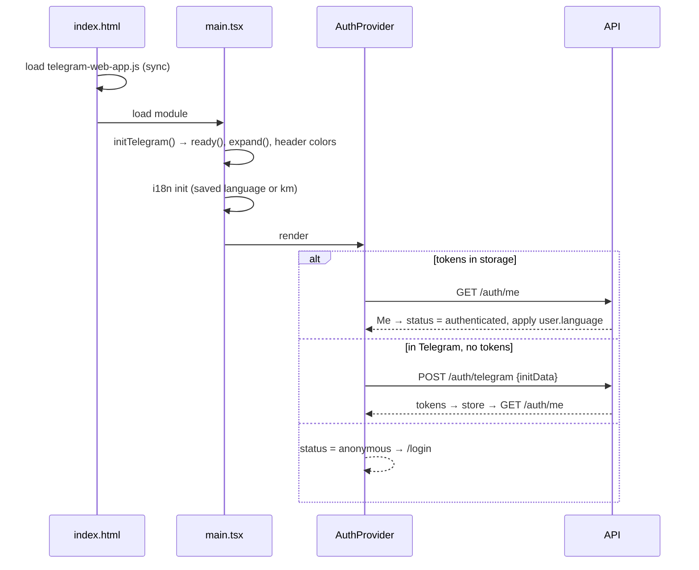
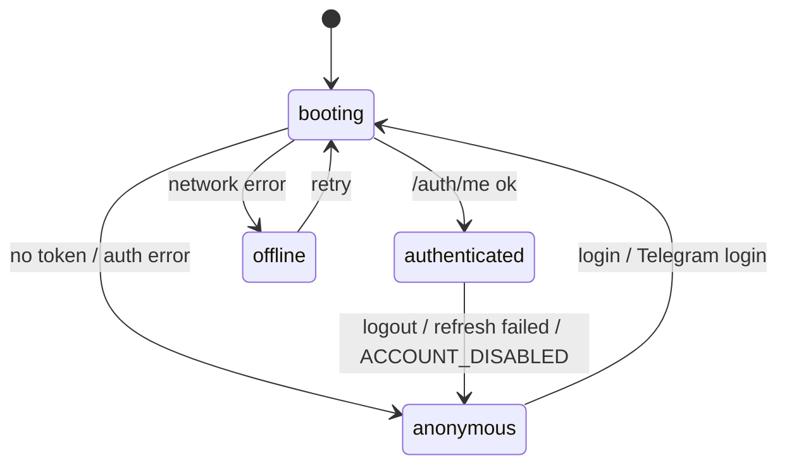
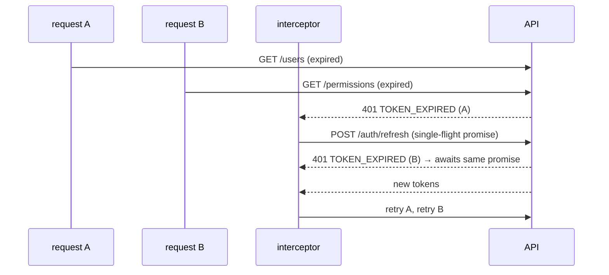
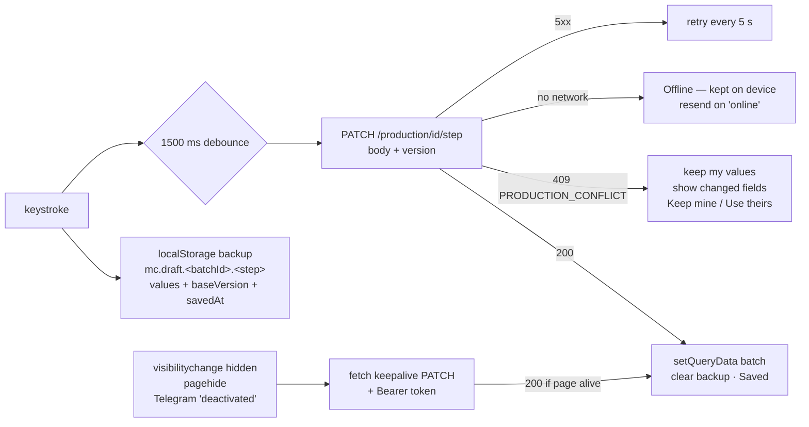

# UI Architecture

How the Mean Chey Grilled Chicken UI is built. For what it *does*, see [FEATURES.md](FEATURES.md). For the backend, see `../meanchey-grilled-chicken-api/docs/ARCHITECTURE.md`.

- [1. Overview](#1-overview)
- [2. Tech stack](#2-tech-stack)
- [3. Source layout](#3-source-layout)
- [4. Boot sequence](#4-boot-sequence)
- [5. Session and auth state](#5-session-and-auth-state)
- [6. API client and token refresh](#6-api-client-and-token-refresh)
- [7. Routing and guards](#7-routing-and-guards)
- [8. Permission-driven UI](#8-permission-driven-ui)
- [9. Layouts and Telegram integration](#9-layouts-and-telegram-integration)
- [10. Server state (TanStack Query)](#10-server-state-tanstack-query)
- [11. Internationalization](#11-internationalization)
- [12. Error handling](#12-error-handling)
- [13. Styling and components](#13-styling-and-components)
- [14. Build, dev server and deployment](#14-build-dev-server-and-deployment)
- [15. Extending the UI](#15-extending-the-ui)
- [16. Design decisions](#16-design-decisions)

---

## 1. Overview



It is a single-page app with no server-side rendering. All data comes from the API. The app holds no business rules beyond UX hints.

## 2. Tech stack

| Concern | Choice |
|---|---|
| Build | Vite 6, TypeScript (strict) |
| UI | React 18 |
| Styling | Tailwind CSS 3; `brand` = Tailwind orange; font Kantumruy Pro (Google Fonts) |
| Routing | React Router 6 (`createBrowserRouter`) |
| Server state | TanStack Query 5 |
| HTTP | axios, with interceptors |
| i18n | i18next + react-i18next (`km` default, `en`) |
| Telegram | Official `telegram-web-app.js` script (incl. `LocationManager`, Bot API 8.0+) |
| Maps | Leaflet 1.9 + OpenStreetMap tiles (attendance only, lazy chunk) |

## 3. Source layout

```
src/
├── main.tsx               # initTelegram, QueryClient, AuthProvider, RouterProvider
├── router.tsx             # route tree + guards
├── index.css              # Tailwind + base styles
├── auth/
│   ├── AuthProvider.tsx   # session state machine, login/logout, Telegram auto-login, me query
│   ├── usePermission.ts   # usePermission, useHasRole, useCanAccess
│   ├── Can.tsx            # <Can permission|roles>
│   └── guards.tsx         # RequireAuth, PublicOnly, RequireAccess
├── lib/
│   ├── api.ts             # axios instance, token injection, refresh + session events
│   ├── storage.ts         # safe localStorage + tokenStore
│   ├── errors.ts          # getError, useErrorMessage, ClientError
│   ├── format.ts          # dates, localized names, initials, username normalize
│   ├── telegram.ts        # telegram handle, isTelegramMiniApp, initTelegram, openTelegramLink
│   ├── quantity.ts        # the inventory unit rule (count / kg 3 / g 1 / m2 2): parse, scaled ints, format, `measureOf`
│   ├── useAutosave.ts     # server-side draft autosave (debounce, keepalive, local backup, conflicts),
│   │                      #   shared by production steps and preparations; keepaliveFetch
│   ├── pdf.ts             # PDFs from the API: fetchPdf (blob, JSON errors), openPdf
│   │                      #   (hidden frame + print dialog on PCs, new tab on phones), openPdf
│   ├── paths.ts           # app routes (paths.users, paths.user(id)…), legacy prefixes, parentPath, isUnder
│   ├── roles.ts           # isSuperadmin, ROLE_LIMIT_ROLES, SUPERADMIN_LOGIN: superadmin checks in one place;
│   │                      #   TRACKED_ROLES (staff, supervisor: attendance)
│   ├── useRoleCapacity.ts # ['role-capacity'] query, byRole(), invalidateRoleCapacity()
│   ├── types.ts           # API types (mirror of the API schemas)
│   ├── usePositions.ts    # ['user-positions'] query
│   └── useDebounced.ts
├── i18n/                  # i18next init + locales/{km,en}.json
├── layouts/               # AppShell → DesktopLayout | MobileLayout, nav.ts (menu tree), Brand
├── components/            # ui.tsx kit, Sheet, ActionMenu, SegmentedControl, KpiGrid, CheckboxFilter, icons, badges, NavTile, LanguageSwitcher, ProfileMenu,
│                          #   ChangePasswordForm, NotificationBell (header bell + notificationKeys), NavBadge (nav counts)
├── pages/
│   ├── HomePage.tsx, LoginPage.tsx, ChangePasswordPage.tsx, StatusPages.tsx, AuthLayout.tsx
│   ├── workstation/       # WorkstationPage (hub) + partners/ (generic Suppliers/Customers list: config,
│   │                      #   PartnerListPage, KpiCards, PartnerFormSheet, validation)
│   │   └── production/    # ProductionListPage, ProductionBatchPage, StepForms (3 step forms), StepSummaries,
│   │                      #   StepShell (autosave status, notices, Finish), SupplierPicker, badges,
│   │                      #   useAutosaveDraft (production's wrapper of lib/useAutosave),
│   │                      #   steps.ts (values / payloads / finish rules / balances),
│   │                      #   numbers.ts (Decimal-safe parsing), api.ts (query keys, keepalive save),
│   │                      #   PlanCard (plan card, "waiting for plan", plan vs actual),
│   │                      #   StockChangesCard (the batch's stock movements)
│   │   └── inventory/     # InventoryPage (lazy; Stock tab = 4 sub-tabs of card grids, History tab),
│   │                      #   MaterialSheets (Add / Remove stock, create / edit material),
│   │                      #   ItemSheet (tap a card: balance + last 20 changes), HistoryTab, MovementRow
│   │                      #   (shared by both), itemVisuals.ts (code / icon_key → picture, badge,
│   │                      #   short name), materialIcons.ts (uploaded icons as blob URLs),
│   │                      #   useItemDisplay.ts (card / sheet texts),
│   │                      #   api.ts (inventoryKeys, invalidateInventory, useStockFormat)
│   │   └── orders/        # OrderListPage, OrderPage, OrderFormPage (lazy: one chunk each), OrderSheets, exportDeliveryNote.ts (Excel delivery note, no React), useExportDeliveryNote
│   │                      #   (Mark delivered, Review return), OrderSummaryView (per colour + total, stock
│   │                      #   warnings; shared by the form's live summary and the page), CustomerPicker,
│   │                      #   badges (status, box swatch / counts, OrderCustomerName / DirectOrderBadge /
│   │                      #   customerText / telHref), api.ts (orderKeys, invalidateOrders,
│   │                      #   integer amounts: parseAmount / amountOf / toApi, formatting)
│   │   └── preparations/  # PreparationListPage, PreparationPage (lazy: one chunk each; the page's
│   │                      #   satay / packaging forms, summary, Reopen / Cancel), values.ts (form values,
│   │                      #   payload, field errors, scaled amounts), badges (status / type badges,
│   │                      #   outputs text, MaterialThumb / ItemThumb), api.ts (preparationKeys,
│   │                      #   onPreparationChanged, draft key)
│   │   └── production-plans/ # PlanListPage, PlanPage (lazy), PlanBadge, api.ts (planKeys, pending count:
│   │                      #   outside the lazy chunk because the nav badge uses it)
│   ├── attendance/        # AttendancePage (hub), MyAttendancePage (lazy: MyAttendancePage and
│   │                      #   EmployeeAttendancePage share AttendanceHistory: period filter, KPI cards and
│   │                      #   chips, day table / phone cards (days off marked, not counted), whole year by month, Fix from a cell), AttendanceCard (Home card, CheckButton (the only action, in the header: Check in / Check out or disabled with opens … / Done for today / Day off),
│   │                      #   ShiftSummary, DayOffNotice), CheckPage (lazy: location, map, Confirm; then → /attendance), RequestsPage (lazy: tabs My requests / To review / All; `requests/` holds its api.ts, CreateRequestSheet, RequestSheet (details + Approve / Approve with changes / Reject), RequestStrip (the strip on the history pages), DeadlineCard (superadmin setting), parts.tsx (SplitEditor, DurationInput, status badge, split text)), TodayPage (lazy:
│   │                      #   day switcher, shift summary with count chips, by-workplace table, exceptions-first list, client-side CSV export), FixSheet (fix / add a record, from Today or an employee's page), MapView (Leaflet: pins as
│   │                      #   circle markers, radius / accuracy circles, tap-to-pick), location.ts
│   │                      #   (useDeviceLocation: Telegram LocationManager → navigator.geolocation; distanceM),
│   │                      #   api.ts (attendanceKeys, queries incl. useWorkplaces / useWorkplace /
│   │                      #   useWorkplaceOptions / useScheduling / useAttendanceCalendar / useHolidays,
│   │                      #   invalidateAttendance / invalidateWorkplaces / invalidateScheduling, clockTime in the
│   │                      #   business time zone, shift / status / day-off texts),
│   │                      #   scheduling/* (lazy SchedulingListPage (workplace cards) and SchedulingPage (one workplace), CalendarCard
│   │                      #   (header: Add holiday + ⋮ Copy from last year; month grid, legend, month's holidays), HolidaySheet,
│   │                      #   WeekdaysCard, ShiftsCard (live preview), UpcomingCard; shared.tsx: Scope, ApplyTo,
│   │                      #   AppliesFrom, weekday / day names)
│   └── settings/          # SettingsPage (hub), AuditLogPage, workplaces/* (lazy: WorkplacesPage list, WorkplacePage =
│                          #   LocationCard (map picker, Make default, Delete / Archive, Restore) + ScheduleSummaryCard
│                          #   (read-only, Edit in Scheduling) + employees), ProfilePage, TelegramLinkCard (superadmin), UserLimitsPage (superadmin),
│                          #   BusinessInfoPage (lazy; settings.business_info), users/* (incl. UserAccessTab, UserPermissionsTab, RoleChangeSheet)
└── types/telegram.d.ts    # minimal Telegram.WebApp typings
```

**Dependency direction:**

```
pages → components, auth, lib → (nothing app-specific)
```

`lib/` never imports React components. `auth/` is the only layer that talks to the session.

## 4. Boot sequence



## 5. Session and auth state

`AuthProvider` exposes this context:

```ts
{
  status,               // 'booting' | 'anonymous' | 'authenticated' | 'offline'
  me,                   // Me | null
  telegramError,        // code from the auto-login, if it failed
  login, loginWithTelegram, logout, refreshMe,
}
```



- **`me` is a TanStack Query** (`['me']`), enabled when an access token exists. The context doesn't copy it; it derives state from the query.
- **Tokens** live in `tokenStore` (`localStorage`, falling back to memory).
- **Login** does three things:
  1. stores the tokens;
  2. clears every cached query, so no data from a previous user leaks into the new session;
  3. flips `hasToken`, which triggers the `me` fetch.
- **Logout** calls `/auth/logout` (best effort), then clears the tokens and the query cache.
- **Offline handling.** A network error on `/auth/me` keeps the tokens and shows *offline* with a retry, instead of logging the user out. Any other error ends the session.
- **Language:**
  - after `me` loads, the user's saved language is applied once per `(user, language)` pair;
  - a later language change made locally, for example while a password change is pending, is not overwritten by refetches.

## 6. API client and token refresh

`lib/api.ts` creates the axios instance at `VITE_API_BASE_URL` (default `/api/v1`).



- **Request interceptor:** adds `Authorization: Bearer <access>`.
- **Response interceptor:**
  - **`401` with `TOKEN_EXPIRED` or `INVALID_TOKEN`:** refresh once and retry.
    - Applies only if a refresh token exists and the request wasn't `/auth/login`, `/auth/telegram` or `/auth/refresh`.
    - Concurrent 401s share **one** refresh promise.
    - The refresh call uses bare `axios`, not the instance, so it can't recurse.
  - **Refresh failure, or `401 ACCOUNT_DISABLED`:** clear the tokens and dispatch `auth:logout`.
  - **`403` with `PASSWORD_CHANGE_REQUIRED`, `MISSING_PERMISSION`, `FORBIDDEN_ROLE` or `FORBIDDEN_SCOPE`:** dispatch `auth:refresh-me`, because the cached `/auth/me` is probably stale. `AuthProvider` refetches it. The guards and menus then redirect to the password change, or drop items the user lost.
- **Window events** decouple the interceptor from React: `AuthProvider` listens and updates state.

## 7. Routing and guards

```
/login                               PublicOnly
<RequireAuth>
  /change-password                   (standalone, AuthLayout)
  <AppShell>
    /                                Home (Workstation + Settings tiles)
    /workstation
      index                          WorkstationPage (hub: cards from the nav tree, or "no access yet")
      suppliers                      RequireAccess suppliers.view → PartnerListPage(SUPPLIERS)
      customers                      RequireAccess customers.view → PartnerListPage(CUSTOMERS)
      production                     RequireAccess production.view → ProductionListPage      (lazy)
      production/:batchId            RequireAccess production.view → ProductionBatchPage     (lazy, ?step=1|2|3)
      production-plans               RequireAccess production_plan.view
        index                        PlanListPage (lazy, ?status=&q=&page=)
        :batchId                     PlanPage (lazy)
      inventory                      RequireAccess inventory.view → InventoryPage           (lazy, ?tab=stock&section=raw|processed|packed|prepared|wasted · ?tab=history&item&area&source&from&to&batch&page; `area` = the stock / wasted filter, `section` stays the Stock sub-tab)
      orders                         RequireAccess orders.view
        index                        OrderListPage (lazy, ?status=&type=&customer=&from=&to=&q=&page=)
        new                          RequireAccess orders.create → OrderFormPage(create) (lazy)
        :orderId                     OrderPage (lazy)
        :orderId/edit                RequireAccess orders.update → OrderFormPage(edit) (lazy)
      preparations                   RequireAccess preparation.view
        index                        PreparationListPage (lazy, ?type=&status=&from=&to=&q=&cancelled=1&page=)
        :preparationId               PreparationPage (lazy)
    /attendance                      RequireAccess anyOf [roles staff/supervisor, ...SCHEDULING_ACCESS, ...REQUESTS_ACCESS]
      index                          AttendancePage (hub: action card for tracked employees + nav cards)
      check                          RequireAccess roles staff/supervisor → CheckPage (lazy; ?action= ignored)
      me                             RequireAccess roles staff/supervisor → MyAttendancePage (lazy, ?year=&month=)
      today                          RequireAccess attendance.view → TodayPage (lazy, ?date=&workplace=&status=&role=&q=)
      requests                       RequireAccess anyOf REQUESTS_ACCESS (roles staff/supervisor, attendance.requests_review) → RequestsPage (lazy, ?tab=&request=)
      scheduling                     RequireAccess anyOf SCHEDULING_ACCESS (attendance.view / .scheduling) → SchedulingListPage (lazy; ?w=id redirects)
      scheduling/:workplaceId        RequireAccess anyOf SCHEDULING_ACCESS → SchedulingPage (lazy, ?m=)
      employees/:id                  RequireAccess attendance.view → EmployeeAttendancePage (lazy, ?year=&month=)
    /settings
      index                          SettingsPage (hub: cards from the nav tree)
      users                          RequireAccess users.view
        index                        UsersList
        new                          RequireAccess users.create → UserForm(create)
        :id                          UserDetail (?tab=permissions)
        :id/edit                     RequireAccess users.update → UserForm(edit)
      audit-logs                     RequireAccess permission=audit.view (superadmin; a GM when allowed)
      user-limits                    RequireAccess roles=ROLE_LIMIT_ROLES (superadmin) → UserLimitsPage
      business-info                  RequireAccess settings.business_info → BusinessInfoPage (lazy)
      attendance/workplaces          RequireAccess anyOf WORKPLACE_ACCESS (workplace_view / _update / _manage)
        index                        WorkplacesPage (lazy, ?archived=1)
        new                          RequireAccess attendance.workplace_manage → WorkplacePage (lazy, create)
        :id                          WorkplacePage (lazy; location editable with workplace_update; default / delete / restore with workplace_manage)
      profile                        Profile
    /users, /users/*                 LegacyRedirect → /settings/users…
    /audit-logs, /audit-logs/*       LegacyRedirect → /settings/audit-logs…
    /profile, /profile/*             LegacyRedirect → /settings/profile…
    *                                NotFound (e.g. a top-level /production: there is no redirect)
```

**Paths.** Every frontend URL comes from `lib/paths.ts` (`paths.users`, `paths.user(id)`, `paths.editUser(id)`, `paths.suppliers`, `paths.customers`, `paths.production`, `paths.productionBatch(id, step?)`, `paths.productionPlans`, `paths.productionPlan(batchId)`, `paths.inventory`, `paths.preparations`, `paths.preparation(id)`, `paths.userLimits`, `paths.businessInfo`, `paths.attendance`, `paths.attendanceCheck`, `paths.attendanceMe`, `paths.attendanceToday`, `paths.attendanceWorkplaces`, `paths.newAttendanceWorkplace`, `paths.attendanceWorkplace(id)`, …). Components never write route literals, so moving a page is a one-file change. API URLs such as `api.get('/users')` are unrelated and stay literal.

**Legacy redirects.** `LegacyRedirect` swaps the old prefix (from `LEGACY_PREFIXES`) for the new one and keeps the rest of the path, the query string and the hash, e.g. `/users/<id>/edit?x=1#a` → `/settings/users/<id>/edit?x=1#a`.

- It sits inside `RequireAuth`. An old deep link opened while signed out goes through login, `location.state.from` keeps the old path, and after sign-in the redirect sends the user to the new place.
- The redirect routes can be deleted once no old links are in circulation.

| Guard | Behavior |
|---|---|
| `RequireAuth` | See the list below. |
| `PublicOnly` | For `/login`. Sends signed-in users to their original destination (`location.state.from`) or to `/`. |
| `RequireAccess` | Takes `permission` and/or `roles`. Renders `ForbiddenPage` if denied. Works as a layout route (`<Outlet/>`) or as a wrapper around children. |

**Lazy pages.** The production pages, the packaging plan pages (another chunk, only for plan holders) the inventory page (another chunk, only with `inventory.view`), the order pages and the Business info page (only with `settings.business_info`) are loaded with `React.lazy` inside `RequireAccess` (wrapped in `PageLoading`, a `Suspense` with a spinner), so they are separate chunks, downloaded on first visit and never by users without Production access. Everything else is in the main bundle. Other large, access-limited features can use the same pattern.

The two `PartnerListPage` routes get distinct React `key`s, so switching between Suppliers and Customers remounts the page instead of carrying state (search text, open panel) across.

`RequireAuth` in detail:

- **booting** → spinner.
- **offline** → retry screen.
- **anonymous:**
  - if a Telegram auto-login failed → the Telegram error screen;
  - otherwise → `/login`, remembering where the user was going.
- **password change pending** → only `/change-password` is allowed.
- **`/change-password` without a pending change** → redirected to `/`.

## 8. Permission-driven UI

All checks read `me.permissions` and `me.user.role` from `/auth/me`:

```ts
usePermission('users.create')                    // boolean
useHasRole('superadmin', 'general_manager')      // boolean
useCanAccess()({ permission, roles, anyOf })     // shared by <Can>, RequireAccess, nav
                                                 // anyOf: passes when any nested rule passes
<Can permission="users.delete" fallback={…}>…</Can>
```

- **Menu tree.** `layouts/nav.ts` declares `NAV_ITEMS` as a tree:

  ```ts
  { to, labelKey, descriptionKey?, icon, permission?, roles?, end?, keepWhenEmpty?, children? }
  ```

  - **Top level:** Home, Workstation, Attendance, Settings. Attendance uses `anyOf: [{roles: TRACKED_ROLES}, ...SCHEDULING_ACCESS]` (tracked employees, viewers *or* schedulers); its children are My attendance (`paths.myAttendance`, `roles: TRACKED_ROLES`), Today (`attendance.view`) and Scheduling (`paths.attendanceScheduling`, `anyOf: SCHEDULING_ACCESS` = `attendance.view` or `attendance.scheduling`, icon `calendar`); the employee page (`paths.attendanceEmployee(id)`, `attendance.view`) is a route without a menu entry, opened from Today; so is a workplace's scheduling (`paths.attendanceSchedulingFor(id)`), opened from Scheduling's cards or a workplace's *Edit in Scheduling*.
  - **Workstation's `children`:** Suppliers (`suppliers.view`, icon `truck`), Customers (`customers.view`, icon `store`) and Production (`production.view`, icon `chicken`).
  - **Settings' `children`:** Users (`users.view`), Audit log (roles `superadmin`, `general_manager`), User limits, Business info, Workplaces (`anyOf: WORKPLACE_ACCESS` from `lib/roles.ts`: any workplace permission) and My profile. These carry the same rules as before.
- **`useNavItems()`** returns the visible top-level items, each with only its visible children.
  - A section whose children are **all** filtered out is hidden, unless it has `keepWhenEmpty`.
  - **Workstation is `keepWhenEmpty`**: staff without partner permissions still get the Workstation tab, and its hub explains that nothing is available yet.
  - A section declared with `children: []` is a real but empty section and also stays visible.
  - `useNavChildren(to)` returns one section's visible children.
- **Consumers,** all reading the same tree:
  - the desktop sidebar: top level plus the nested children of the current section;
  - the mobile bottom nav: top level only;
  - the Home tiles: top-level sections, via `NavTile`;
  - the Workstation and Settings hubs: `useNavChildren(paths.workstation | paths.settings)`, via `NavTile`.
- **Staff** see only My profile under Settings purely because of these rules. There is no role-specific UI code.
- **Freshness.** Home and the Workstation and Settings hubs call `useRefreshMeWhenStale()`, which adds a `['me']` observer that refetches if the cached copy is more than 60 s old. Combined with the 403 → `auth:refresh-me` rule (§6), a revoked permission disappears from the menus without a reload.
- **Per-object decisions come from the API.**
  - **Access tab** (`UserAccessTab`): shown when `me.can_manage_features` and `GET /users/{id}/features` returns at least one menu. `can_manage_features` means the viewer holds `permissions.grant` (GM, superadmin: any level for anyone they manage) **or** `users.manage_access` (a supervisor with Staff access: staff only, capped by its own levels); the UI doesn't need to know which. The server decides which features apply (`applies_to`), each feature's `levels` as `{level, allowed}` (2 for Staff access, 3, or 4 with `record` for Production and Staff management), the current level (`off` / `view` / `record` / `full` / `custom`) and `can_edit`; the client renders one segment per listed level, **disables a segment with `allowed: false`** (tooltip *Higher than your own access*, `access.aboveOwnAccess`), and shows the legend lines only for the features present (*Record* with Production, plus Production plan, Staff management and Staff access lines). Each segment click `PUT`s the level optimistically (rolled back on error) and invalidates `['user-features', id]`, plus `['me']` when editing oneself.
  - **Permissions (advanced)** (`UserPermissionsTab`, superadmin only) uses `can_edit` / `reason` from `GET /users/{id}/permissions`; `reason` is translated through `errors.<CODE>`.
  - `UserDetailPage` builds the tab list from these rules; an unknown or unavailable `?tab=` falls back to Details.
  - The Create User form offers `me.manageable_roles`; **Change role** offers the manageable roles other than the user's current one, and is shown only with `users.update` when there is at least one (so never to supervisors).
- **Security boundary:** the API. UI checks only avoid showing dead-end actions.
- **System references.** Every user reference from the API is a `UserRef` with `is_system`; render `is_system` (or a null `id`) as "System" without a link. The API uses it for actions by the system and to hide the superadmin from everyone else.
- **The superadmin in the UI.** Superadmin checks go through `lib/roles.ts` (`isSuperadmin`, `ROLE_LIMIT_ROLES`, `SUPERADMIN_LOGIN`; the audit log is behind the `audit.view` permission, not a role). Its role label (`roles.superadmin`) is "System" / "ប្រព័ន្ធ", the same word the API uses when it hides the superadmin from others. The code is a single bundle; the superadmin-only screens are ordinary runtime checks.

## 9. Layouts and Telegram integration

- **Layout choice:** `AppShell` picks `MobileLayout` when `isTelegramMiniApp || matchMedia('(max-width: 767px)')`, and `DesktopLayout` otherwise.
- **Desktop:** a sticky 256 px sidebar and a top bar with `LanguageSwitcher`, `NotificationBell` and `ProfileMenu`.
- **Nav badges:** a `NavItem` may declare `badge` (`pendingPlans`, `pendingRequests`); `NavBadge` renders the count next to the sidebar child and on its hub card (`NavTile`). The count hooks (`usePendingPlanCount`, `usePendingRequestCount`) only fetch with `production_plan.view` / `attendance.requests_review`.
  - The sidebar lists the top-level items.
  - When the route is under a section (`isUnder(pathname, '/workstation')`, `'/settings'`), that section's visible children appear indented below it.
  - The section's own page (`/settings`) is filled; on a child page, the parent keeps the brand color and only the child is filled.
- **Mobile:** a sticky top bar (brand, language, bell, avatar; the bell's sheet is portalled to `<body>` because the bar's `backdrop-blur` would otherwise contain a `position: fixed` child) and a fixed bottom nav with exactly the visible top-level items (Home · Workstation · Attendance · Settings; four at most). It uses `env(safe-area-inset-bottom)` padding, and the main content reserves space for the nav.
  - The Settings tab is a non-`end` `NavLink`, so it stays active on every `/settings/*` route.
- **Telegram helpers** (`lib/telegram.ts`):
  - `isTelegramMiniApp = Boolean(Telegram.WebApp.initData)`. The script also loads in normal browsers, so the presence of `initData` is the real signal.
  - `initTelegram()` calls `ready()` and `expand()` and sets the header and background colors to match the brand.
  - **Location** (`pages/attendance/location.ts`, `useDeviceLocation`): inside the Mini App `Telegram.WebApp.LocationManager` (`init` → `getLocation`; it asks for access once per bot; `openSettings()` after a refusal), else — and when Telegram returns no accuracy — `navigator.geolocation.getCurrentPosition` with `enableHighAccuracy`, 20 s timeout, no cache. States: locating, ok, denied, unavailable; `refresh()` reads again. Typings in `types/telegram.d.ts`.
  - **Deep links:** the bot's `/start` **Attendance** button, reminders and confirmations open `MINI_APP_URL/attendance/check`; the automatic Telegram sign-in keeps the path, so the check screen opens directly.
  - `openTelegramLink(url)` opens a t.me link inside Telegram in the Mini App (`WebApp.openTelegramLink`), else in a new tab (the superadmin's link to the bot).
  - `MobileLayout` wires Telegram's **BackButton**: hidden on `/`, shown elsewhere.
    - On click it navigates to `parentPath(pathname)`, i.e. the path with its last segment dropped: `/settings/users/:id/edit` → `/settings/users/:id` → `/settings/users` → `/settings` → `/`, `/workstation/suppliers` → `/workstation` → `/`, and `/workstation/production/<id>` → `/workstation/production` → `/workstation` → `/` (the `?step` query is dropped).
    - It uses the route tree, not history (`navigate(-1)`), so a deep link opened directly in the Mini App still goes somewhere sensible.
    - In-page `PageHeader` back buttons follow the same parent targets.
- **Auth pages** (login, change password, Telegram error, offline) use `AuthLayout`: a centered card with the brand and language switcher.

## 10. Server state (TanStack Query)

| Query key | Source |
|---|---|
| `['me']` | `GET /auth/me` (staleTime 60 s) |
| `['users', params]` | `GET /users` (`keepPreviousData` for smooth paging and filtering) |
| `['user', id]` | `GET /users/{id}` |
| `['user-permissions', id]` | `GET /users/{id}/permissions` (superadmin only) |
| `['user-features', id]` | `GET /users/{id}/features` (enabled with `me.can_manage_features`) |
| `['user-positions']` | `GET /users/positions`, via `usePositions()` in `lib/usePositions.ts`. Enabled with `users.view`, staleTime 60 s. Feeds the position `<datalist>` suggestions in the user form and the position filter on the users list. |
| `['audit-logs', params]` | `GET /audit-logs` |
| `['suppliers', params]` / `['customers', params]` | `GET /suppliers` / `GET /customers` (`keepPreviousData`; the previous page stays visible, dimmed, while the next loads) |
| `['suppliers-stats']` / `['customers-stats']` | `GET /suppliers/stats` / `GET /customers/stats` (KPI cards) |
| `['supplier', id]` / `['customer', id]` | Single record; written with `setQueryData` from mutation responses |
| `['production', params]` | `GET /production` (`keepPreviousData`) |
| `['production-stats']` | `GET /production/stats` (KPI cards) |
| `['production-batch', id]` | `GET /production/{id}`; written with `setQueryData` by every draft save, finish, reopen and cancel |
| `['production-supplier-options', q]` | `GET /production/supplier-options` (supplier picker, only while it's open) |
| `['production-plans', params]` | `GET /production-plans` (`keepPreviousData`) |
| `['production-plans-pending']` | `GET /production-plans?page_size=1` → `pending_count` (nav badge; refetched every 60 s; only with `production_plan.view`) |
| `['production-plan', batchId]` | `GET /production-plans/{batchId}`; written with `setQueryData` by Save and Confirm |
| `['inventory']` | `GET /inventory` (balances by section) |
| `['inventory-item', code]` | `GET /inventory/items/{code}`: the item sheet's **From production** breakdown (everyone with `inventory.view`) |
| `['inventory-materials', {include_archived}]` | `GET /inventory/materials` (Raw's *Show archived*, managers only) |
| `['inventory-movements', params]` | `GET /inventory/movements`, only with `inventory.history`: the History tab (`keepPreviousData`) and the item sheet's recent changes (`{item_code, page_size: 20}`) |
| `['orders', params]` | `GET /orders` (`keepPreviousData`) |
| `['orders-stats']` | `GET /orders/stats` (KPI cards) |
| `['order', id]` | `GET /orders/{id}`; written with `setQueryData` by every save and action (and from `details.order` on `ORDER_CONFLICT`) |
| `['orders-customer-options', q]` | `GET /orders/customer-options` (`{id, name, phone_display, location}`; customer picker while open; the list's customer filter with `''`) |
| `['orders-driver-options']` | `GET /orders/driver-options` (form) |
| `['orders-available-stock']` | `GET /orders/available-stock` (form: item options, live summary warnings) |
| `['preparations', params]` | `GET /preparations` (`keepPreviousData`) |
| `['preparations-stats']` | `GET /preparations/stats` (KPI cards) |
| `['preparation', id]` | `GET /preparations/{id}`; written with `setQueryData` by every draft save, Finish, reopen and cancel |
| `['preparations-material-options']` | `GET /preparations/material-options` (the packaging form's picker, stock per material) |
| `['business-settings']` | `GET /settings/business` (Business info page); written with `setQueryData` by Save, logo upload and remove |
| `['business-settings', 'logo', updated_at]` | `GET /settings/business/logo` as a blob → object URL for the preview (only when `has_logo`; the `updated_at` in the key refetches it after a change) |
| `['role-limits']` | `GET /settings/role-limits` (superadmin, User limits page); written with `setQueryData` by each Save |
| `['role-capacity']` | `GET /users/role-capacity` via `useRoleCapacity()` in `lib/useRoleCapacity.ts` (enabled with `users.view` or `users.create`, staleTime 30 s): create form, role change sheet, users list |
| `['attendance-me-today']` | `GET /attendance/me/today` (tracked employees only): Home card, My attendance, check screen. Enabled for staff and supervisors (`useHasAttendance`); the Home card and the Attendance hub card need `useIsTracked` (also `me.user.attendance_tracked !== false`, so a supervisor switched off sees no card, only *My attendance* for past records). The response's `starts_on` / `tracked` make the card, the header button and the check screen show *"Your attendance starts on …"* / *"Attendance isn't required for you"* (`TrackingNotice`). The Today view's `starts_later` / `not_tracked` lists and the summary days' `not_tracked` flag drive the groups and the greyed *Not tracked* rows. `refetchInterval` 60 s, **refetch on focus**, and a one-off timer (in `useAttendanceToday`) at `next_opens_at` / the open window's `closes_at` + 1 s, shifted by the device's clock skew from `server_time` (only within 12 h), so the header button (`CheckButton`) switches exactly when a window opens or closes; written with `setQueryData` from a check-in / check-out response |
| `['attendance-day', {date, workplaceId}]` | `GET /attendance/day?date=&workplace_id=` (Today; previous data kept while the next date loads; 60 s refetch) |
| `['attendance-summary', 'me' \| userId, {year, month}]` | `GET /attendance/me/summary` (My attendance) or `GET /attendance/users/{id}/summary` (an employee's page); `month` null = the whole year; previous data kept while another period loads |
| `['attendance-workplaces', {includeArchived}]` | `GET /attendance/workplaces` (Settings → Workplaces list; the workplace page uses the active list for the default's map centre) |
| `['attendance-workplace', id]` | `GET /attendance/workplaces/{id}` (the workplace page, with its employees and read-only `schedule`); written with `setQueryData` by Location saves, Make default and Restore |
| `['attendance-scheduling', {workplaceIds}]` | `GET /attendance/scheduling?workplace_ids=…` (Scheduling: `[]` = every workplace for the list's cards, `[id]` on a workplace's page; current / upcoming versions and `workplace_options` (the count behind *Apply to all workplaces*); repeated `workplace_ids` via `paramsSerializer: {indexes: null}`) |
| `['attendance-calendar', {year, month, workplaceIds}]` | `GET /attendance/calendar` (Scheduling's month grid; previous data kept while another month loads) |
| `['attendance-holidays', {year}]` | `GET /attendance/holidays?year=` (the calendar month's list under the grid and tapping a holiday day) |
| `['attendance-requests', 'me', year]` | `GET /attendance/requests/me?year=` (My requests: the months of the year with their state; tracked employees) |
| `['attendance-requests', {status, year, month, userId, page}]` | `GET /attendance/requests` (To review = `status: 'pending'`, All; previous data kept while paging; the pending badge reads the pending list's `pending_count`, 60 s refetch). `invalidateRequests` invalidates the whole `['attendance-requests']` prefix |
| `['attendance-request', id]` | `GET /attendance/requests/{id}` (the request sheet) |
| `['attendance-request-settings']` | `GET /attendance/settings/requests` (the superadmin's deadline card; written with `setQueryData` on save) |
| `['attendance-requests-employees']` | `GET /users?page_size=100` filtered to staff and supervisors (the All tab's Employee select; only with `users.view`) |
| `['attendance-workplace-options']` | `GET /attendance/workplace-options` (user form select, users list filter; staleTime 60 s) |
| `['notifications-unread']` | `GET /notifications?unread_only=true&page_size=1` → `unread_count` (the bell; polled every 60 s **and on window focus**, from the app shell, not per page) |
| `['notifications', params]` | `GET /notifications` (the bell's list, refetched when it opens) |

- Mutations use `useMutation`. After a change they either write the response straight into the cache (`setQueryData`, e.g. after editing a user or the profile) or invalidate the affected keys: `users`, `user`, `user-permissions`. Creating or editing a user also invalidates `user-positions`, so a newly typed position shows up in the suggestions and filter. A role change (`RoleChangeSheet`, `POST /users/{id}/role`) writes the returned user into `['user', id]` and invalidates `users`, `user-features`, `user-permissions` and `user-positions`.
- Supplier / customer mutations (create, edit, deactivate, reactivate) write the returned record into `[entity, id]` and invalidate both the list prefix (`[resource]`) and the stats key, so the table and the KPI cards update together. The keys are built by `partnerKeys(config)`.
- Production: draft saves only write the returned batch into `['production-batch', id]`. Finish, reopen, cancel and "New production" also invalidate `['production']` and `['production-stats']` (`onBatchChanged` in `production/api.ts`), the plan keys (finishing or reopening steps creates or resets the plan) and the inventory keys (`invalidateInventory`: `['inventory']`, every `['inventory-movements', …]` and `['inventory-item', …]`; Finish, reopen and cancel move stock). There is no manual change to invalidate for: production items are read-only.
- Inventory: the batch response carries `stock_changes` and `inventory_tracked` **only for viewers with `inventory.history`** (the keys are absent otherwise, so the types are optional); `StockChangesCard` renders nothing without them. The Inventory page reads `usePermission('inventory.history')` to show the History tab (no tab bar without it; `?tab=history` falls back to Stock) and the item sheet's recent changes. `INVENTORY_INSUFFICIENT` is translated per item from `details.items` (names from the API, the unit that is short) in `useErrorMessage`. The keys are built by `productionKeys`.
- Materials: add / remove stock, create, edit (incl. the unit), archive and restore call `invalidateInventory` (`['inventory']`, `['inventory-movements', …]`, `['inventory-item', …]`, `['inventory-materials', …]`); step 2 Finish / reopen / cancel already invalidate the same keys (`onBatchChanged`), so the marinade balance updates. Quantities are parsed with `lib/quantity.ts` into scaled integers (count × 1, kg × 1000, g × 10) for exact previews and sent back as the API's strings; the chips add to the latest input (functional state update). The item sheet swaps its content for the Add / Remove / Edit sheet and returns to it. The step 2 form compares the typed marinade (g × 10) with `marinade_stock` (converted when it's in kg) and adds a Finish blocker. `INVENTORY_INSUFFICIENT` lines show grams for materials (`available_g` / `needed_g`).
- Orders: create / edit / cancel / Start delivery / Mark delivered / Review return write the returned order into `['order', id]` and call `invalidateOrders` (`['orders']`, `['orders-stats']`, `['orders-available-stock']` and the inventory keys: Start delivery and the review move stock). On `ORDER_CONFLICT` the current order from `details.order` is written into the cache (the form resets to it) and a notice is shown; on `ORDER_INVALID_STATUS` the order is refetched. Amounts are integers (counts, or grams for kg: `parseAmount("1.25", "kg") = 1250`), so the live summary, the "at most delivered" and "stock + wasted = returned" checks are exact; they go back to the API as `count` or a 3-decimal `kg` string (`toApi`). `PRODUCTION_STOCK_ALREADY_USED` is translated with the item names and order codes from `details` (`useErrorMessage`).
- Delivery notes (order page): **Send to my Telegram** is a mutation, not a query (each one is counted by the API, so nothing is cached); on success it invalidates `['order', id]` so `print_count` updates. PDFs are fetched by `lib/pdf.ts` with the API client (`responseType: 'blob'`, bearer token) and shown from a `blob:` URL (revoked after a minute); an error body arriving as a Blob is parsed back to JSON so `useErrorMessage` translates the code (`TELEGRAM_NOT_LINKED`, `TELEGRAM_SEND_FAILED`, `DOCUMENT_UNAVAILABLE`, `TELEGRAM_NOT_CONFIGURED`). Send to my Telegram is in the ⋮ menu everywhere.
- **Excel delivery note** (header button, `orders.export_delivery_note`): `useExportDeliveryNote` (a mutation: `GET /orders/delivery-note/supplier`, then maps the order into plain data) calls `exportDeliveryNoteXlsx` (`orders/exportDeliveryNote.ts`, no React or app imports). That fetches `/templates/delivery_note_template.xlsx` (`public/`), loads **ExcelJS with a dynamic `import('exceljs')`** (its own lazy chunk, not in the main bundle), fills B3–B5 supplier, B7–B10 customer, F7 date and the item rows from row 13 (A no., C name, D unit), inserts rows styled like the first item row with `spliceRows` when there are more than two items (merged ranges are taken off and put back shifted, since ExcelJS doesn't move them), and downloads the Blob through a temporary `<a download>` (URL revoked after a second). In the Telegram Mini App it tries `navigator.share({files})` first and falls back to the same link (`openLink` / `downloadFile` need a URL, and nothing is stored on a server). `ExportError` codes (`noSupplier`, `noCustomer`, `noItems`, `template`, `build`) map to `orders.document.exportErrors.*`. Not counted or audited.
- Business info: Save sends every text field (empty → `null`); the logo is uploaded as `FormData` (`file`), type and size checked first (`LOGO_WRONG_TYPE` / `LOGO_TOO_LARGE` client errors); Preview opens `GET /settings/business/preview.pdf` in a new tab (`openPdf`).
- Preparations: draft saves only write the returned preparation into `['preparation', id]`; Finish, reopen, cancel and New (`onPreparationChanged`) also invalidate the list, the stats, the material options and the inventory keys (they move stock). `PREPARATION_CONFLICT` / `PREPARATION_INVALID_STATUS` / `PREPARATION_CANCELLED` on reopen or cancel refetch the preparation. The form keeps strings as typed (`values.ts`): satay lines by pack size (`include`, `satay_g`, `zip_bag_qty`, `sachets`) and packaging lines (`material_id`, `quantity`); amounts are parsed into scaled integers in their unit (satay g × 10; zip bags / materials in the material's unit; `gramsInUnit` converts the sauce to a kg material like the API) for the *Available* checks and blockers; `toPayload` sends only valid values. Inventory: `InventoryItem.origin` may be `preparation`; the item sheet renders `preparation_sources`; Add / Remove / Edit (`materialRefOfItem`) only for `origin = manual`, so a prepared twin (which carries its `material` for the picture) is never changed by hand.
- Plans: Save and Confirm write the returned plan into `['production-plan', batchId]` and invalidate the plan list, the pending count, the batch and the production list. On `PRODUCTION_CONFLICT` the plan is refetched and a notice shown (no merge UI: a plan has three fields). Confirm with unsaved edits sends the PATCH first, then confirms with the new version.
- Role limits: creating a user, reactivating, deactivating and changing a role call `invalidateRoleCapacity()` (`['role-capacity']` and `['role-limits']`); saving a limit writes `['role-limits']` and invalidates `['role-capacity']`. `ROLE_LIMIT_REACHED` is translated with the role name from its `details.role` (`useErrorMessage`).
- Attendance: a check-in / check-out writes `today` from the response into `['attendance-me-today']` and invalidates `['attendance-day', …]` and `['attendance-summary', …]` (`invalidateAttendance`); a refused one refetches today's state (the window may have moved on). Fix / Add record invalidate the same keys. Every Scheduling write (weekdays, shifts, delete an upcoming version, holiday create / edit / delete / copy) goes through `invalidateScheduling`: the scheduling, calendar and holidays keys, the workplace lists and pages (their schedule summary) and the attendance keys (`me/today`, day views, summaries: days off moved). Workplace changes (create, edit, default, delete / archive, restore) go through `invalidateWorkplaces`: the returned workplace into `['attendance-workplace', id]`, then every `['attendance-workplaces', …]`, `['attendance-workplace', …]`, the options and the attendance keys (windows may have moved). Saving a user invalidates the workplace lists (employee counts). Times are formatted with `clockTime(iso, timezone)` (`Intl.DateTimeFormat` with the API's `timezone`, `Asia/Phnom_Penh`), so they show Cambodia time whatever the device's zone; today's date for the date picker comes from the same zone.
- Requests: submitting or reviewing one calls `invalidateRequests` (`['attendance-requests']` prefix, `['attendance-request']`, `['attendance-summary']` and `['attendance-day']`), so the strip, the month lock and the badge update; a Fix on a record (`invalidateAttendance`) also invalidates `['attendance-requests']` (the month's balance changed). The summary carries `request`, `request_eligibility` and `month_locked`: the strip and the hidden Fix actions come from them, with no extra request. The whole-year view can't know which months are locked, so the API refuses the fix (`ATTENDANCE_MONTH_LOCKED`) and the sheet shows the translated error.
- Notifications: opening one marks it read (`POST /notifications/{id}/read`), **Mark all as read** calls `read-all`; both invalidate `['notifications']` and `['notifications-unread']`.
- Defaults: `retry: 1`, `refetchOnWindowFocus: false`. The Telegram WebView focuses and blurs often, so refetching on focus would be noisy. The unread count is the one exception (a single tiny request, and the point of the bell).

### Autosave (production drafts, preparations)

`lib/useAutosave.ts` keeps a draft form on the server while it's being filled in, and survives the Mini App being closed. It knows nothing about the record: an `AutosaveTarget` gives the local-backup key, the server copy, its `version` / `updated_at`, whether it still takes drafts, the PATCH and its `keepalive` twin (`keepaliveFetch`), the conflict code and where the conflict body carries the current copy, and how to reload it. `pages/workstation/production/useAutosaveDraft.ts` is production's thin wrapper (`mc.draft.<batchId>.<step>`, `PATCH /production/{id}/{step}`, `PRODUCTION_CONFLICT` / `details.batch`); the preparation page builds its own target (`mc.prep.<id>`, `PATCH /preparations/{id}`, `PREPARATION_CONFLICT` / `details.preparation`) and reuses `StepShell` (its Finish label and confirmation texts are props). Typing back to the saved value settles the status to *Saved* (nothing to send). Each step form (`StepForms.tsx`) owns its values (strings, as typed) and passes two pure functions from `steps.ts`: `fromBatch(batch)` (server → form values) and `toPayload(values)` (form → draft body; invalid inputs are left out so the server keeps its value).



- **Version.** The hook tracks the batch `version` its values are based on and sends it with every save; each successful save (or keepalive response) moves it forward. `flush()` waits for pending and in-flight saves; **Finish** calls it first and then posts `{version}`, so Finish always validates what's on screen.
- **Keepalive.** Axios can't send `keepalive` requests, so the hide/close flush uses `fetch(..., { keepalive: true })` with the same bearer token (`keepaliveSave` in `production/api.ts`). If the page stays alive the response is applied like a normal save; if the token has expired (no refresh is possible there) or the page is gone, the local backup covers it.
- **No dates in payloads.** Step dates are recorded by the server at Finish, so they are neither form values nor part of any draft body, keepalive save or local backup. The payload is always rebuilt from the values with `toPayload`, so an older backup that still holds a `production_date` value can't send it.
- **Local backup.** Written on every change that differs from the server copy, removed once that exact state is saved. On opening a step: a backup whose payload equals the server copy is dropped (the keepalive made it); one based on the current version is **resent automatically**; one based on an older version but newer than the step's `updated_at` shows **"Restore unsaved changes?"**; an older one is dropped.
- **Conflicts.** `409 PRODUCTION_CONFLICT` carries the current batch. The form keeps the user's values; the notice lists the fields the other save changed (payload diff against what this screen last knew). *Keep my values* re-bases on the new version and saves; *Use their version* loads the server copy.
- **Server changes.** When the cached batch gets a newer version from elsewhere (refetch, reopen) and nothing here is unsaved, the form adopts it. Other errors (`PRODUCTION_STEP_FINISHED`, `PRODUCTION_CANCELLED`, …) stop autosave, drop the backup and reload the batch.
- **Never** for finished steps: the form (and so the hook) is only mounted for a draft step the user may record; finished steps render `StepSummary`.
- **Numbers** (`numbers.ts`): weights are parsed into scaled integers (kg × 1000, g × 10, m² × 100), never floats, so the balance checks compare exactly; `,` is accepted as the decimal point.

## 11. Internationalization

- `i18n/index.ts` initializes i18next with the bundled `km.json` and `en.json`.
  - Initial language: the value saved in `localStorage` (`mc.language`), otherwise `km`.
  - `fallbackLng: en`.
  - On every change, `<html lang>` is updated and the choice is saved.
- `setLanguage(lang)` is the single entry point.
- `LanguageSwitcher` calls `setLanguage`. When signed in, and no password change is pending, it also calls `PATCH /me` and writes the result into the `['me']` cache.
- **Key conventions:**

  | Keys | Content |
  |---|---|
  | `roles.*`, `languages.*` | Enum labels. Positions are free text from the user record and are never translated. |
  | `errors.<API_CODE>` | One key per API error code, plus client codes (`PASSWORDS_DO_NOT_MATCH`, `NETWORK_ERROR`, `UNKNOWN`) |
  | `audit.actions.<action with . replaced by _>` | Audit action labels (including `supplier_*`, `customer_*`, `production_*`) |
  | `partners.*` | Shared supplier/customer texts: field labels and hints, KPI labels, status and sort options, list actions |
  | `suppliers.*`, `customers.*` | Per-list texts: title, description, buttons, empty states, confirmations, success messages (`{{name}}`) |
  | `preparations.*` | Preparation: types (`types.<type>.title/short/description`), statuses, KPI and filter labels, satay / packaging form texts, blockers, Finish / Reopen / Cancel dialogs; sachet short names under `inventory.shortNames`, the Prepared sub-tab under `inventory.groups/sections/badges.prepared`, the bell text under `notifications.preparationFinished` |
| `production.*` | Production: steps, fields, units, KPI and filter labels, autosave states, restore / conflict notices, balance texts, dialogs; `production.errors.*` are the client-side field errors (required, invalid kg, …). By-product names come from the API catalog (`useLocalized`). |

- **Server-provided bilingual text** (permission and module names and descriptions) goes through `useLocalized()`, which picks `*_km` or `*_en` with an English fallback.
- **Dates** use `Intl.DateTimeFormat` with the `km-KH` or `en-GB` locale, via `useFormatDate()`. Calendar dates from the API (`"2026-09-29"`, e.g. production step dates) go through `useFormatDay()` (same helper, formatted in UTC), so they show the same day in any device time zone. Month and weekday names that must be Khmer whatever the browser (My attendance's period filter, day labels, month headers) come from `useCalendarNames()` (`common.months`, `common.monthsShort`, `common.weekdaysShort`). Durations are `useDuration()` (`attendance/api.ts`): *1 h 05 min* / *1 ម៉ោង 05 នាទី*, signed on request.
- **Pack names:** `production.fields.bigPackages` = កញ្ចប់ ៤ ដុំ / 4-Piece Packs, `production.fields.smallPackages` = កញ្ចប់ ២ ដុំ / 2-Piece Packs (the API fields stay `big_packages` / `small_packages`). Plans: `plans.*`; the bell: `notifications.*` (texts built from `type` + `payload`); the superadmin's link: `telegramLink.*`.
- **Production wording:** step names are `production.steps.rawMaterial` = ការនាំចូល / Intake, `production.steps.produced` = ការផលិត / Processing, `production.steps.standardize` = ការវេចខ្ចប់ / Standardize (keys follow the API step codes, which didn't change); the type dropdown is `production.fields.materialKind` = ប្រភេទ / Type. Step dates: `production.dates.*` (ថ្ងៃនាំចូល, ថ្ងៃផលិត, ថ្ងៃវេចខ្ចប់) and the short chip labels `production.datesShort.*` (នាំចូល, ផលិត, វេចខ្ចប់).
- **Key parity:** `npm run check:i18n` fails the build step if the two locale files have different keys.
- **Attendance** strings live under `attendance.*` (shifts, statuses incl. `lateMinutes` = មកយឺត {{count}} នាទី, phases, check screen, My attendance (`mine.*`, `kpis.*`, `tags.*`, `duration.*`, `shiftsShort.*`, `employee.*`), Today, Fix sheet, the Workplaces pages (`workplaces.*`, `workplace.*`, `shiftsPage.*` with `shiftsPage.problems.*`)), error codes under `errors.ATTENDANCE_*` and `errors.WORKPLACE_*` (incl. the client codes `ATTENDANCE_REASON_REQUIRED`, `ATTENDANCE_TIME_REQUIRED`, `ATTENDANCE_COORDINATES_INVALID`), the menu under `nav.attendance*`, the Access tab's menu name under `access.menus.attendance`.
- Access tab strings live under `access.*` (level labels incl. `record` = កត់ត្រា, legend incl. `legendRecord`, menus, feature names for the audit log); feature names and descriptions on the tab itself come from the API (`useLocalized`).

## 12. Error handling

```ts
getError(err) → { code, details }
// ClientError        → its own code
// axios, no response → NETWORK_ERROR
// axios, API body    → error.code / error.details
// otherwise          → UNKNOWN

useErrorMessage()(err) → t(`errors.${code}`, { ...details, time, min })
```

- Details are turned into readable interpolation values. For example, `locked_until` becomes a localized `time`.
- Forms keep the raw error and translate it at render time, so switching language re-translates an error that is already on screen.
- **Client-side validation** throws `ClientError` with the same codes the server uses, for example `PASSWORD_TOO_SHORT` or `INVALID_PHONE` (with the same `min_digits` / `max_digits` details), so messages are identical whichever side caught the problem. Where the server only says `VALIDATION_ERROR`, the client uses field-specific codes (`NAME_REQUIRED`, `FIELD_TOO_LONG`).
- **Attendance** errors: `useErrorMessage` turns `details.opens_at` / `next_opens_at` / `closed_at` into Cambodia times (`time`, `closed_at`) and `shift_code` / `next_shift_code` into shift names (`shift`, `nextShift`), so *"Too early: check-in opens at 06:30"* and *"…you're 320 m from the workplace. You must be within 100 m."* read naturally. The workplace page's Schedule section maps the API's validation messages to `attendance.shiftsPage.problems.*`.
- **Production** client codes: `PRODUCTION_UNSAVED` (Finish couldn't save pending changes first). Server codes `PRODUCTION_*` and `SUPPLIER_INACTIVE` are translated like any other.
- **Field-level server errors.** The partner form maps an error to its field: `DUPLICATE_PHONE` / `INVALID_PHONE` → phone; `VALIDATION_ERROR` → the field in `details.fields[].loc`; anything else → an alert above the form.

## 13. Styling and components

- **Tailwind utility classes only,** with no CSS modules. `cx()` joins class names.
- **`components/ui.tsx`** is a small in-house kit:
  - `Button` (primary / soft / secondary / danger / ghost, loading state). **primary** (solid brand orange) is the page's main action (New order, Add material); **soft** (brand-orange text and ring on `brand-50`, a shade darker on hover) is a brand action repeated in a list (Add on every material card); use these variants rather than one-off classes;
  - form controls: `Input`, `Select`, and `Field`, which generates the id and renders the label and hint;
  - containers and feedback: `Card`, `Badge`, `Alert`, `Spinner`, `EmptyState`;
  - page structure: `PageHeader` (optional back button), and `ConfirmDialog` (bottom sheet on mobile, centered on desktop, Escape to close);
  - `useEscapeKey(open, onClose)`, shared by the dialogs.
- **`components/Sheet.tsx`** extends the `ConfirmDialog` pattern for forms and longer content: a full-height **side drawer** on desktop and a **bottom sheet** (max 90 % height, grab handle, safe-area padding) on mobile, chosen with `useIsMobileLayout()`. It has a title bar with a close button, a scrollable body and an optional sticky footer. Escape and backdrop clicks close it unless `busy`, and page scrolling is locked while it's open. The footer's submit button targets the form with `form="<id>"`.
- **`components/SegmentedControl.tsx`:** a radio group of buttons (`role="radiogroup"`) with 40 px touch targets. Optional `slots`: the full ordered column list shared by stacked controls; a slot the control has no segment for is an empty `—` cell (`aria-hidden`), so values align across rows. The Access tab passes every level present on the tab (`off, view, record, full`), so 3- and 4-level features share the same columns. By default it's always the full width of its container with equal columns that can shrink (`auto-cols-[minmax(0,1fr)]`, segments `min-w-0`, centered and `truncate`, the full label as a tooltip), so it fits a phone, the Mini App and a desktop drawer (the material sheet's **kg · g · count**, *គ.ក · ក្រាម · ចំនួន*, used to overflow the drawer); four segments, e.g. Production's Off · View only · Record · Full access, become a 2 × 2 grid below `sm`. `fixedColumns` (the Access tab): from `lg` every segment has the same fixed width (`9.5rem`, enough for the longest Khmer label), so a column of controls with 3 and 4 levels lines up and never clips a label; the Access tab rows switch to side-by-side at `lg` too. `value` may match no segment (the *Custom* state). `suggested` adds a dashed outline as a hint only. A segment may carry `disabled` + `title` to lock just that one option (the Access tab's `allowed: false`); `disabled` on the control locks all of them.
- **`components/ActionMenu.tsx`:** a **⋮** button with a small menu of `{label, icon, tone, onSelect}` items. It uses fixed positioning, so it isn't clipped by tables or scroll containers, and it opens upwards near the bottom of the screen. It renders nothing when there are no items, so permission-filtered item lists need no extra check.
- **Production form parts** (`production/StepShell.tsx`): `NumberField` (`inputMode="decimal"` for kg / g, `"numeric"` for counts; 48 px tall on mobile, unit suffix, inline error), `LockedValue` (computed counts with a lock), `AutosaveStatus`, and `StepShell` (header with status, restore / conflict notices, blockers list, Finish with confirmation; on mobile Finish sits in a fixed bar above the bottom nav, with a spacer so it never covers the last field).
- **Icons:** inline SVG paths in `components/icons.tsx`, with no icon dependency.
- **`components/InventoryItemCard.tsx`:** the product-style card of the Inventory page, presentational only (the page passes the picture URL, badge, texts and handlers): picture (72 px phones, 88 px from `sm`), optional corner badge (the Wasted tab only), name (2 lines), big number, second line, last change, and an optional full-width action. The card body is a `<button>` (`aria-label` = name and amount) that opens the item; the action is a sibling button (no nested buttons; the Inventory page passes none today: production items are read-only). `h-full` + flex column make the cards in a grid row equal height. Also exports `ItemPicture` (image or the `boxes` icon, `muted` = greyscale) and `InventoryCardSkeleton`.
- **Inventory sub-tabs** (`InventoryPage`): the Stock tab's section is the `section` URL parameter (`raw` default, `processed`, `packed`, `wasted`; anything else → `raw`), written with `setSearchParams(…, { replace: true })` like the main tab, and kept when switching to History and back, so refresh and Back return to it. Items are split by the API's `group` field, and each pill's badge counts the items in that group with stock (count or kg > 0), from the same `['inventory']` data. The pills are a `role="tablist"` (`aria-selected`) on a grid with `auto-cols-[minmax(max-content,1fr)]`: equal on phones, never narrower than the Khmer label, scrolling sideways (`scrollbar-none`) when they don't fit; `inline-grid` from `sm`.
- **Inventory item sheet** (`ItemSheet`): `['inventory-item', code]` gives the balance and `sources` (per batch, oldest first, adding up to the balance); the rows link to `paths.productionBatch(batch_id, last_step)` and a Total line shows the balance. Recent changes and See full history only with `inventory.history`. Cards have no action (production items are read-only), so there is no spacer either.
- **Inventory pictures** live in `src/assets/inventory/` (`chicken`, `wing`, `thigh`, `gizzard`, `liver`, `heart`, `head`, `pack4`, `pack2` `.svg`: flat, transparent, under 1 kB each) and are imported as files (Vite URLs). **To replace a picture**, overwrite the file with the same name (any square SVG or PNG; for PNG, change the import extension in `itemVisuals.ts`). `pages/workstation/inventory/itemVisuals.ts` is the only place that maps item codes to pictures: processed / packed by-products share the by-product's picture, wasted items reuse the base picture (drawn greyscale), and an unknown code (a future by-product) falls back to the box icon. It also gives the badge (wasted only: the Stock sub-tab names processed / packed) and the short-name key (`inventory.shortNames.<base>`; unknown items use the API's full name).
- **Material pictures**, in this order: the **uploaded icon** (`material.icon_url`, an API path such as `/inventory/materials/{id}/icon?v=…`), the **bundled picture** of `material.icon_key` (`src/assets/inventory/materials/<key>.svg`: `string`, `skewer`, `sticker_2`, `sticker_4`, `sticker_2_m2`, `sticker_4_m2` (a teal label roll, so it never reads as the amber kg sticker), `marinade`, `satay`, `zip_bag_2`, `zip_bag_4`, `vacuum_bag`; same flat 64 × 64 style and palette, under 1 kB each; `MATERIAL_PICTURES` / `materialPicture()` in `itemVisuals.ts`), then the unit icon (`scale` / `grid` / `hash`). An unknown key falls back like no key, so the API can add keys before the UI draws them. The icon route needs the bearer token, so `materialIcons.ts` `useMaterialIcon(icon_url)` fetches it with the API client and keeps a blob URL in TanStack Query under `['material-icon', icon_url]` (`staleTime` / `gcTime` Infinity: the URL changes with every upload, so a cached one never goes stale); `useItemPicture(visual)` returns uploaded ?? bundled. The card and the item sheet (which reads the refetched `['inventory-item', code]`, so a new icon shows while it's open) use it. The material form keeps the uploaded URL in local state (updated from the PUT / DELETE response) and, while creating, the chosen `File` as an object URL; type (`image/png`, `image/jpeg`, `image/webp`) and size (1 MB) are checked before sending (`ICON_WRONG_TYPE` / `ICON_TOO_LARGE`, client codes), and an API `VALIDATION_ERROR` (not a real image) shows as `ICON_WRONG_TYPE`.
- **`useRelativeTime()`** (`lib/format.ts`): *"2 h ago"* / *"២ ម៉ោងមុន"* from `common.relative.*` translations (browsers often lack Khmer data for `Intl.RelativeTimeFormat`); a week or older shows the date.
- **`components/KpiGrid.tsx`:** the figures above the Suppliers, Customers and Production lists. A grid on every screen, never a sideways scroller: 3 figures → 3 columns, 4 → 2 × 2 (4 columns from `lg`). On phones each card is compact (icon and a label of up to two lines above the number); from `sm` the icon sits beside the text. Cards with `onClick` become buttons (`aria-pressed`, outlined when selected); the current pages use figures only. A figure may be ready text (`value: '18 shifts'`, a size smaller than numbers) with `valueClassName` (e.g. the balance's red / green) and `detail` lines under it (My attendance).
- **`components/CheckboxFilter.tsx`:** a labelled checkbox sized like the other filter controls. Lists leave removed records out by default and show them only when it's ticked: *Show deactivated* (suppliers, customers: `?deactivated=1` → `status=all`) and *Show cancelled* (production: `?cancelled=1` → `include_cancelled=true`). A new Workstation list with soft-deleted records should do the same. On phones the label wraps inside the box (the Khmer *Show deactivated* shares a row with the sort dropdown and would otherwise run off the screen); from `sm` up it stays on one line.
- **`scrollbar-none`** (in `index.css`): horizontal scrollers (e.g. the production filter chips) swipe without a visible scrollbar.
- **Accessibility:**
  - labelled controls;
  - `role="alert"` on errors;
  - `aria-pressed` on the language toggle;
  - `aria-haspopup` and `aria-expanded` on the profile menu;
  - dialogs with `aria-modal`.

## 14. Build, dev server and deployment

| Command | Purpose |
|---|---|
| `npm run dev` | Vite on `:5173`, `host: true`, `allowedHosts: true` (for ngrok / cloudflared), proxies `/api` → `VITE_API_PROXY_TARGET`. That covers both `/api/v1` and the Telegram webhook `/api/telegram/webhook`, so one tunnel to `:5173` serves the Mini App, the API and the bot. |
| `npm run build` | `tsc --noEmit` then `vite build` → `dist/`. Chunks: `vendor` (React, router, TanStack Query, axios, i18next: `manualChunks` in `vite.config.ts`, cached across releases), the app (`index`), and the lazily loaded pages; Leaflet and its CSS land in a shared `MapView` chunk loaded only by the check screen and Settings → Workplace. |
| `npm run typecheck` | Types only |
| `npm run check:i18n` | Locale key parity |

**Production image**

- `Dockerfile`: Node 22 builds `dist/` (`VITE_API_BASE_URL` defaults to `/api/v1`), then `nginx:alpine` serves it.
- `deploy/nginx.conf`: port 80 redirects to HTTPS; port 443 uses the Cloudflare Origin Certificate mounted at `/etc/ssl/cloudflare/{origin.pem,origin.key}`, serves `dist/` with the SPA fallback (`index.html` is `no-cache`, `/assets/` is cached for a year), and proxies `/api/*` and `/health` to `api:8000` (same origin, no CORS).
- `deploy/cloudflare-real-ip.conf`: restores the visitor IP from `CF-Connecting-IP`.
- Built and run by `docker-compose.prod.yml` at the repo root (see `deploy/DEPLOY.md`).

**Production (general)**

- Serve `dist/` as static files with an SPA fallback, so unknown paths return `index.html`.
- Preferably serve the API from the **same origin** under `/api`. That needs no CORS, and a single HTTPS domain serves the Mini App, the API and the Telegram webhook (`/api/telegram/webhook`). Make sure the reverse proxy forwards all of `/api/*`.
- Otherwise:
  1. build with `VITE_API_BASE_URL=https://api.example.com/api/v1`;
  2. add the UI origin to the API's `CORS_ORIGINS`.
- The Telegram Mini App URL must be **HTTPS**.

## 15. Extending the UI

For a new feature, for example `orders`, after its permissions exist in the API registry, first decide where it lives:

- **Under Workstation** (most business features), e.g. `/workstation/orders`;
- **Under Settings** (configuration and admin screens), e.g. `/settings/branches`;
- **A new top-level section**, only for a genuinely separate area. It gets its own sidebar and bottom-nav entry and Home tile, and the bottom bar gets tight beyond 4–5 items.

Then:

1. **Types:** add them to `lib/types.ts`.
2. **Path:** add it to `lib/paths.ts`, e.g. `orders: '/workstation/orders'`, `order: (id) => …`.
3. **Page:** create `pages/workstation/orders/…` (or `pages/settings/…`). Fetch data with `useQuery` using a feature-specific key, and give the page a `PageHeader` whose `back` is the parent path.
4. **Route:** nest it under `/workstation` (or `/settings`) in `router.tsx`, wrapped in `<RequireAccess permission="orders.view">`.
5. **Navigation:** add a child to the section's `children` in `NAV_ITEMS`, with `permission: 'orders.view'`, an icon, `labelKey` and `descriptionKey`. What follows from that:
   - It appears automatically in the sidebar (nested) and, for Settings, as a hub card.
   - It also appears on the Workstation or Settings hub page as a card.
   - For a **new top-level section**, add a top-level entry instead. It needs `children` if it has sub-pages, a hub page if it has children, and a `descriptionKey` for its Home tile.
6. **Actions:** wrap them in `<Can permission="orders.create">`.
7. **Strings:** add them to `km.json` **and** `en.json` (label, description, page texts, any new API error codes). Run `npm run check:i18n`.

The Access tab, the Permissions (advanced) tab and the Telegram back button need no changes. A feature added to the API's `FEATURES` registry appears on the Access tab automatically, in its menu group, with names from the API; only its audit label needs an `access.featureNames.<code>` translation. The back target follows the path structure.

**Pattern: generic list page.** Suppliers and Customers are one page, `pages/workstation/partners/PartnerListPage.tsx`, configured by a `PartnerConfig` (`config.ts`):

```ts
{ resource: 'suppliers', entity: 'supplier', path: paths.suppliers, icon: 'truck' }
```

- `resource` is the API path (`/suppliers`), the permission prefix (`suppliers.create`) and the i18n namespace (`suppliers.title`).
- `entity` is the single-record query key and the audit `entity_type`.
- `partnerKeys(config)` builds the query keys; `permission(config, action)` the permission codes; `partnerSearchLink(config, q)` the audit log's deep link.

The page brings the KPI cards (`KpiGrid`), URL-driven filters (`?q&deactivated=1&sort&page`; deactivated records only with the *Show deactivated* `CheckboxFilter`, like *Show cancelled* on Production), table/card list, `ActionMenu`, the `PartnerFormSheet` and confirm dialogs. Another list with the same fields needs a config, a route, a nav child and its `<resource>.*` translations.

**Pattern: step flow with autosave.** Production (`pages/workstation/production/`) is the reference for multi-step records: one form component per step built on `useStep` (autosave + Finish), pure `fromBatch` / `toPayload` / finish-rule functions in `steps.ts`, and `StepShell` for the chrome. A new by-product needs no UI change (it comes from the API catalog).

## 16. Design decisions

| Decision | Rationale |
|---|---|
| One app for PC and Mini App | One codebase and one auth flow. Only the layout and sign-in entry point differ. |
| Tokens in `localStorage` | Works inside the Telegram WebView and across reloads. The short access-token lifetime and server-side refresh revocation limit the exposure. An httpOnly cookie setup is a future option if the UI and API share a domain. |
| `/auth/me` as the single source of the user's rights | Menus, guards and forms react to grants and revokes after a refetch, with no client copy of the rules. |
| `can_edit` computed by the server | Keeps the complex grant rules in one place (the API). |
| Window events between the interceptor and React | The interceptor stays framework-agnostic, and session changes flow through one owner (`AuthProvider`). |
| Error codes translated in the client | The API stays language-neutral, and every message, including errors, switches with the language. |
| No component library | Small bundle, full control over Khmer typography, and a consistent mobile/desktop look. |
| Khmer default, English fallback | Matches the primary audience. A missing Khmer string still shows readable English. |
| Two sections (Workstation, Settings) and a nav tree | Business work and administration are kept apart. The bottom bar stays at three items as features grow, and one tree drives the sidebar, bottom nav, Home tiles and Settings hub. |
| Production drafts saved on the server, backed up on the device | The Mini App can be closed at any moment (a swipe, a phone call). Debounced saves keep the server current, a `keepalive` flush covers the last keystrokes, and the localStorage backup covers no network or an expired token. The batch `version` turns simultaneous edits into a visible choice instead of a silent overwrite. |
| By-product balance checked only in the UI | It's a working rule that may be relaxed; keeping it client-side means relaxing it is a UI change. The API still enforces the piece balance, which is exact by nature. |
| Weights as scaled integers in the client | Floats can't represent 0.1 exactly, so `0.4 + 0.1` might not equal `0.5`; integers in thousandths compare exactly, like the API's `Decimal`. |
| Lazy-load large feature pages, separate vendor chunk | Keeps the first load of the Mini App small (and under Vite's 500 kB warning): Production code is fetched only by people who open it, and library code, which rarely changes, stays in the browser cache across app releases. |
| One generic list page for suppliers and customers | The two lists have identical fields and rules; one implementation keeps them from drifting and makes the next similar list cheap. |
| List filters in the URL | Links (e.g. from the audit log) can open a prefilled search, and Back or a refresh keeps the filters. |
| Lock reasons from the server (`reason`) | Explains a locked permission without duplicating the grant rules, including `grantable_by`, in the client. |
| Drawer on desktop, bottom sheet on mobile | Keeps the list visible beside the form on a PC, and is thumb-friendly in the Mini App. |
| Access tab with levels, detailed permissions superadmin-only | Managers pick Off / View only / Full access per feature instead of permission codes; the server owns the mapping, so the UI renders whatever features exist. |
| `allowed` per level from the server | A supervisor may only give levels within its own access. The server computes that with the same function it enforces, so the tab greys out exactly what `PUT` would refuse, without the client knowing any permission codes. |
| One bundle; the superadmin labelled "System" | A separate admin build was considered and dropped as too complex. The API is the boundary: it never returns superadmin data to anyone else, and the UI's own label for the role reads "System". The bundle still contains the superadmin-only screens' code. |
| Step 3 locked in the UI while the plan is pending | The API refuses step 3 saves until the plan is confirmed, so the form would only produce autosave errors. A clear "Waiting for the packaging plan" card (with Open plan for planners) replaces it; the plan card under the stepper shows the state at every step. |
| Bell polled from the app shell | One 60-second poll (plus window focus) for the unread count serves every page; the list itself loads only when the bell opens. Telegram delivers the same alerts in real time, so no websocket is needed. |
| Plan-vs-actual comment rule mirrored in the UI | The API refuses Finish without a comment when packs differ; the form shows the difference as it's typed and lists the missing comment among the Finish blockers, so the refusal never surprises anyone. |
| Capacity shown before submitting | The API is the authority on role limits (row lock, `ROLE_LIMIT_REACHED`), but a manager shouldn't fill in a whole form to learn the role is full: the form, the role sheet and the list show *active / limit* up front, and the server error remains the fallback for races. |
| One autosave hook for every server-side draft | Production steps and preparations need exactly the same guarantees (debounce, keepalive on close, local backup and restore, version conflicts). Extracting the hook behind a small target interface keeps one implementation to fix and test; production's behaviour is unchanged (it only supplies its URL, key and conflict code). |
| Prepared stock as its own sub-tab, twins shown with their material | Prepared items are a separate stock (the API's Prepared section), so they get their own pill like Wasted; a prepared material reuses its raw material's picture with a *Prepared* badge rather than a new picture per material, so a material created or re-iconed in the app needs nothing else. |
| Order form keeps boxes on the client until Save | An order is short and typed in one go, so there are no server drafts (unlike production): boxes and lines live in component state with local keys, the summary is computed live, and one POST / PATCH replaces the boxes. The API repeats every check; the version guards against a concurrent edit. |
| Order actions by status, one primary button | Each status has exactly one next step (Start delivery, Mark delivered, Review return), shown as the main button only to whoever may do it; Edit and Cancel, rarer and only while Created, live in the ⋮ menu. |
| Inventory amounts straight from the API | Balances and movements are computed and locked server-side (the ledger); the page only formats them (count, kg with up to 3 decimals, "≈" when estimated) and never adds anything up, so it can't disagree with the server. |
| Delivery notes as API-made PDFs, printed or sent to Telegram | Inside Telegram's WebView `window.print()` and downloads don't work reliably, and browser printing of a web page gives A4 with headers. The API renders an 80 mm receipt PDF; the PC prints it from a hidden frame, phones open it in a tab, and the Mini App has the bot send it to the person's chat, from where it can be printed or forwarded. |
| PDFs through the API client, not links | The routes need the bearer token (tokens live in `localStorage`, not cookies), so a plain `<a href>` can't open them; fetching a blob keeps auth, refresh and error translation in one place. |
| One quantity rule shared with the API | Count, kg (3 decimals), g (1 decimal) and m² (2 decimals) are parsed, previewed and formatted by one module (`lib/quantity.ts`) that mirrors the API's `units.py`, so a value the form accepts is a value the API accepts, and every screen shows a unit the same way. |
| Order customer from the API's snapshot, both types in one shape | `Order.customer` is `{type: saved \| direct, id, name, phone, phone_display, location, is_active}` (`id` / `name` null for direct orders), the order's own copy (API FEATURES §19.2). Every screen renders it through `badges.tsx`: `OrderCustomerName` (name, or the **Direct order** badge + phone) in the list, cards and header, `customerText(t, customer)` for one-line texts (Start delivery confirmation), `telHref` for call links; the bell uses the alert payload (`customer` null → `orders.directOrderWithPhone` with `customer_phone`). The order form keeps `customerType`, the picked customer **and** the direct `phone` / `location` in its state, so switching the type loses nothing; `customerBody(form)` sends only the selected one (`{customer_type: saved, customer_id}` / `{customer_type: direct, phone, location}`). The phone check reuses `partners/validation.compactPhone` and the API's limits (`PHONE_MIN_DIGITS` / `PHONE_MAX_DIGITS`); a server `INVALID_PHONE` is shown under the field instead of the form-level alert. |
| Uploaded material icons fetched as blobs, cached by URL | The icon route is guarded like the rest of the inventory (bearer token), so `` can't load it directly. A versioned `icon_url` lets the blob be cached for the session without any invalidation logic: a new upload is a new URL. Default materials ship their own SVGs so a fresh install looks finished without uploads. |
| Material actions on the card and in the sheet | Adding stock is the frequent action (deliveries of string, bags, sauce), so it's one tap on the card with quick chips; removing needs a reason and editing / archiving is rare, so they live in the item sheet and its ⋮ menu. |
| Attendance as its own section | Checking in is daily work for every employee, not a Workstation feature with access levels: tracked employees see it by role, managers by `attendance.view`. A fourth bottom-bar item is acceptable for something used twice a day. |
| The check screen shows one action and reads the location at once | People open it from a reminder with seconds to spare: the API decides check-in or check-out (`next_action`), the GPS read starts on open, and Confirm is enabled only when the API would accept it (inside the radius, accurate enough, window open). The API still checks everything. A success (or nothing to do) replaces it with the Attendance page, whose card shows the new state: no result screen to close. |
| Telegram's LocationManager first, the browser's geolocation as fallback | Inside Telegram the WebView's `navigator.geolocation` may be blocked or ask every time; LocationManager asks once per bot and offers a settings shortcut after a refusal. Older clients, browsers and fixes without accuracy fall back to the standard API. |
| Leaflet with circle markers, in a lazy chunk | A small, dependency-free map with OSM tiles needs no API key; circle markers avoid Leaflet's image assets (broken by bundlers), and the ~150 kB chunk loads only on the two screens with a map. |
| One Workplaces page per workplace; schedules in Scheduling | A workplace page is about where people check in (location, radius, default, employees); its schedule is shown read-only with **Edit in Scheduling** (that workplace's scheduling). Weekdays, holidays and shift rules are edited in Attendance → Scheduling, where *Apply to all workplaces* makes a change for every branch one action. |
| Scheduling: a page per workplace, dates instead of "now" | Scheduling opens on workplace cards and each workplace has its own page, so what is shown and what a save changes is always that workplace; no selection to misread. Copying a change to every workplace is one opt-in checkbox next to Save (*Apply to all workplaces*, unticked, confirmed with how many it replaces); the API's targets (`all` or ids) already support it, and its `differs` flag is unused by this UI. Changes carry **Applies from** (today by default), so planned changes don't need someone to remember the day, and upcoming ones are listed and deletable. Saves that remove recorded attendance (a holiday covering today or earlier, untracking today) confirm first and report how many records were removed. The calendar is a plain, high-contrast grid with text labels (a dot on phones plus the list below) rather than colour-only cues. Holidays are added from the calendar's header (with Copy from last year in its ⋮ menu) and listed per month under the grid; there is no separate year list. |
| Day off as a state, not an error | On a day off `me/today` has no shifts and a `day_off` reason, so the Home card and My attendance show *Today — Holiday: Pchum Ben* with when attendance resumes and the header button disabled (*Day off*); the check screen just returns to Attendance. Day rows are marked and don't count, matching the API's KPIs. |
| Workplace options as their own endpoint | The user form must offer workplaces to supervisors who add staff, who have no workplace permission; `GET /attendance/workplace-options` (id, name, default; `users.view`) gives just that, without exposing locations or rules. |
| Times in the business zone, not the device's | Shift windows are Cambodia times; a phone set to another zone must still see "until 07:44". The API sends its zone and every attendance time is formatted with it. |
| Back = parent route, not history | Mini App sessions often start from a deep link with no history. The route structure always gives a meaningful "up". |
